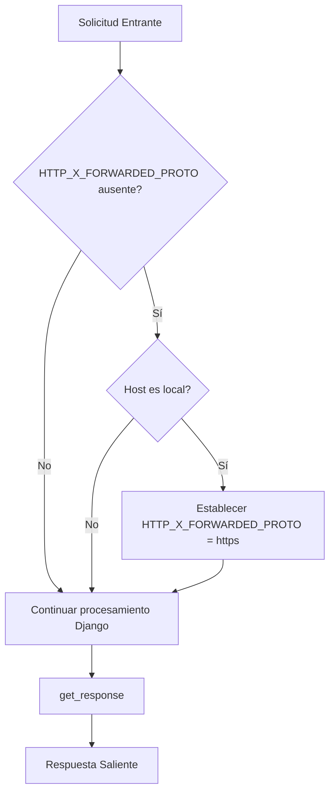

# Middleware y Utilidades de Core_Shopify_App

Este módulo contiene middleware y utilidades esenciales para el funcionamiento de la aplicación principal de Shopify, centrándose en la adaptación del entorno de desarrollo local y el manejo de solicitudes.

## ShopifyLocalProxyMiddleware

### Propósito y Funcionalidad Principal

La clase `ShopifyLocalProxyMiddleware` aborda un escenario específico durante el desarrollo local de una aplicación Shopify. Cuando se utiliza el proxy local de Shopify CLI, ocasionalmente omite el encabezado `X-Forwarded-Proto`. Este middleware se encarga de inyectar o asegurar que el encabezado `HTTP_X_FORWARDED_PROTO` se establezca a `https` para solicitudes que se originan de hosts locales (como `localhost` o `127.0.0.1`). Esto es crucial para que la aplicación funcione correctamente en un entorno de desarrollo, donde muchas funcionalidades dependen de que las solicitudes se consideren seguras (HTTPS).

### Arquitectura y Relaciones entre Componentes

El `ShopifyLocalProxyMiddleware` es un middleware de Django estándar. Se inserta en la cadena de procesamiento de solicitudes de Django. Funciona de la siguiente manera:

1.  **Inicialización**: Recibe la función `get_response` como argumento, que representa el siguiente middleware o la vista final en la cadena de procesamiento.
2.  **Procesamiento de Solicitudes**: Intercepta cada `request` entrante.
3.  **Lógica Condicional**: Verifica si el encabezado `HTTP_X_FORWARDED_PROTO` está ausente en la solicitud (`request.META`).
4.  **Detección de Entorno Local**: Si el encabezado está ausente, examina el encabezado `HTTP_HOST` para determinar si la solicitud proviene de un host local (por ejemplo, `localhost:`, `127.0.0.1:`, `[::1]:`).
5.  **Inyección del Encabezado**: Si se detecta un host local y el encabezado `X-Forwarded-Proto` no existe, lo establece explícitamente a `https`.
6.  **Paso de Solicitud**: Finalmente, pasa la solicitud (potencialmente modificada) al siguiente componente en la cadena de middleware o a la vista.

#### Diagrama de Flujo de Procesamiento de Solicitudes

### Cómo el Módulo Encaja en el Sistema General

Este middleware es fundamental para la experiencia de desarrollo local de la aplicación Shopify. Sin él, es posible que ciertas redirecciones o funcionalidades que esperan un protocolo HTTPS fallen en un entorno de desarrollo donde la aplicación se ejecuta a través de un proxy local HTTP, como el proporcionado por Shopify CLI.

El archivo de configuración `shopify.web.toml` (visto en `shopify.web.toml`) indica que la aplicación tiene roles de `frontend` y `backend`, y define un comando `dev` que utiliza `daphne` para servir la aplicación. En este contexto de desarrollo, `ShopifyLocalProxyMiddleware` asegura que la aplicación se comporte como si estuviera sirviéndose a través de HTTPS, resolviendo posibles problemas de seguridad y compatibilidad con las APIs de Shopify que a menudo requieren conexiones seguras, incluso cuando se desarrolla localmente.

En resumen, `ShopifyLocalProxyMiddleware` actúa como un adaptador esencial para el entorno de desarrollo local, garantizando la compatibilidad y el correcto funcionamiento de la aplicación en Shopify CLI.

### Referencias

*   Para la configuración general de la aplicación, consulte [Configuración de Core Shopify App](Core_Shopify_App/Core_Shopify_App_Configuracion.md).
*   Para entender cómo se configuran los roles y comandos de desarrollo, revise el archivo `shopify.web.toml` en la raíz del repositorio. 

