# Pruebas de la Aplicación Principal de Shopify (Core_Shopify_App_Pruebas)

## Introducción

El módulo `Core_Shopify_App_Pruebas` contiene la suite de pruebas unitarias y de integración para los componentes centrales de la aplicación Shopify. Su objetivo principal es asegurar la correcta funcionalidad, la robustez y la fiabilidad de las características fundamentales de la aplicación, incluyendo la autenticación, la configuración de la tienda, la gestión de tokens y el despacho de comandos incrustados, así como las redirecciones dentro de la aplicación incrustada.

## Documentación exhaustiva

Este módulo (`core/tests.py`) abarca una amplia gama de escenarios de prueba, validando el comportamiento de las vistas, formularios, modelos y utilidades que constituyen el corazón de la integración con Shopify. Las pruebas se organizan en clases lógicas que reflejan las funcionalidades que validan.

### Componentes principales de prueba

*   **`ShopConfigFormTests`**: Prueba el formulario `ShopConfigForm` responsable de la validación y normalización de los dominios de las tiendas Shopify.
*   **`RootMenuViewTests`**: Valida que la vista raíz (`RootMenuView`) renderice correctamente el centro de navegación principal de la aplicación.
*   **`PublicEntryViewTests`**: Asegura que la vista de entrada pública (`PublicEntryView`) maneje adecuadamente tanto las solicitudes iniciales de instalación como el acceso continuo a la aplicación.
*   **`AuthLoginViewTests`**: Verifica el flujo de inicio de sesión de autenticación (`AuthLoginView`), incluyendo la validación de dominios y la redirección a la instalación de Shopify.
*   **`HomeViewAuthTests`**: Cubre las pruebas de autenticación para la `HomeView`, asegurando que el proceso de verificación de la solicitud de inicio de la aplicación funcione como se espera, incluyendo el manejo de tokens y las interacciones con la API GraphQL de Shopify.
*   **`AuthPatchIdTokenViewTests`**: Prueba la vista `AuthPatchIdTokenView`, que es fundamental para la gestión del ciclo de vida del token de identidad en entornos incrustados.
*   **`TokenLifecycleTests`**: Valida el ciclo de vida completo de los tokens de acceso, incluyendo el intercambio de tokens offline, la actualización de tokens existentes y el manejo de errores que pueden llevar a la invalidación del token.
*   **`EmbeddedRedirectValidationTests`**: Se encarga de probar las funciones de utilidad para la validación de URLs de redirección, tanto relativas a la aplicación como de redirecciones padre.
*   **`EmbeddedRedirectViewTests`**: Prueba las vistas de redirección incrustadas (`EmbeddedInAppRedirectView` y `EmbeddedParentRedirectView`), asegurando que las redirecciones se realicen correctamente y de forma segura dentro del contexto de la aplicación incrustada.
*   **`EmbeddedShopifySyncViewTests`**: Contiene pruebas para la vista `EmbeddedShopifySyncView`, que gestiona las operaciones de sincronización de contenido con Shopify, como la importación de productos y otros recursos.
*   **`EmbeddedCommandDispatchViewTests`**: Valida la vista `EmbeddedCommandDispatchView`, responsable de despachar comandos incrustados a través de la interfaz de la aplicación, como la configuración de locales o la reconstrucción de índices.
*   **`ShopConfigLookupTests`**: Prueba las funciones de utilidad `get_shop_config` y `shop_has_access_token` que se utilizan para recuperar y verificar la configuración de la tienda.

### Arquitectura y relaciones entre componentes

Las clases de prueba en `Core_Shopify_App_Pruebas` están diseñadas para interactuar directamente con los componentes de la aplicación principal que se encuentran en otros submódulos de `Core_Shopify_App`, así como con módulos externos como `Shopify_API_Client` y `Shopify_Content_Management`.

A continuación, se presenta un diagrama de componentes que ilustra las relaciones entre el módulo de pruebas y los componentes principales que valida:

```mermaid
graph TD
    subgraph Pruebas_Core_Shopify_App [core/tests.py]
        A[ShopConfigFormTests] -->|Prueba| B(ShopConfigForm)
        C[RootMenuViewTests] -->|Prueba| D(RootMenuView)
        E[PublicEntryViewTests] -->|Prueba| F(PublicEntryView)
        G[AuthLoginViewTests] -->|Prueba| H(AuthLoginView)
        I[HomeViewAuthTests] -->|Prueba| J(HomeView)
        K[AuthPatchIdTokenViewTests] -->|Prueba| L(AuthPatchIdTokenView)
        M[TokenLifecycleTests] -->|Prueba| N(ShopConfig)
        O[EmbeddedRedirectValidationTests] -->|Prueba| P(embedded_redirects.py)
        Q[EmbeddedRedirectViewTests] -->|Prueba| R(EmbeddedInAppRedirectView & EmbeddedParentRedirectView)
        S[EmbeddedShopifySyncViewTests] -->|Prueba| T(EmbeddedShopifySyncView)
        U[EmbeddedCommandDispatchViewTests] -->|Prueba| V(EmbeddedCommandDispatchView)
        W[ShopConfigLookupTests] -->|Prueba| X(shop_config_lookup.py)
        I --> Y(AppHomeVerifiedMixin)
        E --> Y
        J --> Z(shopify_requests.graphql_client)
        M --> Z
        S --> AA(ShopifySyncRun)
        U --> BB(EmbeddedCommandRun)
    end

    subgraph Modulo_Core_Shopify_App [Core_Shopify_App]
        B -- formulario --> Cfg[Core_Shopify_App/Core_Shopify_App_Configuracion.md]
        D -- vista --> Vistas[Core_Shopify_App/Core_Shopify_App_Vistas_Principales.md]
        F -- vista --> Vistas
        H -- vista --> Autenticacion[Core_Shopify_App/Core_Shopify_App_Autenticacion.md]
        J -- vista --> Vistas
        L -- vista --> Autenticacion
        N -- modelo --> Cfg
        Y -- mixin --> Autenticacion
        P -- utilidades --> Vistas_Incrustadas[Core_Shopify_App/Core_Shopify_App_Vistas_Incrustadas.md]
        R -- vistas --> Vistas_Incrustadas
        T -- vista --> Vistas_Incrustadas
        V -- vista --> Vistas_Incrustadas
        X -- utilidades --> Cfg
    end

    subgraph Cliente_API_Shopify [Shopify_API_Client]
        Z[shopify_requests.graphql_client] --> ClienteAPI[Shopify_API_Client.md]
    end

    subgraph Gestion_Contenido_Shopify [Shopify_Content_Management]
        AA[ShopifySyncRun] --> ModelosContenido[Shopify_Content_Management/Shopify_Content_Models.md]
        BB[EmbeddedCommandRun] --> ModelosContenido
    end

    style Cfg fill:#f9f,stroke:#333,stroke-width:2px
    style Vistas fill:#f9f,stroke:#333,stroke-width:2px
    style Autenticacion fill:#f9f,stroke:#333,stroke-width:2px
    style Vistas_Incrustadas fill:#f9f,stroke:#333,stroke-width:2px
    style ClienteAPI fill:#f9f,stroke:#333,stroke-width:2px
    style ModelosContenido fill:#f9f,stroke:#333,stroke-width:2px
```

### Cómo encaja el módulo en el sistema general

El módulo `Core_Shopify_App_Pruebas` es fundamental para mantener la calidad y la estabilidad de la aplicación principal de Shopify. Al probar rigurosamente las funcionalidades críticas como la autenticación de usuarios, la configuración de la tienda, la sincronización de datos y las interacciones dentro del iframe de Shopify, este módulo garantiza que la aplicación se comporte de manera predecible y segura.

Las pruebas actúan como una red de seguridad, detectando regresiones y asegurando que los cambios o nuevas características en la `Core_Shopify_App` no introduzcan errores en el sistema. Esto es vital para una integración fluida con la plataforma Shopify y para la experiencia del usuario final. La correcta ejecución de estas pruebas es un paso esencial en el proceso de desarrollo y CI/CD, reflejando el compromiso con un software robusto y fiable.

### Referencias

*   [Configuración de la Aplicación Principal de Shopify](../Core_Shopify_App_Configuracion.md)
*   [Autenticación de la Aplicación Principal de Shopify](../Core_Shopify_App_Autenticacion.md)
*   [Vistas Principales de la Aplicación Principal de Shopify](../Core_Shopify_App_Vistas_Principales.md)
*   [Vistas Incrustadas de la Aplicación Principal de Shopify](../Core_Shopify_App_Vistas_Incrustadas.md)
*   [Cliente de la API de Shopify](../../Shopify_API_Client.md)
*   [Modelos de Contenido de Shopify](../../Shopify_Content_Management/Shopify_Content_Models.md)