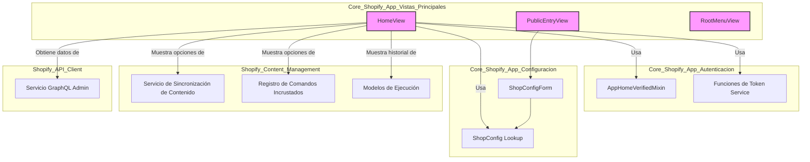

# Vistas Principales de la Aplicación Core de Shopify

Este módulo, `Core_Shopify_App_Vistas_Principales`, contiene las vistas fundamentales que actúan como puntos de entrada y paneles de control principales para la aplicación de Shopify, gestionando la interacción inicial del usuario y la visualización del estado general de la aplicación.

## Propósito y Funcionalidad Principal

Las vistas definidas en este módulo (`HomeView`, `PublicEntryView`, `RootMenuView`) son cruciales para la experiencia del usuario dentro de la aplicación Shopify. 

*   **`RootMenuView`**: Sirve como el hub de navegación raíz de la aplicación. Es una vista simple que renderiza un menú de navegación, típicamente para una aplicación "headless CMS" donde la raíz no corresponde a una página de contenido específica de Wagtail.
*   **`PublicEntryView`**: Representa el punto de entrada público de la aplicación. Se utiliza para la configuración inicial de la tienda o para dirigir a los usuarios a la página de inicio de sesión si es necesario. Presenta un formulario (`ShopConfigForm`) para recopilar la información inicial de la tienda.
*   **`HomeView`**: Es el panel de control principal de la aplicación incrustada de Shopify. Esta vista es donde los administradores de la tienda pueden gestionar diversas operaciones, como la sincronización de contenido y la ejecución de comandos. Proporciona una visión general del estado de la aplicación, incluyendo recursos de sincronización disponibles, comandos recientes y el estado de configuración de la tienda.

## Arquitectura y Relación entre Componentes

El módulo `Core_Shopify_App_Vistas_Principales` se integra con varios otros componentes y módulos para ofrecer su funcionalidad completa. A continuación, se detalla la arquitectura y las dependencias clave.

### Dependencias Principales

Las vistas en este módulo dependen de:

*   **Configuración de la Tienda**: Utiliza `ShopConfigForm` para la entrada de datos inicial y se apoya en `get_shop_config` y `shop_has_access_token` para verificar el estado de configuración de la tienda. Estos componentes están documentados en [Core_Shopify_App/Core_Shopify_App_Configuracion.md](../Core_Shopify_App/Core_Shopify_App_Configuracion.md).
*   **Autenticación y Autorización**: `HomeView` hereda de `AppHomeVerifiedMixin`, que se encarga de la verificación y autenticación del contexto de la aplicación incrustada. La gestión del ciclo de vida del token sin conexión se realiza a través de `ensure_offline_token_lifecycle`. Para más detalles, consulte [Core_Shopify_App/Core_Shopify_App_Autenticacion.md](../Core_Shopify_App/Core_Shopify_App_Autenticacion.md).
*   **Sincronización de Contenido de Shopify**: `HomeView` muestra las opciones de sincronización y el historial de ejecuciones de sincronización. Las operaciones de importación de contenido se gestionan a través de `enqueue_shopify_import` y la validación de recursos (`VALID_IMPORT_RESOURCES`), provenientes del módulo de gestión de contenido.
*   **Comandos Incrustados**: También presenta grupos de comandos y ejecuciones de comandos recientes, con la lógica de obtención de comandos (`get_command_by_id`, `get_commands_by_group`) y el encolamiento (`enqueue_embedded_command`) proporcionada por el módulo de gestión de contenido.
*   **Modelos de Ejecución**: Muestra `EmbeddedCommandRun` y `ShopifySyncRun` para el historial de operaciones. Estos modelos se encuentran en [Shopify_Content_Management/Shopify_Content_Models.md](../Shopify_Content_Management/Shopify_Content_Models.md).
*   **API de Shopify**: `HomeView` interactúa con la API de administración de Shopify a través de `fetch_shop_admin_graphql` para obtener metadatos de la tienda, que forma parte del [Shopify_API_Client.md](../Shopify_API_Client.md).
*   **Utilidades Comunes**: Utiliza varias funciones de utilidad (`get_shopify_app`, `log_shopify_result`, `request_to_shopify_req`, `shopify_result_to_django_response`) para interactuar con el SDK de Shopify y manejar las respuestas HTTP.

### Diagrama de Componentes

El siguiente diagrama ilustra las relaciones entre las vistas principales y sus componentes dependientes.

**Descripción del Diagrama:**

*   **`PublicEntryView`**: Depende de `ShopConfigForm` para la entrada del dominio de la tienda y de las utilidades de `ShopConfig Lookup` para la configuración.
*   **`HomeView`**: Es el componente más central, depende de `AppHomeVerifiedMixin` y las funciones de `Token Service` para la autenticación. También depende de `ShopConfig Lookup` para obtener la configuración de la tienda. Interactúa con el `Servicio de Sincronización de Contenido` y el `Registro de Comandos Incrustados` para mostrar las funcionalidades de gestión. Obtiene datos de la API de Shopify a través del `Servicio GraphQL Admin`. Finalmente, muestra el historial de `Modelos de Ejecución`.
*   **`RootMenuView`**: Una vista sencilla que no tiene dependencias directas complejas dentro de este diagrama, principalmente renderiza una plantilla.

### Vistas Relacionadas (Documentadas en otros módulos)

Es importante mencionar que `core/views.py` también define otras vistas que, si bien son parte del archivo, están documentadas en módulos específicos debido a su enfoque temático:

*   **Vistas de Autenticación**: `AuthLoginView` y `AuthPatchIdTokenView` gestionan el flujo de inicio de sesión y la actualización de tokens. Su documentación detallada se encuentra en [Core_Shopify_App/Core_Shopify_App_Autenticacion.md](../Core_Shopify_App/Core_Shopify_App_Autenticacion.md).
*   **Vistas Incrustadas**: `EmbeddedCommandDispatchView`, `EmbeddedInAppRedirectView`, `EmbeddedParentRedirectView`, y `EmbeddedShopifySyncView` facilitan la interacción y redirecciones dentro de la aplicación incrustada de Shopify. Su documentación se detalla en [Core_Shopify_App/Core_Shopify_App_Vistas_Incrustadas.md](../Core_Shopify_App/Core_Shopify_App_Vistas_Incrustadas.md).

## Cómo Encaja el Módulo en el Sistema General

Este módulo actúa como la interfaz de usuario central para la aplicación de Shopify.

*   **Punto de Entrada Inicial**: `PublicEntryView` y `RootMenuView` manejan las primeras interacciones del usuario, guiándolo a través del proceso de configuración inicial o presentándole la estructura de navegación de la aplicación.
*   **Panel de Control Central**: `HomeView` es el "cerebro" operacional para el administrador de la tienda, consolidando las funcionalidades críticas como la sincronización de contenido y la ejecución de comandos. Al mostrar información de sincronizaciones y comandos recientes, proporciona retroalimentación inmediata sobre las operaciones en curso.
*   **Integración con Shopify**: Las vistas están diseñadas para funcionar perfectamente dentro del entorno incrustado de Shopify, utilizando el SDK de Shopify y las redirecciones específicas (`EmbeddedInAppRedirectView`, `EmbeddedParentRedirectView`) para mantener una experiencia de usuario fluida.

La configuración general de la aplicación, incluyendo detalles sobre cómo se integra con Shopify, se puede encontrar en el archivo `shopify.web.toml`. Este archivo declara el tipo de aplicación, el host y otras configuraciones específicas de Shopify.