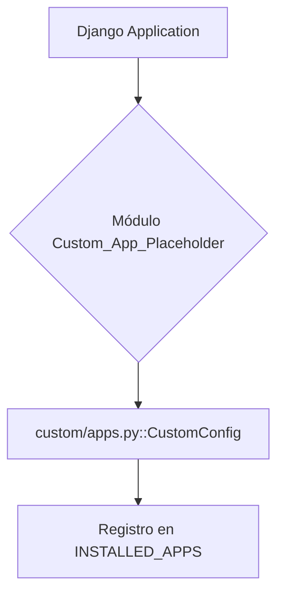

# Módulo Custom_App_Placeholder

El módulo `Custom_App_Placeholder` es un componente fundamental para la integración de funcionalidades personalizadas dentro de la aplicación principal. Sirve como un marcador de posición para la lógica de negocio específica del cliente o extensiones de la aplicación que no forman parte del núcleo genérico del sistema.

## Propósito y Funcionalidad Principal

El objetivo principal de este módulo es proporcionar un punto de entrada estructurado y aislado para el desarrollo de características únicas sin modificar directamente el código base de la aplicación. Esto facilita la mantenibilidad, la actualización y la escalabilidad del sistema al permitir que las personalizaciones vivan en su propio espacio de nombres.

Su componente principal es `CustomConfig`, que es una subclase de `django.apps.AppConfig`. Esta configuración se encarga de registrar la aplicación "custom" dentro del framework Django, lo que permite que Django descubra y gestione sus modelos, vistas, URLs y otras características.

## Arquitectura y Relaciones de Componentes

La arquitectura de este módulo es sencilla, centrándose en la configuración de la aplicación Django.

### Componentes:

*   **`custom/apps.py::CustomConfig`**: Esta clase hereda de `django.apps.AppConfig` y es la encargada de definir la configuración de la aplicación "custom". Su propiedad `name = 'custom'` asegura que Django reconozca este módulo como una aplicación independiente.

## Cómo Encaja el Módulo en el Sistema General

El módulo `Custom_App_Placeholder` se integra en el sistema general como una aplicación Django estándar. Al ser listado en la configuración `INSTALLED_APPS` de Django, se inicializa durante el arranque de la aplicación. Esto permite:

*   **Extensibilidad**: Los desarrolladores pueden añadir fácilmente nuevos modelos, vistas, plantillas y lógica de negocio en el directorio `custom/` sin afectar los módulos centrales.
*   **Separación de Preocupaciones**: Mantiene el código personalizado distinto del código base, mejorando la organización y reduciendo conflictos durante las actualizaciones del sistema.
*   **Aislamiento**: Cualquier lógica o característica específica que se implemente dentro de este módulo se mantiene encapsulada, minimizando el riesgo de efectos secundarios en otras partes de la aplicación.

En esencia, actúa como un "plugin" o una extensión del sistema principal, ofreciendo un marco robusto para la personalización y el crecimiento de la aplicación.
