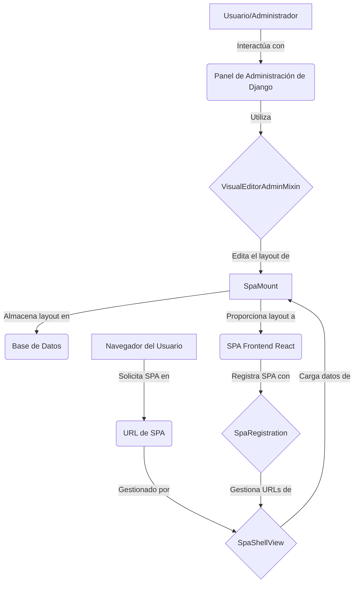

# Framework de Edición de UI de Django React

Este módulo (`django_react_ui_editor`) es un framework que facilita la integración de un editor visual de interfaz de usuario basado en React (como [Puck](https://github.com/measuredco/puck)) dentro de aplicaciones Django. Permite a los desarrolladores y usuarios gestionar y editar visualmente el layout de las Single Page Applications (SPAs) montadas, proporcionando una experiencia de edición rica directamente desde el panel de administración de Django.

## Propósito
El objetivo principal de este framework es desacoplar la lógica de presentación de las SPAs de la configuración del backend de Django, permitiendo una edición dinámica y visual de los layouts de las SPA. Esto es especialmente útil para sistemas de gestión de contenido (CMS) o aplicaciones que requieren flexibilidad en la disposición de sus interfaces de usuario.

## Arquitectura

El framework `Django_React_UI_Editor_Framework` se compone de varios elementos clave que trabajan en conjunto para proporcionar una experiencia de edición visual para SPAs:

*   **Modelos de Montaje SPA (`SpaMount`)**: Define la estructura de datos para un "punto de montaje" de SPA, incluyendo su slug, prefijo de URL y el layout JSON.
*   **Registro de SPA (`SpaRegistration`)**: Un sistema para registrar dinámicamente diferentes SPAs y sus configuraciones asociadas, lo que permite al framework gestionar múltiples SPAs.
*   **Vistas de Shell de SPA (`SpaShellView`)**: Una vista genérica de Django que sirve el shell HTML para las SPAs registradas, inyectando los datos de bootstrap necesarios, incluyendo el layout JSON.
*   **Mezclador de Administración del Editor Visual (`VisualEditorAdminMixin`)**: Un mezclador para el panel de administración de Django que integra el editor visual de React (Puck) para la edición del layout de las SPAs.

A continuación, se presenta un diagrama de componentes que ilustra las relaciones de alto nivel:

## Módulos y Componentes Clave

El framework se divide en los siguientes submódulos para una mejor organización y gestión:

*   [Administración del Editor Visual](Django_React_UI_Editor_Framework/Django_React_UI_Editor_Framework_Admin.md): Detalla cómo el editor visual se integra en el panel de administración de Django.
*   [Modelos y Configuración de SPA](Django_React_UI_Editor_Framework/Django_React_UI_Editor_Framework_Modelos.md): Describe los modelos de base y la configuración de la aplicación para las SPAs.
*   [Registro de SPA](Django_React_UI_Editor_Framework/Django_React_UI_Editor_Framework_Registro_SPA.md): Explica el mecanismo para registrar y gestionar múltiples SPAs.
*   [Vistas de Shell de SPA](Django_React_UI_Editor_Framework/Django_React_UI_Editor_Framework_Vistas.md): Proporciona información sobre cómo se sirven las SPAs al público.
