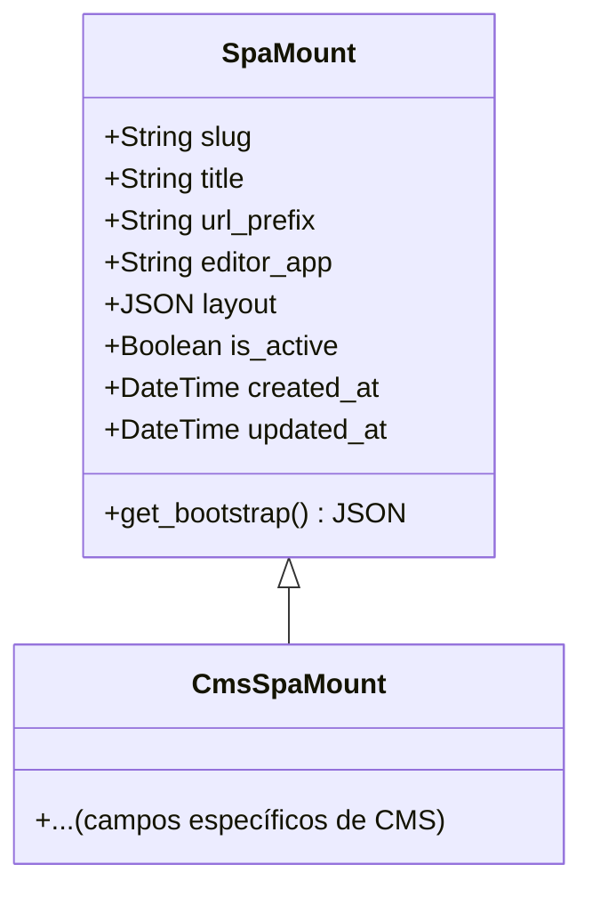

# Modelos del Framework del Editor de UI de Django React

El módulo `Django_React_UI_Editor_Framework_Modelos` es una parte fundamental del marco de trabajo del editor de UI de Django React, proporcionando los modelos de base para integrar aplicaciones de una sola página (SPA) en una aplicación Django. Su propósito principal es definir la estructura de datos necesaria para montar y configurar dinámicamente las SPA dentro del sistema.

Este módulo contiene los siguientes componentes principales:

*   [`SpaMount`](#spamouunt): Un modelo abstracto de Django que sirve como base para montar SPAs de comerciantes bajo un prefijo de URL.
*   [`SpaMount.Meta`](#spamouuntmeta): La clase interna `Meta` de `SpaMount` que define opciones para el modelo, como hacerlo abstracto y el orden predeterminado.
*   [`DjangoReactUiEditorConfig`](#djangoreactuieditorconfig): La clase de configuración de la aplicación Django para el módulo `django_react_ui_editor`.

## Propósito y Funcionalidad del Módulo

El módulo `Django_React_UI_Editor_Framework_Modelos` facilita la integración de interfaces de usuario de React desarrolladas como SPAs en un entorno Django. Al proporcionar un modelo `SpaMount` base, permite que diferentes productos o casos de uso personalicen cómo se arrancan y presentan sus SPAs sin acoplamientos multitenant. Esto es crucial para un marco de trabajo que busca ser flexible y extensible, permitiendo a los desarrolladores definir sus propios modelos de SPA que hereden de `SpaMount` y se adapten a sus necesidades específicas.

La configuración de la aplicación `DjangoReactUiEditorConfig` asegura que el módulo se registre correctamente dentro de la aplicación Django, proporcionando un nombre legible y configurando el tipo de campo de clave primaria automática predeterminado.

## Arquitectura y Relaciones de Componentes

### Diagrama de Relaciones de Modelos

El siguiente diagrama de clases de Mermaid ilustra la relación entre `SpaMount` y sus posibles subclases concretas (por ejemplo, `CmsSpaMount` en el módulo `CMS_UI___Frontend/CMS_UI___Frontend_Administracion.md`).

**Explicación del Diagrama:**

*   `SpaMount`: Es el modelo base abstracto. Contiene campos comunes como `slug`, `title`, `url_prefix`, `editor_app`, `layout`, `is_active`, `created_at` y `updated_at`. También define el método `get_bootstrap` para generar la carga JSON inicial para la SPA.
*   `CmsSpaMount`: Representa una subclase concreta de `SpaMount` (definida en el módulo [CMS_UI___Frontend/CMS_UI___Frontend_Administracion.md](../CMS_UI___Frontend/CMS_UI___Frontend_Administracion.md)). Esta subclase heredaría todos los campos y métodos de `SpaMount` y podría añadir sus propios campos específicos para el contexto de un CMS.

### Cómo encaja el módulo en el sistema general

El módulo `Django_React_UI_Editor_Framework_Modelos` se integra en el sistema como la capa de persistencia para la configuración de las SPAs.

*   **Configuración de SPA:** El modelo `SpaMount` define cómo se configura una SPA, incluyendo su prefijo de URL (`url_prefix`), el editor frontend (`editor_app`) y la estructura del layout (`layout`).
*   **Integración con Vistas:** Las vistas, como `SpaShellView` en [Django_React_UI_Editor_Framework/Django_React_UI_Editor_Framework_Vistas.md](Django_React_UI_Editor_Framework_Vistas.md), utilizarían instancias de `SpaMount` (o sus subclases) para renderizar el shell de la SPA, inyectando la carga JSON de bootstrap generada por el método `get_bootstrap`.
*   **Administración:** El `VisualEditorAdminMixin` en [Django_React_UI_Editor_Framework/Django_React_UI_Editor_Framework_Admin.md](Django_React_UI_Editor_Framework_Admin.md) interactuaría con los modelos definidos aquí para proporcionar una interfaz de administración para las SPAs.
*   **Registro de SPA:** El [`SpaRegistration`](Django_React_UI_Editor_Framework_Registro_SPA.md) se encarga de registrar las diferentes SPAs disponibles en el sistema, lo que podría implicar la interacción con las configuraciones de los modelos de SPA.

## Componentes del Módulo

### SpaMount

`django_react_ui_editor/models.py::SpaMount`

`SpaMount` es un modelo abstracto de Django que proporciona la estructura base para montar una aplicación de una sola página (SPA) bajo un prefijo de URL específico. Está diseñado para ser heredado por subclases concretas (como `CmsSpaMount`) que luego manejarán la tabla de la base de datos, lo que permite a cada producto personalizar el bootstrap y el diseño de la SPA sin un acoplamiento multi-inquilino.

**Campos:**

*   `slug` (CharField): Un identificador único para la SPA, utilizado para referenciarla.
*   `title` (CharField): Un título descriptivo para la SPA.
*   `url_prefix` (SlugField): El prefijo de URL bajo el cual se montará la SPA (por ejemplo, 'cms'). No debe incluir barras diagonales iniciales o finales.
*   `editor_app` (SlugField): La clave de la aplicación de editor frontend utilizada por `VisualEditorAdminMixin`. Por defecto es 'cms'.
*   `layout` (JSONField): Un campo JSON que almacena la estructura del diseño de la SPA. El valor por defecto es el generado por la función `default_layout`, que define un envoltorio de diseño básico para un Workbench SPA.
*   `is_active` (BooleanField): Indica si la SPA está activa o no.
*   `created_at` (DateTimeField): Marca de tiempo de cuándo se creó la SPA.
*   `updated_at` (DateTimeField): Marca de tiempo de cuándo se actualizó por última vez la SPA.

**Métodos:**

*   `__str__(self)`: Devuelve el título o el slug del objeto `SpaMount`, proporcionando una representación de cadena legible.
*   `get_bootstrap(self, request=None)`: Devuelve una carga JSON que se inyecta en el shell de la SPA. Contiene el `slug`, `urlPrefix` y `layout` de la SPA.

### SpaMount.Meta

`django_react_ui_editor/models.py::SpaMount.Meta`

Esta es la clase interna `Meta` del modelo `SpaMount`. Define las opciones específicas para el modelo.

**Opciones:**

*   `abstract = True`: Indica que `SpaMount` es un modelo abstracto y no creará una tabla de base de datos propia. Debe ser heredado por otros modelos concretos.
*   `ordering = ["slug"]`: Define el orden predeterminado de las instancias de `SpaMount` cuando se consultan, ordenándolas por el campo `slug`.

### DjangoReactUiEditorConfig

`django_react_ui_editor/apps.py::DjangoReactUiEditorConfig`

Esta clase de configuración de aplicación Django se encarga de configurar el módulo `django_react_ui_editor` dentro de la aplicación Django.

**Atributos:**

*   `default_auto_field = "django.db.models.BigAutoField"`: Especifica el tipo de campo de clave primaria automática que se utilizará para los modelos dentro de esta aplicación.
*   `name = "django_react_ui_editor"`: El nombre corto de Python para la aplicación.
*   `verbose_name = "Django React UI Editor"`: Un nombre legible para la aplicación que se mostrará en la interfaz de administración de Django.
