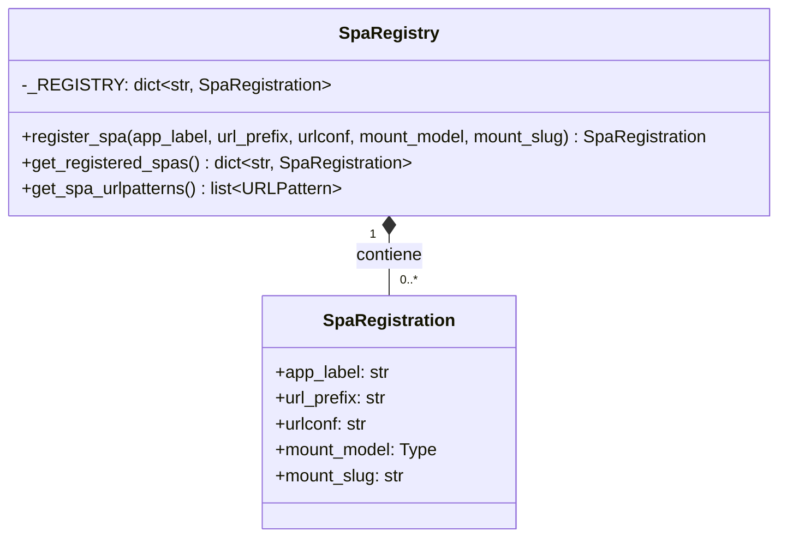

# Registro de SPA en Django React UI Editor Framework

Este módulo, `django_react_ui_editor/spa_registry.py`, es el corazón del sistema de registro y gestión de Single Page Applications (SPAs) dentro del `Django_React_UI_Editor_Framework`. Su propósito principal es permitir que las aplicaciones frontend construidas con React sean integradas de manera fluida en la estructura de enrutamiento de URL de Django, facilitando su despliegue y acceso.

## Propósito y Funcionalidad Principal

El módulo `django_react_ui_editor/spa_registry.py` centraliza la definición y el registro de las SPAs. Proporciona las herramientas necesarias para:
1.  **Definir una SPA:** A través de la clase `SpaRegistration`, se encapsulan los metadatos esenciales de una SPA, como su etiqueta de aplicación, prefijo de URL, configuración de URL, modelo de montaje y slug.
2.  **Registrar SPAs:** La función `register_spa` permite añadir nuevas SPAs al registro global del sistema.
3.  **Recuperar SPAs Registradas:** La función `get_registered_spas` proporciona acceso al listado de todas las SPAs que han sido registradas.
4.  **Generar Patrones de URL:** La función `get_spa_urlpatterns` automatiza la creación de los patrones de URL de Django necesarios para que cada SPA registrada sea accesible a través de su prefijo de URL definido.

## Arquitectura y Relaciones entre Componentes

### Componente Principal: `SpaRegistration`

La clase `SpaRegistration` es un dataclass que actúa como el descriptor para cada SPA. Contiene la información crucial para la integración de la SPA:

```python
@dataclass(frozen=True)
class SpaRegistration:
    app_label: str
    url_prefix: str
    urlconf: str
    mount_model: Type
    mount_slug: str
```

### Funciones de Gestión

*   **`register_spa`**: Esta función es el punto de entrada para registrar una nueva SPA en el sistema. Toma los parámetros necesarios y crea una instancia de `SpaRegistration`, que luego se almacena en el diccionario global `_REGISTRY`. El `url_prefix` se normaliza eliminando las barras diagonales iniciales o finales.
*   **`get_registered_spas`**: Devuelve una copia del diccionario `_REGISTRY`, permitiendo consultar las SPAs registradas sin modificar el estado interno del registro.
*   **`get_spa_urlpatterns`**: Esta función es clave para la integración con el sistema de URL de Django. Itera sobre todas las `SpaRegistration` en `_REGISTRY` y, para cada una, construye un objeto `path` de Django que incluye el `urlconf` de la SPA bajo su `url_prefix` definido.

### Diagrama de Clases



### Diagrama de Flujo de Registro de SPA

```mermaid
flowchart TD
    A[Inicio de la aplicación Django] --> B{Llamada a register_spa()};
    B --> C{Crear instancia de SpaRegistration};
    C --> D{Almacenar SpaRegistration en _REGISTRY};
    D --> E[SPA registrada];
    E --> F{Llamada a get_spa_urlpatterns()};
    F --> G{Iterar sobre _REGISTRY};
    G -- Por cada SpaRegistration --> H{Crear objeto Django path()};
    H --> I[Añadir path() a la lista de patrones de URL];
    I --> J{Devolver lista de patrones de URL};
    J --> K[Integración en el urls.py principal de Django];
```

## Cómo el Módulo Encaja en el Sistema General

El módulo `Django_React_UI_Editor_Framework_Registro_SPA` es un componente fundamental para la modularidad y extensibilidad del `Django_React_UI_Editor_Framework`. Facilita la creación de una arquitectura donde múltiples SPAs pueden coexistir dentro de una misma aplicación Django, cada una gestionando su propio enrutamiento frontend y lógica de presentación.

Se relaciona estrechamente con:

*   **[Vistas del Framework](Django_React_UI_Editor_Framework_Vistas.md)**: Específicamente con `SpaShellView`, que probablemente utiliza la información de `SpaRegistration` para renderizar el contenedor HTML de la SPA y cargar los activos de frontend correspondientes.
*   **[Modelos del Framework](Django_React_UI_Editor_Framework_Modelos.md)**: El `mount_model` especificado en `SpaRegistration` (como `SpaMount`) se utiliza para configurar y persistir la información de montaje de la SPA en la base de datos de Django, permitiendo una configuración dinámica y gestionable desde el backend.

### Diagrama de Componentes e Interacción

```mermaid
graph TD
    subgraph Django_React_UI_Editor_Framework
        A[django_react_ui_editor/spa_registry.py]
        B[django_react_ui_editor/views.py::SpaShellView]
        C[django_react_ui_editor/models.py::SpaMount]
    end

    subgraph Configuración de Django
        D[urls.py principal de Django]
    end

    A -- "Registra SPAs" --> C
    A -- "Genera URL patterns" --> D
    D -- "Ruta a" --> B
    B -- "Usa configuración de" --> C
    B -- "Sirve contenido de SPA" --> Frontend[Aplicación Frontend React]

    click B "Django_React_UI_Editor_Framework/Django_React_UI_Editor_Framework_Vistas.md"
    click C "Django_React_UI_Editor_Framework/Django_React_UI_Editor_Framework_Modelos.md"
