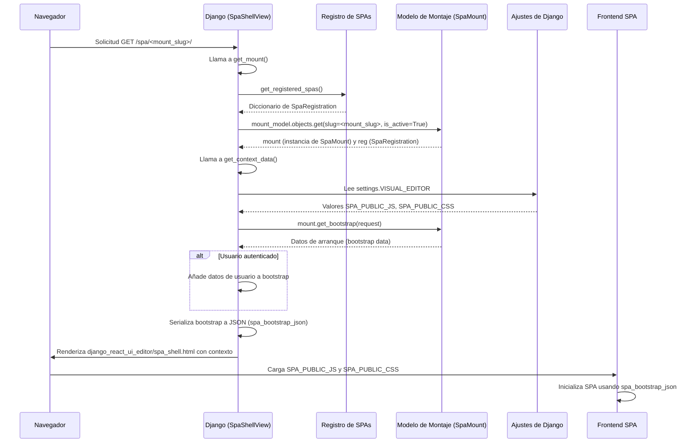

# Vistas del Framework Editor de UI Django-React

Este módulo, `Django_React_UI_Editor_Framework_Vistas`, gestiona la forma en que las Single Page Applications (SPAs) registradas dentro del [Django_React_UI_Editor_Framework](../Django_React_UI_Editor_Framework.md) son servidas al usuario final. Su componente central es `SpaShellView`, una vista de propósito general que renderiza el shell HTML base para cualquier SPA activa, inyectando los datos de configuración necesarios para su inicialización en el lado del cliente.

## Funcionalidad principal

La clase `SpaShellView` es la encargada de:
*   Identificar y recuperar una instancia de `SpaMount` activa basada en un "slug" único.
*   Preparar el contexto de la plantilla, incluyendo el título de la SPA, las rutas a los archivos JavaScript y CSS públicos de la SPA, y un objeto JSON de arranque (`spa_bootstrap_json`) con datos esenciales para la aplicación frontend.
*   Proporcionar información básica del usuario autenticado al frontend si corresponde.

## Arquitectura y relaciones de componentes

El `SpaShellView` opera en estrecha colaboración con el sistema de registro de SPAs y los modelos de montaje.

```mermaid
graph TD
    A[Solicitud del Navegador] --> B(SpaShellView);
    B --> C{Obtener mount_slug};
    C --> D[get_registered_spas()];
    D --> E["SpaRegistration"];
    E --> F["mount_model (p. ej., SpaMount)"];
    F -- Consulta por slug activo --> G{Montaje de SPA Encontrado?};
    G -- No --> H[404 No Encontrado];
    G -- Sí --> I[Obtener Contexto de Datos];
    I --> J[settings.VISUAL_EDITOR];
    I --> K[mount.get_bootstrap(request)];
    I --> L{Usuario Autenticado?};
    L -- Sí --> M[Añadir Datos de Usuario];
    L -- No --> N[No Añadir Datos de Usuario];
    M --> O[Contexto Final];
    N --> O;
    O --> P[django_react_ui_editor/spa_shell.html];
    P --> Q[Renderizar Shell HTML con Datos de SPA];
    Q --> R[Servir SPA al Navegador];

    subgraph Dependencias
        D
        E
        F
        J
        P
    end
```
**Diagrama 1: Arquitectura de `SpaShellView`**

*   **`SpaShellView`**: La vista principal que orquesta la entrega del shell de la SPA.
*   **`[SpaRegistration](Django_React_UI_Editor_Framework_Registro_SPA.md)`**: A través de la función `get_registered_spas()`, `SpaShellView` descubre las configuraciones de todas las SPAs disponibles. Cada `SpaRegistration` contiene el modelo de montaje (`mount_model`) y el prefijo de URL (`url_prefix`) asociados a una SPA específica.
*   **`[SpaMount](Django_React_UI_Editor_Framework_Modelos.md)`**: Representa una instancia configurada de una SPA. La `SpaShellView` consulta este modelo (o un modelo similar registrado) para encontrar una SPA activa por su "slug". Los datos de este `mount` son cruciales para el `spa_bootstrap_json`.
*   **`settings.VISUAL_EDITOR`**: Los ajustes de Django se utilizan para configurar las rutas de los archivos JavaScript y CSS públicos de la SPA (`SPA_PUBLIC_JS`, `SPA_PUBLIC_CSS`). Esto permite la personalización de los activos del frontend. Por defecto, estos apuntan a recursos gestionados por el módulo `[CMS_UI___Frontend](../CMS_UI___Frontend.md)`.

## Flujo de proceso: Sirviendo una SPA


**Diagrama 2: Flujo de Sirviendo una SPA**

1.  El navegador realiza una solicitud GET a una URL que coincide con el patrón de la `SpaShellView`, incluyendo el "slug" del montaje de la SPA.
2.  `SpaShellView` invoca su método `get_mount()` para identificar la SPA solicitada.
3.  Se consulta el registro de SPAs (`get_registered_spas()`) para obtener las configuraciones disponibles.
4.  Utilizando el `mount_model` asociado a la SPA, se busca una instancia activa de `SpaMount` que coincida con el "slug" de la solicitud. Si no se encuentra, se lanza un `Http404`.
5.  Una vez obtenido el montaje de la SPA, `SpaShellView` procede a generar el contexto para la plantilla HTML.
6.  Se leen los ajustes `VISUAL_EDITOR` de Django para determinar las rutas de los archivos JS y CSS del frontend.
7.  Se invoca el método `get_bootstrap()` del objeto `SpaMount` para obtener los datos de inicialización específicos de la SPA.
8.  Si el usuario está autenticado, su información básica se añade a los datos de arranque.
9.  Los datos de arranque se serializan a una cadena JSON (`spa_bootstrap_json`) para ser incrustados en el HTML.
10. Finalmente, la vista renderiza la plantilla `django_react_ui_editor/spa_shell.html` con todo el contexto preparado, sirviendo el shell HTML al navegador.
11. El navegador carga los archivos JS y CSS, y la aplicación frontend de React se inicializa utilizando el `spa_bootstrap_json` para configurar su estado inicial.

## Cómo el módulo encaja en el sistema general

Este módulo es un puente fundamental entre el backend de Django y las aplicaciones frontend de React dentro del [Django_React_UI_Editor_Framework](../Django_React_UI_Editor_Framework.md). Proporciona el mecanismo estándar para entregar el entorno de ejecución básico de una SPA, permitiendo que diferentes aplicaciones React se monten y se ejecuten con configuraciones dinámicas proporcionadas por el backend de Django. Facilita la creación de una experiencia de usuario fluida al integrar el contenido y la interactividad del frontend con la gestión de datos y lógica del backend.

## Referencias

*   [Registro de SPAs](Django_React_UI_Editor_Framework_Registro_SPA.md)
*   [Modelos del Framework Editor de UI Django-React](Django_React_UI_Editor_Framework_Modelos.md)
*   [Módulo CMS UI Frontend](../CMS_UI___Frontend.md)