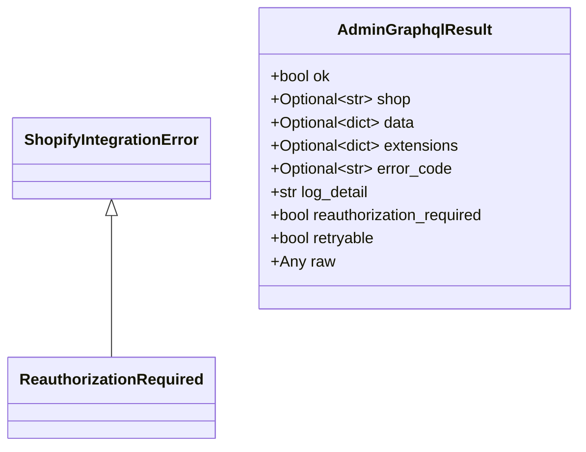
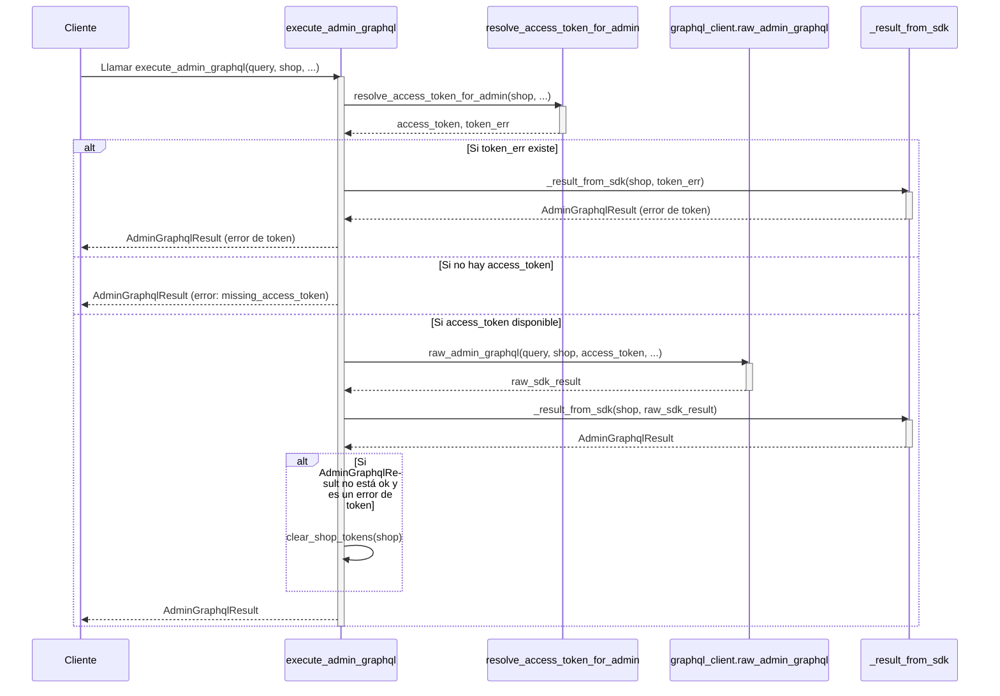

# Cliente de la API de Shopify

Este módulo, `Shopify_API_Client`, proporciona las herramientas fundamentales para interactuar con la API de administración de Shopify, centrándose en las operaciones GraphQL. Su propósito principal es simplificar la comunicación, gestionar la autenticación y la reautorización, y estructurar las respuestas de las consultas GraphQL para un consumo eficiente por otras partes del sistema.

## Propósito y Funcionalidad Principal

El módulo abstrae las complejidades de la interacción con la API de Shopify, ofreciendo una interfaz clara para:

*   Ejecutar consultas GraphQL en la API de administración de Shopify.
*   Manejar automáticamente la resolución y el uso de tokens de acceso.
*   Proporcionar un formato de resultado estandarizado (`AdminGraphqlResult`) que incluye información sobre el éxito, datos, errores y si se requiere reautorización.
*   Definir excepciones específicas para errores de integración, como la necesidad de reautorización por parte del comerciante.

## Arquitectura y Relaciones entre Componentes

La arquitectura del módulo se centra en un servicio GraphQL y un conjunto de clases de excepción para un manejo robusto de errores.

### Componentes Principales

*   **`shopify_requests/exceptions.py`**:
    Consulte la documentación detallada en [Manejo de Errores](Shopify_API_Client/Shopify_API_Client_Manejo_de_Errores.md).
*   **`shopify_requests/graphql_service.py`**:
    Consulte la documentación detallada en [Servicio GraphQL](Shopify_API_Client/Shopify_API_Client_Shopify_API_Client_Servicio_GraphQL.md).

### Diagrama de Clases

El siguiente diagrama de clases ilustra las relaciones entre las excepciones y el dataclass principal de resultados.

### Diagrama de Secuencia de Ejecución GraphQL

Este diagrama muestra el flujo de interacción cuando se ejecuta una consulta GraphQL a través de `execute_admin_graphql`.

## Cómo encaja el módulo en el sistema general

El `Shopify_API_Client` es un componente central para cualquier funcionalidad que necesite interactuar con la API de administración de Shopify. Es utilizado por otros módulos que requieren acceso a datos o que realizan operaciones en la plataforma Shopify.

Por ejemplo, otros módulos como [Shopify_Content_Management](Shopify_Content_Management.md) o [Shopify_Metaobjects](Shopify_Metaobjects.md) podrían usar este cliente para:

*   Sincronizar contenido (artículos, productos, colecciones) entre el CMS local y Shopify.
*   Gestionar y manipular metaobjetos y sus definiciones en Shopify.
*   Obtener información de la tienda o de productos específicos para mostrar en el frontend.

La gestión de la autenticación y los errores de reautorización se integra con el módulo [Core_Shopify_App](Core_Shopify_App.md), asegurando que los tokens de acceso se resuelvan y se gestionen correctamente, y que la aplicación pueda guiar al usuario a través del proceso de reautorización si es necesario.
