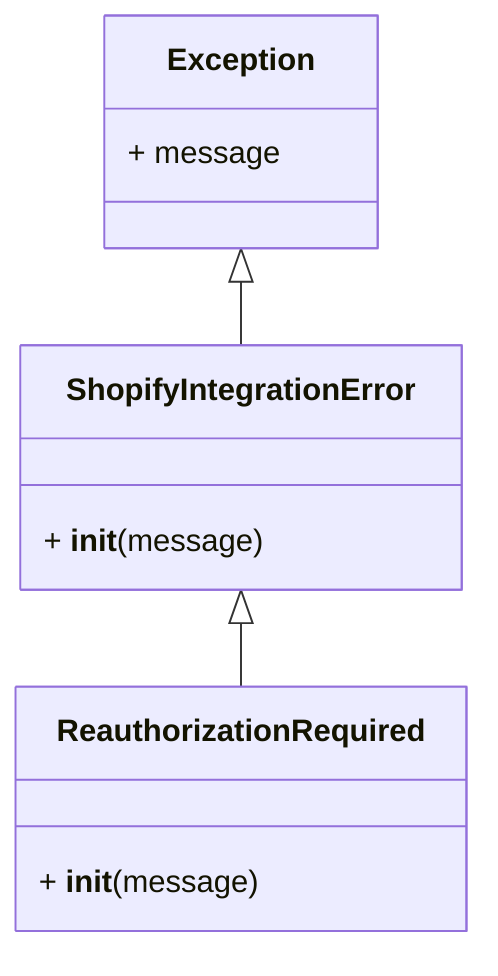

# Manejo de Errores del Cliente de la API de Shopify

Este módulo (`shopify_requests/exceptions.py`) define las clases de excepción base para gestionar errores específicos que pueden ocurrir durante la integración con la API de administración de Shopify, tanto para operaciones GraphQL como para el manejo de tokens de autenticación. Estas excepciones están diseñadas para proporcionar una estructura clara para el manejo de condiciones de error predecibles y significativas dentro del cliente de la API de Shopify.

## Arquitectura y Componentes

El módulo `shopify_requests/exceptions.py` contiene las siguientes clases de excepción:

### `ShopifyIntegrationError`

`ShopifyIntegrationError` es la clase base para todos los errores relacionados con la integración con la API de administración de Shopify. Cualquier excepción que surja de problemas generales con las solicitudes GraphQL o la gestión de tokens debería heredar de esta clase. Esto permite un manejo de errores centralizado para problemas de integración amplios.

### `ReauthorizationRequired`

`ReauthorizationRequired` es una subclase de `ShopifyIntegrationError`. Esta excepción específica se lanza cuando el comerciante debe volver a autorizar o reinstalar la aplicación. Indica un estado en el que la sesión actual de la aplicación con Shopify no es válida, requiriendo una intervención por parte del usuario o del sistema para restablecer el acceso.

## Diagrama de Clases



## Uso

Estas excepciones están destinadas a ser lanzadas por componentes del cliente de la API de Shopify cuando se encuentran las condiciones de error correspondientes. Los desarrolladores que utilicen el cliente de la API pueden capturar estas excepciones para implementar una lógica de manejo de errores específica.

```python
try:
    # Código que interactúa con la API de Shopify
    pass
except ReauthorizationRequired as e:
    print(f"Reautorización requerida: {e}. Por favor, instruya al comerciante a reinstalar o reautorizar la aplicación.")
    # Lógica para redirigir al flujo de autorización o notificar al usuario
except ShopifyIntegrationError as e:
    print(f"Error general de integración con Shopify: {e}. Vuelva a intentarlo más tarde o consulte los registros.")
    # Lógica para manejar errores generales de integración
except Exception as e:
    print(f"Ocurrió un error inesperado: {e}.")
    # Manejo de cualquier otra excepción no anticipada
```

## Relación con otros módulos

Este módulo es una parte fundamental del [Shopify_API_Client](../Shopify_API_Client.md) ya que define el marco para el manejo de errores dentro de las operaciones de la API. Las excepciones definidas aquí son utilizadas por otros componentes del cliente de la API, como el [Shopify_API_Client_Servicio_GraphQL](Shopify_API_Client_Servicio_GraphQL.md), para comunicar estados de error de manera consistente y manejable. 

Específicamente, `ShopifyIntegrationError` y `ReauthorizationRequired` son cruciales para el flujo de trabajo de autenticación y las interacciones con la API GraphQL, asegurando que la aplicación pueda reaccionar adecuadamente a problemas como tokens caducados o permisos insuficientes.