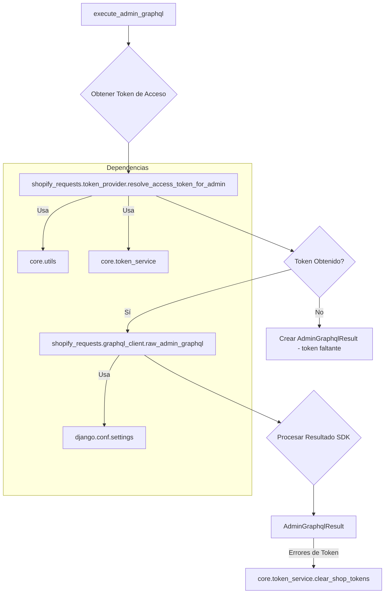
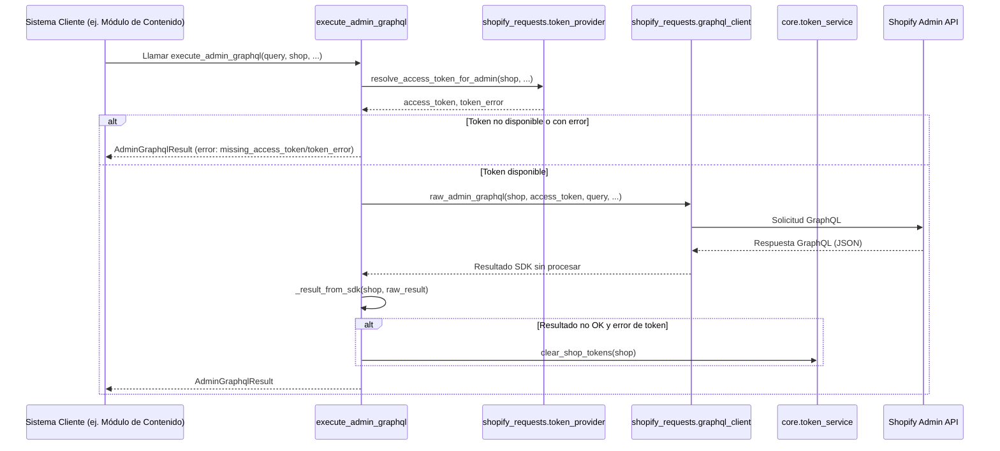

# Servicio GraphQL del Cliente de la API de Shopify

Este documento describe el módulo `shopify_requests/graphql_service.py`, que proporciona la lógica central para interactuar con la API GraphQL de administración de Shopify.

## 1. Propósito y Funcionalidad Principal

El módulo `shopify_requests/graphql_service.py` es el componente clave para ejecutar consultas GraphQL contra la API de administración de Shopify. Encapsula la lógica de autenticación, manejo de errores, reintentos y estructuración de respuestas, asegurando una interacción robusta y consistente con la plataforma Shopify.

Sus responsabilidades principales incluyen:
*   Resolución y gestión de tokens de acceso para la API de administración.
*   Ejecución de consultas GraphQL.
*   Mapeo de las respuestas del SDK de Shopify a un formato de resultado estandarizado (`AdminGraphqlResult`).
*   Manejo de errores específicos de la API, incluyendo la detección de reautorización requerida y errores de límite de tasa (throttling).
*   Limpieza de tokens de tienda cuando se detectan errores de autorización.

## 2. Arquitectura y Relaciones entre Componentes

El módulo se compone principalmente de la clase `AdminGraphqlResult` y la función `execute_admin_graphql`.

### 2.1. Componentes Principales

*   **`AdminGraphqlResult`**: Una clase de datos que encapsula el resultado de una operación GraphQL. Proporciona información sobre el éxito de la operación, la tienda asociada, los datos de la respuesta, las extensiones, códigos de error, detalles de log y banderas para indicar si se requiere reautorización o si la operación es reintentable.
*   **`execute_admin_graphql(query, *, shop, ...)`**: La función principal para ejecutar consultas GraphQL. Se encarga de obtener un token de acceso válido, realizar la llamada al cliente GraphQL subyacente y procesar la respuesta en una instancia de `AdminGraphqlResult`.

### 2.2. Relaciones con Otros Módulos

El `graphql_service.py` interactúa con varios otros módulos:

*   **`core.utils`**: Utilizado para funciones auxiliares como `_get_attr` y `get_shopify_app`.
*   **`core.token_service`**: Proporciona `TOKEN_ERROR_CODES` para identificar errores de token y `clear_shop_tokens` para invalidar tokens cuando es necesario.
*   **`shopify_requests.graphql_client`**: Este módulo (a través de `graphql_client.raw_admin_graphql`) es el responsable de la ejecución real de la petición HTTP a la API GraphQL de Shopify.
*   **`shopify_requests.token_provider`**: Proporciona la lógica para `resolve_access_token_for_admin`, que se encarga de obtener o refrescar el token de acceso para una tienda dada.
*   **`django.conf.settings`**: Accede a la configuración de Django, específicamente `SHOPIFY_ADMIN_API_VERSION`, para determinar la versión de la API de Shopify a utilizar.
*   **`shopify_requests.exceptions`**: Aunque no se importa directamente en el código proporcionado, la lógica de `AdminGraphqlResult` y `execute_admin_graphql` maneja situaciones que podrían llevar a excepciones como `ReauthorizationRequired` o `ShopifyIntegrationError`, que se definen en este módulo. Consulte [Manejo de Errores del Cliente de la API de Shopify](Shopify_API_Client_Manejo_de_Errores.md) para más detalles.

## 3. Cómo el Módulo se Integra en el Sistema General

Este módulo es una parte fundamental de la capa de integración con Shopify. Cualquier componente del sistema que necesite leer o escribir datos en Shopify a través de su API de administración, especialmente utilizando GraphQL, dependerá de `execute_admin_graphql`. Esto incluye:

*   **Sincronización de Contenido**: Módulos como [Shopify_Content_Management](../Shopify_Content_Management.md) podrían usar este servicio para importar o exportar datos de contenido de Shopify.
*   **Funcionalidades de Agente/Automatización**: Si el sistema tiene agentes que interactúan con Shopify, este servicio será su puerta de enlace principal.
*   **Interfaces de Usuario que Consumen Datos de Shopify**: Cualquier interfaz que muestre datos en tiempo real o casi real de Shopify utilizará este servicio.

Al centralizar la lógica de llamadas a la API GraphQL, este módulo asegura que la interacción con Shopify sea coherente, segura y manejable en todo el sistema. Su capacidad para manejar la reautorización y los límites de tasa es crucial para la estabilidad y fiabilidad de la integración.

### 3.1. Flujo de Datos para una Consulta GraphQL

