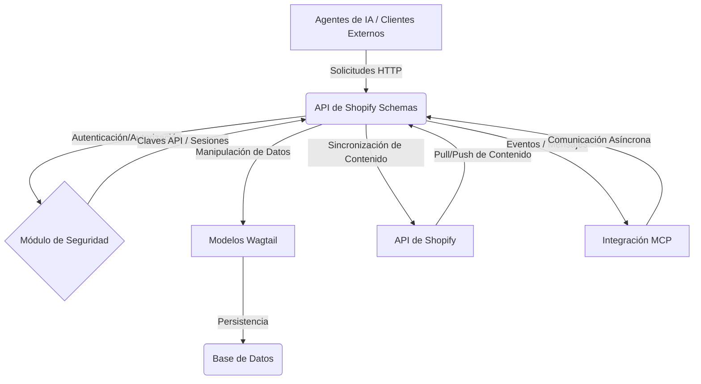

# Esquemas de la API de Shopify

Este módulo define los esquemas de datos y los componentes de la API para interactuar con el contenido de Shopify a través de Wagtail. Actúa como la capa de contrato de datos para diversas entidades de contenido como productos, colecciones, blogs, artículos, términos de glosario, páginas de inicio y ubicaciones, facilitando la sincronización de datos de contenido entre Wagtail y Shopify.

## Propósito

El propósito principal de este módulo es:
*   **Definir la estructura de datos**: Proporciona esquemas (`In`, `Out`, `Patch`) para la entrada, salida y actualización de datos de contenido.
*   **Habilitar la comunicación de la API**: Sirve como base para los puntos finales de la API que permiten a los agentes externos y al CMS interactuar con el contenido de Shopify gestionado en Wagtail.
*   **Gestionar la autenticación y autorización**: Incluye componentes para la autenticación de claves API y de sesión, así como el registro dinámico de clientes OAuth.
*   **Facilitar la integración de MCP**: Proporciona la infraestructura para la integración con el Protocolo de Comunicación de Microservicios (MCP) para la comunicación en tiempo real.
*   **Definir capacidades de los agentes**: Enumera las capacidades que los agentes de IA pueden utilizar para interactuar con el sistema, incluyendo operaciones de descubrimiento, lectura, creación, actualización, eliminación y sincronización.

## Arquitectura General

El módulo `Shopify_API___Schemas` está diseñado para ser la interfaz principal para la gestión de contenido. Se integra con el sistema Wagtail CMS en la parte trasera y con la API de Shopify en la parte delantera, actuando como un centro para el flujo de datos de contenido.

**Componentes Clave y Relaciones:**

*   **API de Shopify Schemas (B)**: El módulo central que expone los esquemas de datos y los puntos finales para la interacción del contenido.
*   **Módulo de Seguridad (C)**: Gestiona la autenticación de los clientes de la API (claves API, sesiones de Django, tokens OAuth).
*   **Modelos Wagtail (D)**: Las estructuras de datos subyacentes en Wagtail que representan el contenido de Shopify (productos, colecciones, etc.). Estos modelos son documentados en el módulo [Shopify_Content_Models](Shopify_Content_Management/Shopify_Content_Models.md).
*   **Base de Datos (E)**: Almacenamiento persistente para los modelos Wagtail.
*   **API de Shopify (F)**: La API externa de Shopify con la que este módulo se sincroniza para recuperar y enviar datos de contenido.
*   **Integración MCP (G)**: Componentes para manejar la comunicación de Microservicios, permitiendo interacciones en tiempo real y flujos de trabajo de agentes.

## Sub-módulos

Este módulo se descompone en varios sub-módulos, cada uno con un enfoque específico:

*   **[Core y Autenticación de la API](Shopify_API___Schemas/Shopify_API___Schemas_Core_Auth.md)**: Gestiona la configuración básica de la API, la autenticación de usuarios y el registro de claves de API.
*   **[Capacidades de los Agentes](Shopify_API___Schemas/Shopify_API___Schemas_Agent_Capabilities.md)**: Define las acciones y los flujos de trabajo que los agentes de IA pueden ejecutar a través de la API.
*   **[Integración MCP](Shopify_API___Schemas/Shopify_API___Schemas_MCP_Integration.md)**: Proporciona el transporte y la gestión de sesiones para la comunicación a través del Protocolo de Comunicación de Microservicios.
*   **[Modelos de Datos Comunes](Shopify_API___Schemas/Shopify_API___Schemas_Common_Data_Models.md)**: Incluye esquemas de datos reutilizables utilizados en todo el módulo para elementos como metacampos, enlaces y resultados de sincronización.
*   **[Esquemas de Contenido de Artículos](Shopify_API___Schemas/Shopify_API___Schemas_Article_Content.md)**: Define la estructura de datos para la creación, actualización y recuperación de artículos de blog.
*   **[Esquemas de Contenido de Blogs](Shopify_API___Schemas/Shopify_API___Schemas_Blog_Content.md)**: Define la estructura de datos para la gestión de blogs.
*   **[Esquemas de Contenido de Colecciones](Shopify_API___Schemas/Shopify_API___Schemas_Collection_Content.md)**: Define la estructura de datos para la gestión de colecciones de productos.
*   **[Esquemas de Contenido de Productos](Shopify_API___Schemas/Shopify_API___Schemas_Product_Content.md)**: Define la estructura de datos para la gestión de productos.
*   **[Esquemas de Contenido del Glosario](Shopify_API___Schemas/Shopify_API___Schemas_Glossary_Content.md)**: Define la estructura de datos para la gestión de términos del glosario.
*   **[Esquemas de Contenido de la Página de Inicio](Shopify_API___Schemas/Shopify_API___Schemas_Home_Content.md)**: Define la estructura de datos para la gestión de la página de inicio, incluyendo sus secciones.
*   **[Esquemas de Contenido de Ubicaciones](Shopify_API___Schemas/Shopify_API___Schemas_Location_Content.md)**: Define la estructura de datos para la gestión de páginas de ubicación.
*   **[Esquemas de Enlaces Semánticos](Shopify_API___Schemas/Shopify_API___Schemas_Semantic_Links.md)**: Define los esquemas para la funcionalidad de sugerencia de enlaces semánticos.
