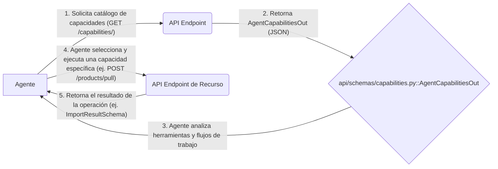

# Capacidades del Agente Shopify_API___Schemas

## Introducción

El módulo `Shopify_API___Schemas_Agent_Capabilities` es fundamental para definir y exponer las capacidades operativas disponibles para los agentes que interactúan con el sistema de gestión de contenido de Shopify. Actúa como un registro exhaustivo de las operaciones que los agentes pueden realizar en diversas fuentes de contenido, como productos, colecciones, blogs, artículos, ubicaciones, glosarios y páginas de inicio, así como funcionalidades para enlaces semánticos y el propio catálogo de capacidades. Además, este módulo delinea flujos de trabajo predefinidos para tareas comunes y especifica el mecanismo de autenticación para las interacciones de los agentes.

## Propósito y Funcionalidad Principal

El propósito principal de este módulo es proporcionar una interfaz estandarizada y autodescriptiva para que los agentes descubran, comprendan y utilicen las funcionalidades del sistema. Sus funcionalidades clave incluyen:

*   **Definición de Capacidades:** Define cada operación que un agente puede realizar, incluyendo el tipo de capacidad (descubrir, leer, crear, actualizar, eliminar, sincronizar entrada/salida), el recurso afectado, un resumen, el momento de uso, los requisitos previos y el esquema de respuesta esperado.
*   **Catálogo de Herramientas:** Mantiene un catálogo completo de todas las capacidades disponibles, mapeadas por su `operation_id` único, lo que permite a los agentes navegar y seleccionar las herramientas adecuadas.
*   **Flujos de Trabajo Predefinidos:** Ofrece secuencias ordenadas de capacidades para tareas comunes, simplificando la orquestación de operaciones complejas por parte de los agentes.
*   **Esquemas de Salida:** Proporciona esquemas Pydantic para la representación de las capacidades y la información de autenticación, asegurando una comunicación clara y validada con los agentes.
*   **Autenticación:** Define el esquema de autenticación requerido para todas las herramientas del agente, garantizando interacciones seguras.

## Arquitectura y Relaciones de Componentes

Este módulo organiza sus componentes para definir y exponer claramente las capacidades del sistema a los agentes externos.

### Diagrama de Relación de Componentes

El siguiente diagrama ilustra cómo los componentes internos (`AgentCapability`) se definen y luego se serializan en esquemas de salida (`AgentToolSchema`, `AgentCapabilitiesOut`) que los agentes consumen.

```mermaid
graph TD
    subgraph Módulo Shopify_API___Schemas_Agent_Capabilities
        A[api/agent_registry.py::AgentCapability] -->|"define propiedades de"| S1[api/schemas/capabilities.py::AgentToolSchema]
        A -- "Datos Internos" --> B(CAPABILITIES)
        C(WORKFLOWS)
        S2[api/schemas/capabilities.py::AgentAuthSchema]
        S3[api/schemas/capabilities.py::AgentCapabilitiesOut] -->|"contiene lista de"| S1
        S3 -->|"contiene"| S2
        S3 -->|"expone catálogo B y flujos de trabajo C"| B
        S3 -->|"expone catálogo B y flujos de trabajo C"| C
    end

    subgraph Otros Módulos Shopify_API___Schemas
        P[../Shopify_API___Schemas_Product_Content.md::ProductOut]
        L[../Shopify_API___Schemas_Common_Data_Models.md::ImportResultSchema]
        SY[../Shopify_API___Schemas_Common_Data_Models.md::SyncResultSchema]
        C1[../Shopify_API___Schemas_Collection_Content.md::CollectionOut]
        B1[../Shopify_API___Schemas_Blog_Content.md::BlogOut]
        A1[../Shopify_API___Schemas_Article_Content.md::ArticleOut]
        LO1[../Shopify_API___Schemas_Location_Content.md::LocationOut]
        G1[../Shopify_API___Schemas_Glossary_Content.md::GlossaryTermOut]
        G2[../Shopify_API___Schemas_Glossary_Content.md::GlossaryTermListOut]
        H1[../Shopify_API___Schemas_Home_Content.md::HomeOut]
        SE1[../Shopify_API___Schemas_Semantic_Links.md::SuggestRelatedOut]
    end

    S1 -->|"referencia esquemas de respuesta como"| P
    S1 -->|"referencia esquemas de respuesta como"| L
    S1 -->|"referencia esquemas de respuesta como"| SY
    S1 -->|"referencia esquemas de respuesta como"| C1
    S1 -->|"referencia esquemas de respuesta como"| B1
    S1 -->|"referencia esquemas de respuesta como"| A1
    S1 -->|"referencia esquemas de respuesta como"| LO1
    S1 -->|"referencia esquemas de respuesta como"| G1
    S1 -->|"referencia esquemas de respuesta como"| G2
    S1 -->|"referencia esquemas de respuesta como"| H1
    S1 -->|"referencia esquemas de respuesta como"| SE1

    style A fill:#f9f,stroke:#333,stroke-width:2px
    style S1 fill:#ccf,stroke:#333,stroke-width:2px
    style S2 fill:#ccf,stroke:#333,stroke-width:2px
    style S3 fill:#ccf,stroke:#333,stroke-width:2px
```

### Diagrama de Flujo de Datos

Este diagrama ilustra el flujo de información cuando un agente interactúa con el sistema para descubrir y utilizar sus capacidades.

## Cómo Encaja el Módulo en el Sistema General

El módulo `Shopify_API___Schemas_Agent_Capabilities` actúa como un puente vital entre los agentes automatizados y el sistema de gestión de contenido. Se integra de las siguientes maneras:

*   **Base para Agentes:** Es el punto de entrada para cualquier agente que necesite interactuar programáticamente con el contenido de Shopify administrado a través de Wagtail.
*   **Referencia de Esquemas:** Las definiciones de las capacidades hacen referencia a varios esquemas de entrada y salida definidos en otros submódulos de `Shopify_API___Schemas` (como [Shopify_API___Schemas_Product_Content.md](Shopify_API___Schemas_Product_Content.md), [Shopify_API___Schemas_Common_Data_Models.md](Shopify_API___Schemas_Common_Data_Models.md), etc.), asegurando coherencia y un contrato de API claro.
*   **Dependencia de la Autenticación:** Las capacidades especifican requisitos de autenticación que se basan en la lógica de autenticación central definida en [Shopify_API___Schemas_Core_Auth.md](Shopify_API___Schemas_Core_Auth.md).
*   **Interacción con la Gestión de Contenido:** Las operaciones de `sync_inbound` y `sync_outbound` se conectan directamente con la lógica de sincronización y los modelos de contenido gestionados por el módulo [Shopify_Content_Management.md](../Shopify_Content_Management.md). Por ejemplo, los requisitos previos como `SHOP_CONFIG_PREREQ` y `ROOT_PAGE_PREREQ` dependen de la configuración del sistema y la estructura de páginas de Wagtail definida en `Shopify_Content_Management/Shopify_Content_Models.md`.
*   **Integración de Metaobjetos:** Varias capacidades, especialmente para "Locations", "Glossary" y "Home", interactúan con los metaobjetos de Shopify, lo que implica la funcionalidad proporcionada por el módulo [Shopify_Metaobjects.md](../Shopify_Metaobjects.md).

## Detalles de los Componentes

### `api/agent_registry.py::AgentCapability`

Este es un `dataclass` congelado que sirve como la representación interna y canónica de una única capacidad de agente. Contiene todos los metadatos necesarios sobre una operación específica que un agente puede realizar.

*   `operation_id` (str): Un identificador único y estable para la capacidad, que coincide con el `operationId` de OpenAPI.
*   `method` (str): El método HTTP asociado a la operación (GET, POST, PATCH, DELETE).
*   `path` (str): La ruta de la API relativa a `/api/v1`.
*   `capability_type` ([CapabilityType](api/agent_registry.py)): El tipo de capacidad, como "discover", "read", "create", "update", "delete", "sync_inbound" (Shopify a Wagtail) o "sync_outbound" (Wagtail a Shopify).
*   `resource` ([Resource](api/agent_registry.py)): El recurso de contenido sobre el que opera la herramienta (ej. "products", "collections", "blogs", "articles", "locations", "glossary", "home", "semantic_links", "capabilities").
*   `summary` (str): Un resumen breve y legible de la herramienta.
*   `when_to_use` (str): Orientación para el agente sobre cuándo debe invocar esta herramienta.
*   `prerequisites` (tuple[str, ...]): Una tupla de condiciones que deben cumplirse antes de llamar a esta herramienta (ej. "ShopConfig con token de acceso sin conexión válido", "ShopifyRootPage con slug=root").
*   `response_schema` (str): El nombre del esquema de respuesta principal de la API.
*   `next_tools` (tuple[str, ...]): Una tupla de `operation_id`s sugeridos para llamar después de que esta herramienta tenga éxito.
*   `sync_direction` ([SyncDirection](api/agent_registry.py), opcional): La dirección de sincronización para herramientas de `sync_inbound`/`sync_outbound`; `None` en caso contrario.

El diccionario `CAPABILITIES` en `api/agent_registry.py` contiene todas las instancias de `AgentCapability` predefinidas, cubriendo operaciones CRUD, sincronización y descubrimiento para varios recursos.

El diccionario `WORKFLOWS` define secuencias de `operation_id`s para tareas comunes de agentes, como `products_existing_store`, `collections_existing_store`, etc.

### `api/schemas/capabilities.py::AgentToolSchema`

Este esquema Pydantic se utiliza para serializar una `AgentCapability` para la salida de la API. Refleja la estructura de `AgentCapability`, proporcionando una representación de datos clara y validada para los agentes.

*   `operation_id` (str): Nombre estable de la herramienta.
*   `method` (str): Método HTTP.
*   `path` (str): Ruta de la API.
*   `capability_type` ([CapabilityType](api/agent_registry.py)): Tipo de capacidad.
*   `resource` ([Resource](api/agent_registry.py)): Recurso de contenido.
*   `summary` (str): Resumen de la herramienta.
*   `when_to_use` (str): Guía de uso.
*   `prerequisites` (list[str]): Lista de condiciones previas.
*   `response_schema` (str): Nombre del esquema de respuesta.
*   `next_tools` (list[str]): `operation_id`s sugeridos para la próxima llamada.
*   `sync_direction` ([SyncDirection](api/agent_registry.py), opcional): Dirección de sincronización.

### `api/schemas/capabilities.py::AgentAuthSchema`

Este esquema define los requisitos de autenticación para todas las herramientas del agente.

*   `type` (Literal["bearer"]): El tipo de esquema de autenticación (actualmente solo "bearer").
*   `header` (Literal["Authorization"]): El nombre del encabezado HTTP para la clave API o el token de acceso OAuth (actualmente solo "Authorization").

### `api/schemas/capabilities.py::AgentCapabilitiesOut`

Este es el esquema de salida principal para el endpoint `/capabilities/`. Agrega la versión de la API, los detalles de autenticación y el catálogo completo de herramientas y flujos de trabajo.

*   `api_version` (str): La cadena de la versión de la API.
*   `auth` ([AgentAuthSchema](api/schemas/capabilities.py)): Los requisitos de autenticación para todas las herramientas.
*   `tools` (list[AgentToolSchema]): Un catálogo completo de capacidades del agente, indexadas por `operation_id`.
*   `workflows` (dict[str, list[str]]): Secuencias predefinidas y ordenadas de `operation_id`s para tareas comunes de agentes.
