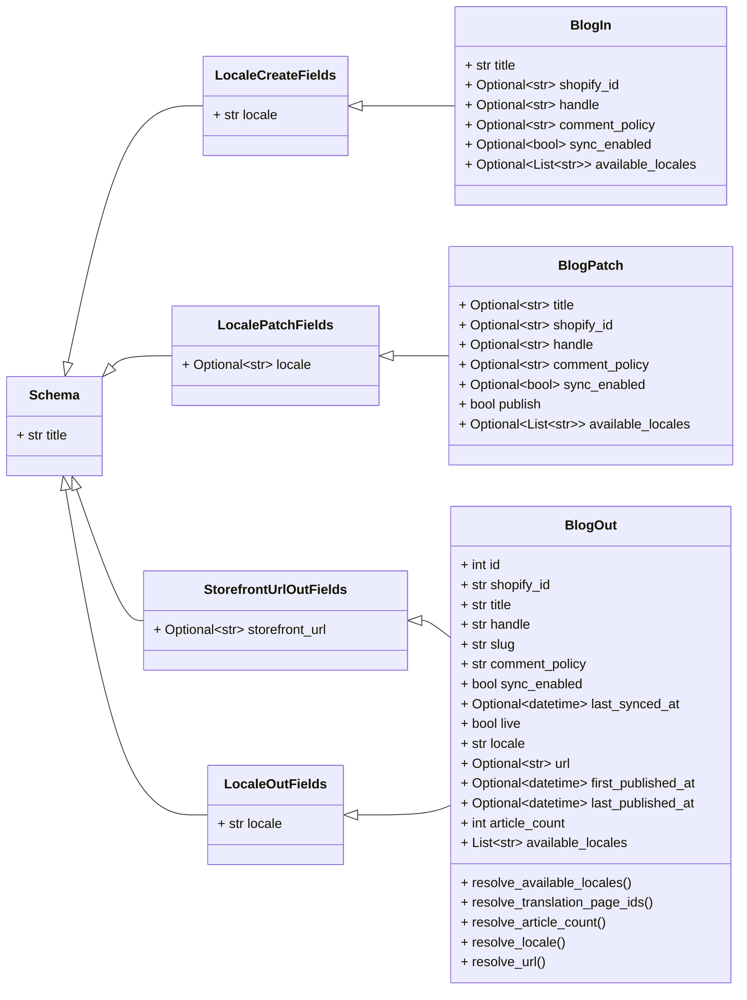

# Módulo Shopify_API___Schemas_Blog_Content

Este módulo define los esquemas de datos utilizados para la gestión del contenido de los blogs dentro del ecosistema Shopify. Estos esquemas facilitan la creación, actualización y recuperación de información de blogs, sirviendo como un puente entre el sistema de gestión de contenido (CMS) Wagtail y la API de Shopify.

## Propósito y Funcionalidad Principal

El `Shopify_API___Schemas_Blog_Content` se encarga de estandarizar la representación de los datos de los blogs, asegurando la coherencia y la correcta comunicación entre los diferentes servicios. Contiene tres componentes principales:

*   **`BlogIn`**: Define la estructura de los datos para crear o realizar una actualización completa de un blog.
*   **`BlogPatch`**: Especifica los campos que se pueden actualizar parcialmente en un blog existente.
*   **`BlogOut`**: Representa la estructura de los datos de un blog tal como se devuelve desde el sistema, incluyendo metadatos y campos derivados.

### Esquemas de Contenido del Blog

#### `BlogIn`

El esquema `BlogIn` se utiliza para la entrada de datos al crear un nuevo blog o para una actualización completa. Hereda de `LocaleCreateFields` de [Shopify_API___Schemas_Common_Data_Models.md](Shopify_API___Schemas_Common_Data_Models.md), lo que le permite incluir información de localización en la creación.

**Campos clave:**

*   `title` (str): Título del blog. Obligatorio.
*   `shopify_id` (Optional[str]): GID de Shopify para este blog. Se autocompleta después de la primera sincronización.
*   `handle` (Optional[str]): Identificador URL para el blog en Shopify. Se deriva del título si se omite.
*   `comment_policy` (Optional[str]): Política de comentarios para el blog (por ejemplo, 'CLOSED', 'AUTO_PUBLISHED', 'MODERATED'). El valor predeterminado es 'CLOSED'.
*   `sync_enabled` (Optional[bool]): Indica si la publicación de la página activará una sincronización saliente a Shopify. El valor predeterminado es `True`.
*   `available_locales` (Optional[List[str]]): Códigos de locales de Wagtail donde el blog está disponible en la tienda.

#### `BlogPatch`

El esquema `BlogPatch` se utiliza para realizar actualizaciones parciales en un blog existente. Hereda de `LocalePatchFields` de [Shopify_API___Schemas_Common_Data_Models.md](Shopify_API___Schemas_Common_Data_Models.md), permitiendo la actualización de campos de localización.

**Campos clave:**

*   `title` (Optional[str]): Nuevo título del blog.
*   `shopify_id` (Optional[str]): Nuevo GID de Shopify.
*   `handle` (Optional[str]): Nuevo identificador URL.
*   `comment_policy` (Optional[str]): Nueva política de comentarios.
*   `sync_enabled` (Optional[bool]): Habilita o deshabilita la sincronización de Shopify al publicar.
*   `publish` (bool): Si es `True`, publica la página después de guardar los cambios. Si `sync_enabled` es `True`, esto también activa una sincronización con Shopify. El valor predeterminado es `False` (solo se guardan los cambios como borrador).
*   `available_locales` (Optional[List[str]]): Actualiza los locales disponibles.

#### `BlogOut`

El esquema `BlogOut` representa la salida de un blog, incluyendo toda la información relevante y los metadatos. Hereda de `StorefrontUrlOutFields` y `LocaleOutFields` de [Shopify_API___Schemas_Common_Data_Models.md](Shopify_API___Schemas_Common_Data_Models.md), proporcionando campos relacionados con la URL de la tienda y la información de localización.

**Campos clave:**

*   `id` (int): ID de la página de Wagtail.
*   `shopify_id` (str): GID de Shopify para el blog.
*   `title` (str): Título del blog.
*   `handle` (str): Identificador URL de Shopify.
*   `slug` (str): Slug de la página de Wagtail (refleja el handle).
*   `comment_policy` (str): Política de comentarios.
*   `sync_enabled` (bool): Estado de sincronización.
*   `last_synced_at` (Optional[datetime]): Marca de tiempo UTC de la última sincronización exitosa.
*   `live` (bool): `True` si la página está publicada en Wagtail.
*   `locale` (str): Código de local de Wagtail.
*   `url` (Optional[str]): URL pública completa de esta página.
*   `first_published_at` (Optional[datetime]): Marca de tiempo UTC de la primera publicación.
*   `last_published_at` (Optional[datetime]): Marca de tiempo UTC de la publicación más reciente.
*   `article_count` (int): Número de `ArticlePage` publicados anidados bajo este blog.
*   `available_locales` (List[str]): Locales disponibles para este blog.

**Métodos de Resolución:**

El esquema `BlogOut` incluye varios métodos estáticos para resolver campos calculados:

*   `resolve_available_locales(obj)`: Resuelve los locales disponibles del objeto.
*   `resolve_translation_page_ids(obj)`: Resuelve los IDs de las páginas de traducción utilizando `resolve_translation_page_ids` del módulo `../locale_utils.py`.
*   `resolve_article_count(obj)`: Cuenta el número de páginas de artículo (ArticlePage) publicadas que son hijas de este blog. Esto implica una relación con [Shopify_Content_Management/Shopify_Content_Models.md](../Shopify_Content_Management/Shopify_Content_Models.md), específicamente con `BlogPage` y `ArticlePage`.
*   `resolve_locale(obj)`: Resuelve el código de local del objeto.
*   `resolve_url(obj)`: Resuelve la URL pública completa de la página.

## Arquitectura y Relaciones entre Componentes

Los esquemas de blog (`BlogIn`, `BlogOut`, `BlogPatch`) son componentes clave en la capa de API para la gestión de contenido. Se basan en esquemas comunes para la gestión de locales y URLs de la tienda, y están diseñados para interactuar estrechamente con el CMS Wagtail y la API de Shopify.

### Dependencias

*   **`api/schemas/common.py`**: Este módulo proporciona los esquemas base `LocaleCreateFields`, `LocalePatchFields`, `LocaleOutFields` y `StorefrontUrlOutFields`, que son heredados por los esquemas de blog para manejar la información de localización y las URLs de la tienda. Para más detalles, consulte [Modelos de Datos Comunes de Shopify API Schemas](Shopify_API___Schemas_Common_Data_Models.md).
*   **`../locale_utils.py`**: El esquema `BlogOut` utiliza la función `resolve_translation_page_ids` de este módulo para obtener los IDs de las páginas de traducción.
*   **Shopify Content Management (Wagtail Models)**: Los esquemas de blog están directamente relacionados con los modelos de Wagtail definidos en [Shopify_Content_Management/Shopify_Content_Models.md](../Shopify_Content_Management/Shopify_Content_Models.md), especialmente `BlogPage` y `ArticlePage`. La creación, actualización y recuperación de blogs a través de estos esquemas se traduce en operaciones sobre estas instancias de modelo de Wagtail.

### Diagrama de Relaciones de Esquemas



### Flujo de Trabajo para la Gestión de Blogs

El siguiente diagrama ilustra un flujo de trabajo típico para la creación, actualización y recuperación de blogs utilizando estos esquemas.

```mermaid
graph TD
    A[Cliente/Editor Wagtail] --> B{Solicitud API};
    B -- "Crear/Actualizar Blog" --> C(API REST - /blogs);
    C -- "Datos BlogIn/BlogPatch" --> D{Validación de Esquema};
    D -- "Válido" --> E[Servicio de Contenido de Wagtail];
    E -- "Almacenar/Actualizar BlogPage" --> F[Base de Datos Wagtail];
    F -- "Si sync_enabled=True en BlogIn/BlogPatch" --> G(Sincronización con Shopify);
    G -- "Crear/Actualizar Blog en Shopify" --> H[API de Shopify];
    H -- "Retorno de ID de Shopify" --> F;
    B -- "Obtener Blog" --> I(API REST - /blogs/{id});
    I -- "Consulta a Wagtail" --> F;
    F -- "Recuperar BlogPage" --> J{Transformación a BlogOut};
    J -- "Datos BlogOut" --> K[Respuesta al Cliente];
    K -- "Mostrar Blog" --> A;

     subgraph Shopify CMS
        F
        G
        H
    end

    subgraph API
        C
        D
        I
        J
    end
```

## Integración en el Sistema General

Los esquemas de contenido de blog son una parte fundamental de la integración entre Wagtail y Shopify para la gestión de contenido. Permiten que los blogs creados y gestionados en Wagtail se sincronicen de manera fluida con la plataforma Shopify, y viceversa.

*   **API de Shopify**: Estos esquemas son la interfaz principal para interactuar con la funcionalidad de blogs de Shopify a través de una API REST.
*   **Sistema Wagtail**: Los esquemas reflejan la estructura de los modelos de páginas de Wagtail, como `BlogPage` y `ArticlePage`, permitiendo que el contenido del CMS se mapee a la API de Shopify.
*   **Localización**: La inclusión de campos de localización (`locale`, `available_locales`) en todos los esquemas asegura que el contenido del blog pueda ser gestionado y sincronizado en múltiples idiomas y regiones.
*   **Sincronización**: El campo `sync_enabled` y los mecanismos de resolución de `shopify_id` y `last_synced_at` demuestran el papel central de estos esquemas en el proceso de sincronización bidireccional entre Wagtail y Shopify.

Este módulo trabaja en conjunto con otros esquemas dentro de `Shopify_API___Schemas` para proporcionar una solución de gestión de contenido completa. Por ejemplo, la resolución de `article_count` en `BlogOut` depende de la existencia de artículos, que a su vez son gestionados por el módulo [Shopify_API___Schemas_Article_Content.md](Shopify_API___Schemas_Article_Content.md).