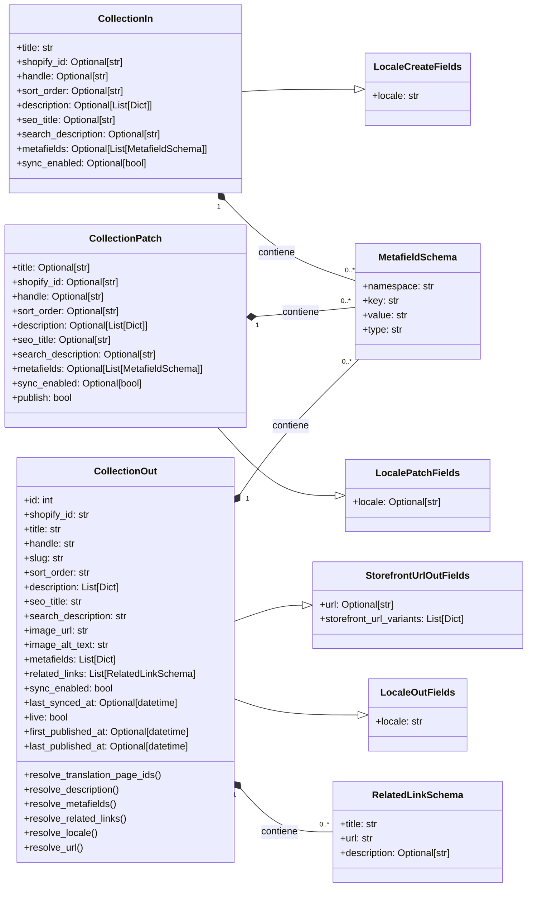
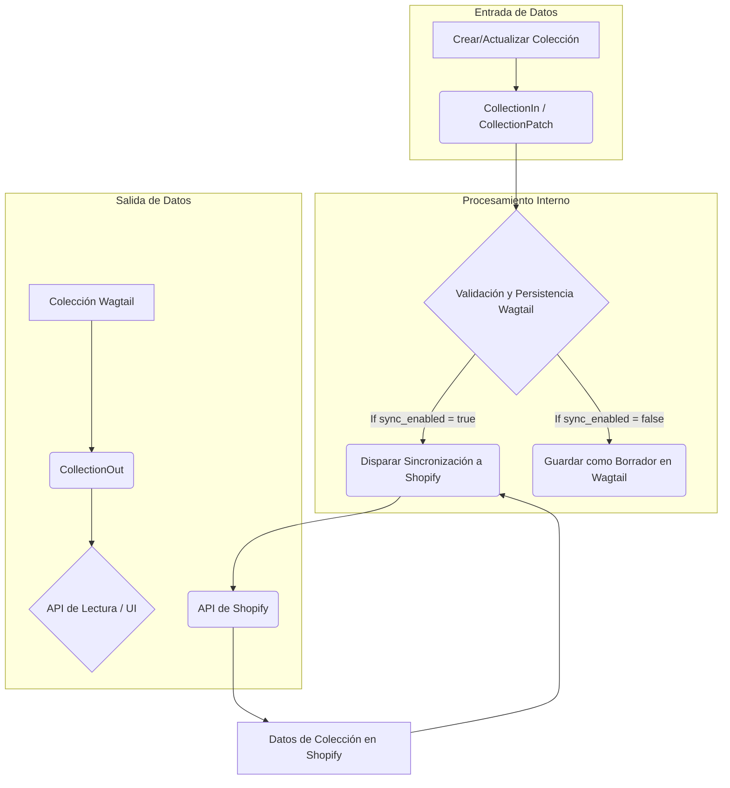

# Esquemas de Contenido para Colecciones de Shopify

Este documento proporciona una visión general completa del módulo `Shopify_API___Schemas_Collection_Content`, que define los esquemas de datos para las colecciones de Shopify. Estos esquemas son fundamentales para la entrada, salida y actualización de datos de colecciones a través de la API.

## Propósito y Funcionalidad Principal

El módulo `Shopify_API___Schemas_Collection_Content` es responsable de tipificar la representación de los datos de las colecciones de Shopify dentro del sistema. Facilita la interacción coherente con la API al validar y estructurar los datos para operaciones de creación, lectura y actualización (CRUD) relacionadas con las colecciones.

Los componentes principales de este módulo son:

*   **`CollectionIn`**: Define la estructura para la creación de nuevas colecciones.
*   **`CollectionOut`**: Representa la estructura de salida de una colección existente, incluyendo datos enriquecidos para la interfaz de usuario y otras integraciones.
*   **`CollectionPatch`**: Especifica los campos que se pueden actualizar en una colección existente.

Estos esquemas garantizan que los datos de las colecciones cumplan con las expectativas tanto del sistema interno como de la API de Shopify, incluyendo la gestión de metacampos, enlaces relacionados y opciones de sincronización.

## Arquitectura y Relaciones entre Componentes

Los esquemas de colección se integran estrechamente con otros módulos de esquemas y componentes de gestión de contenido para proporcionar una funcionalidad robusta.

### Diagrama de Clases de Esquemas de Colección

El siguiente diagrama de clases muestra la relación entre los esquemas `CollectionIn`, `CollectionOut` y `CollectionPatch` y sus esquemas comunes de los que heredan o con los que se componen.

### Diagrama de Flujo de Datos para Colecciones

Este diagrama ilustra el ciclo de vida de los datos de una colección, desde su entrada en el sistema hasta su salida, incluyendo las interacciones con Shopify.

### Relaciones con Otros Módulos

*   **[`Shopify_API___Schemas/Shopify_API___Schemas_Common_Data_Models.md`](Shopify_API___Schemas_Common_Data_Models.md)**: Este módulo proporciona los esquemas base `LocaleCreateFields`, `LocalePatchFields`, `LocaleOutFields`, `StorefrontUrlOutFields`, `MetafieldSchema` y `RelatedLinkSchema` que son heredados o compuestos por los esquemas de colección. Esto asegura la coherencia en la gestión de la localización, metacampos y enlaces en todo el sistema.
*   **[`Shopify_Content_Management/Shopify_Content_Models.md`](../Shopify_Content_Management/Shopify_Content_Models.md)**: El modelo `CollectionPage` definido en este módulo es la representación interna de una colección en Wagtail. Los esquemas `CollectionIn`, `CollectionOut` y `CollectionPatch` se utilizan para serializar y deserializar los datos de y hacia este modelo.
*   **[`Shopify_Content_Management/Content_URL___Semantic_Linking_Logic.md`](../Shopify_Content_Management/Content_URL___Semantic_Linking_Logic.md)**: La lógica para resolver `related_links` en `CollectionOut` depende de la funcionalidad de serialización de enlaces semánticos de este módulo (`shopify_content.semantic_links.serialization.serialize_semantic_links`).

## Cómo Encaja el Módulo en el Sistema General

El módulo `Shopify_API___Schemas_Collection_Content` es una parte integral de la capa de API para la gestión de contenido. Al definir contratos de datos claros y consistentes, permite que otras partes del sistema interactúen con los datos de las colecciones de manera predecible.

*   **API Frontend/Backend**: Los esquemas son utilizados por los puntos finales de la API para recibir solicitudes de creación (`CollectionIn`) y actualización (`CollectionPatch`), y para enviar respuestas de colecciones (`CollectionOut`).
*   **Sincronización de Contenido**: El campo `sync_enabled` en los esquemas de entrada y parcheo juega un papel crucial en el proceso de sincronización de contenido, determinando si los cambios realizados en Wagtail deben propagarse a Shopify. Los campos `shopify_id` y `last_synced_at` en `CollectionOut` reflejan el estado de esta integración.
*   **Experiencia del Usuario (UX)**: Los datos proporcionados por `CollectionOut` son consumidos por las interfaces de usuario (tanto el CMS de Wagtail como cualquier frontend personalizado) para mostrar información de la colección, incluyendo su título, descripción, URL de la tienda, y enlaces relacionados.
*   **SEO**: Los campos `seo_title` y `search_description` permiten la gestión de metadatos SEO directamente a través de los esquemas, lo que es vital para la visibilidad de las colecciones en los motores de búsqueda.
