# Modelos de Datos Comunes de Shopify API - Esquemas

Este módulo, `Shopify_API___Schemas_Common_Data_Models`, define un conjunto de esquemas de datos fundamentales y reutilizables utilizando Pydantic y `ninja.Schema`. Estos esquemas sirven como contratos de datos para diversas operaciones dentro de la API de Shopify, asegurando la estandarización, validación y serialización de la información intercambiada. Abstraen las estructuras de datos comunes utilizadas en la integración con Shopify y en la gestión de contenido, facilitando un desarrollo consistente y robusto.

## Modelos de Datos Principales

A continuación, se describen los esquemas de datos clave definidos en `api/schemas/common.py`:

### RelatedLinkSchema

Define la estructura para un enlace a un recurso relacionado de Shopify, como un producto, colección, blog, artículo, página o metaobjeto.

**Campos clave:**
*   `type`: Tipo de recurso de destino en Shopify (literal: 'product', 'collection', 'blog', 'article', 'page', 'metaobject').
*   `handle`: Identificador del recurso en Shopify.
*   `label`: Etiqueta de visualización para el enlace.
*   `blog_handle`: Requerido cuando `type` es 'article'. Identificador del blog padre.
*   `url_handle`: Requerido cuando `type` es 'metaobject'. Identificador de la URL de la definición del metaobjeto.
*   `shopify_id`: GID del recurso de Shopify cuando está disponible (ej. `gid://shopify/Product/123`).

### ContentReferenceSchema

Esquema para referenciar páginas de Wagtail, típicamente utilizado en las secciones `sections_json` de una `HomePage`.

**Campos clave:**
*   `page_id`: ID de la página de Wagtail (CollectionPage, ProductPage, etc.).
*   `label`: Etiqueta opcional para mostrar.
*   `override_title`: Título opcional para sobrescribir.
*   `override_label`: Etiqueta opcional para sobrescribir.
*   `description`: Descripción opcional.
*   `type`: Tipo de página inferido del modelo de página de Wagtail (producto, colección, artículo, etc.).
*   `shopify_id`: GID de Shopify resuelto en lectura, cuando está disponible.

### ExternalLinkSchema

Define un esquema simple para enlaces externos.

**Campos clave:**
*   `url`: URL externa absoluta.
*   `label`: Etiqueta de visualización para el enlace.

### Esquemas de Localización (Locale Fields)

Estos esquemas manejan los campos relacionados con la localización y traducción del contenido.

*   **LocaleCreateFields**: Campos para crear un nuevo recurso con información de localización.
    *   `locale`: El código de localización.
    *   `translation_of`: ID de la página de Wagtail de la cual este contenido es una traducción.
*   **LocalePatchFields**: Campos para actualizar la información de localización de un recurso existente.
    *   `locale`: El código de localización. Se omite para dejar sin cambios.
    *   `translation_of`: ID de la página de Wagtail de la cual este contenido es una traducción. Se omite para dejar sin cambios.
*   **LocaleOutFields**: Campos de salida para la información de localización, incluyendo las IDs de las páginas de traducción.
    *   `translation_page_ids`: IDs de todas las variantes de localización de la página en este grupo de traducción.

### StorefrontUrlOutFields

Esquema para la salida de URLs del escaparate de Shopify, incluyendo la ruta canónica y las variantes de ruta localizadas.

**Campos clave:**
*   `storefront_path`: Ruta canónica del escaparate de Shopify (ej. `/products/{handle}`).
*   `storefront_urls`: Lista de variantes de ruta URL del escaparate para esta página (prefijos de localización de Markets y canónica). Se rellena desde `ContentUrlIndex` o se calcula.

**Métodos estáticos para resolución de URLs:**
*   `resolve_storefront_path(obj)`: Resuelve la ruta canónica del escaparate para un objeto de página dado, utilizando la función `storefront_path_for_page` del módulo `shopify_content.storefront_urls`.
*   `resolve_storefront_urls(obj)`: Resuelve todas las variantes de URL del escaparate para un objeto de página, utilizando `indexed_paths_for_page` de `shopify_content.content_url_index` y `all_paths_for_page` de `shopify_content.storefront_urls`.

### FAQSchema

Esquema para una pregunta frecuente, que contiene la pregunta y su respuesta.

**Campos clave:**
*   `question`: Texto de la pregunta.
*   `answer`: Texto de la respuesta, puede ser texto plano o HTML.

### MetafieldSchema

Define la estructura para un metafield de Shopify, permitiendo la extensión de los modelos de datos de Shopify.

**Campos clave:**
*   `namespace`: Agrupación del namespace del metafield de Shopify (ej. 'custom', 'global', 'seo').
*   `key`: Clave del metafield dentro del namespace (ej. 'ingredients', 'title_tag').
*   `type`: Tipo de metafield de Shopify que controla la validación y visualización (ej. 'single_line_text_field', 'rich_text_field', 'json').
*   `value`: Valor del metafield como una cadena.

### SyncResultSchema

Representa el resultado de una operación de sincronización con Shopify.

**Campos clave:**
*   `success`: Booleano que indica si la sincronización se completó sin errores.
*   `message`: Descripción del resultado, incluyendo detalles del error si `success` es falso.
*   `shopify_id`: GID de Shopify del recurso sincronizado (ej. `gid://shopify/Product/12345678`). Nulo si el recurso nunca fue vinculado a Shopify.

### ImportResultSchema

Representa el resultado de una operación de importación de datos de Shopify a Wagtail.

**Campos clave:**
*   `created`: Número de nuevas páginas de Wagtail creadas.
*   `updated`: Número de páginas de Wagtail existentes actualizadas.
*   `skipped`: Número de páginas omitidas (cuando se usa `new_only`).
*   `errors`: Número de recursos que no se pudieron importar.
*   `message`: Resumen de la operación de importación.

### ImportTaskSchema

Utilizado para trabajos asíncronos de Celery (administración de Wagtail / aplicación incrustada). **Deprecated para uso en API.**

**Campos clave:**
*   `sync_run_id`: Clave primaria de `ShopifySyncRun` para el seguimiento del estado.
*   `celery_task_id`: ID de la tarea de Celery.
*   `status`: Estado del trabajo (pending, running, success, or failed).
*   `message`: Mensaje de estado legible por humanos.

### ErrorSchema

Un esquema genérico para mensajes de error de la API.

**Campos clave:**
*   `detail`: Mensaje de error legible por humanos que describe lo que salió mal.

### ShopifyImageUrlSchema

Define la estructura para una URL de imagen de Shopify.

**Campos clave:**
*   `shopify_id`: GID de `Shopify MediaImage`.
*   `url`: URL CDN absoluta para `img src`.
*   `alt_text`: Texto alternativo de la imagen.
*   `sort_order`: Orden de visualización (solo para productos).

## Arquitectura y Relaciones de Componentes

El módulo `Shopify_API___Schemas_Common_Data_Models` es un componente central dentro de la capa de esquemas de la API de Shopify. Proporciona bloques de construcción de datos que son utilizados por otros esquemas y endpoints de la API para garantizar la coherencia y la validación de los datos.

### Dependencias Internas

*   **`locale_utils`**: Los esquemas de localización (`LocaleCreateFields`, `LocalePatchFields`, `LocaleOutFields`) dependen de descripciones de campos definidas en `../locale_utils`, lo que indica una capa de utilidad para la gestión de la localización dentro del módulo `api`.

### Interacciones con Otros Módulos

Este módulo tiene dependencias significativas con el módulo [Shopify_Content_Management](../Shopify_Content_Management.md), específicamente con las partes que gestionan la indexación de URLs y las páginas de Wagtail.

*   **`Shopify_Content_Management/Content_URL___Semantic_Linking_Logic`**: El esquema `StorefrontUrlOutFields` se integra directamente con la lógica de resolución de URLs definida en `shopify_content.storefront_urls` y `shopify_content.content_url_index`. Esto asegura que las URLs de escaparate devueltas por la API sean precisas y reflejen la configuración de mercados de Shopify.
*   **`Shopify_Content_Management/Shopify_Content_Models`**: El `ContentReferenceSchema` hace referencia a IDs de páginas de Wagtail (`CollectionPage`, `ProductPage`, etc.), lo que implica una fuerte relación con los modelos de contenido definidos en ese módulo.
*   **`Shopify_Metaobjects`**: Aunque no hay una dependencia directa explícita en el código de los esquemas, el `MetafieldSchema` está diseñado para interactuar con la funcionalidad de metafields de Shopify. Es probable que el módulo [Shopify_Metaobjects](../Shopify_Metaobjects.md) utilice este esquema o esquemas similares para definir y gestionar metaobjetos y metafields de forma más estructurada.
*   **`Shopify_Content_Management/Content_Synchronization___Management_Commands`**: Los esquemas `SyncResultSchema`, `ImportResultSchema` e `ImportTaskSchema` están intrínsecamente ligados a los procesos de sincronización e importación de contenido que se orquestan a través de los comandos de gestión y los trabajos asíncronos en el módulo de gestión de contenido.

## Diagramas

### Diagrama de Clases de Esquemas Comunes

El siguiente diagrama de clases ilustra la estructura de los esquemas de datos definidos en `api/schemas/common.py`.

```mermaid
classDiagram
    direction LR
    class RelatedLinkSchema {
        +type: Literal
        +handle: str
        +label: str
        +blog_handle: Optional[str]
        +url_handle: Optional[str]
        +shopify_id: Optional[str]
    }

    class ContentReferenceSchema {
        +page_id: int
        +label: Optional[str]
        +override_title: Optional[str]
        +override_label: Optional[str]
        +description: Optional[str]
        +type: Optional[str]
        +shopify_id: Optional[str]
    }

    class ExternalLinkSchema {
        +url: str
        +label: str
    }

    class LocaleCreateFields {
        +locale: Optional[str]
        +translation_of: Optional[int]
    }

    class LocalePatchFields {
        +locale: Optional[str]
        +translation_of: Optional[int]
    }

    class LocaleOutFields {
        +translation_page_ids: List[int]
    }

    class StorefrontUrlOutFields {
        +storefront_path: Optional[str]
        +storefront_urls: List[str]
        +resolve_storefront_path()
        +resolve_storefront_urls()
    }

    class FAQSchema {
        +question: str
        +answer: str
    }

    class MetafieldSchema {
        +namespace: str
        +key: str
        +type: str
        +value: str
    }

    class SyncResultSchema {
        +success: bool
        +message: str
        +shopify_id: Optional[str]
    }

    class ImportResultSchema {
        +created: int
        +updated: int
        +skipped: int
        +errors: int
        +message: str
    }

    class ImportTaskSchema {
        +sync_run_id: int
        +celery_task_id: str
        +status: str
        +message: str
    }

    class ErrorSchema {
        +detail: str
    }

    class ShopifyImageUrlSchema {
        +shopify_id: str
        +url: str
        +alt_text: str
        +sort_order: int
    }
```



### Diagrama de Dependencias del Módulo

Este diagrama muestra las dependencias de `Shopify_API___Schemas_Common_Data_Models` con otros módulos del sistema.

```mermaid
graph TD
    A[Shopify_API___Schemas_Common_Data_Models] --> B[api/locale_utils];
    A --> C[Shopify_Content_Management];
    C --> C1[Content_URL___Semantic_Linking_Logic];
    C --> C2[Shopify_Content_Models];
    C --> C3[Content_Synchronization___Management_Commands];
    A --> D[Shopify_Metaobjects];

    subgraph Shopify_Content_Management
        C1
        C2
        C3
    end

    subgraph Shopify_API___Schemas
        A
    end

    subgraph Otros Módulos
        B
        D
    end

    style A fill:#f9f,stroke:#333,stroke-width:2px
    style C fill:#ccf,stroke:#333,stroke-width:1px
    style D fill:#ccf,stroke:#333,stroke-width:1px
