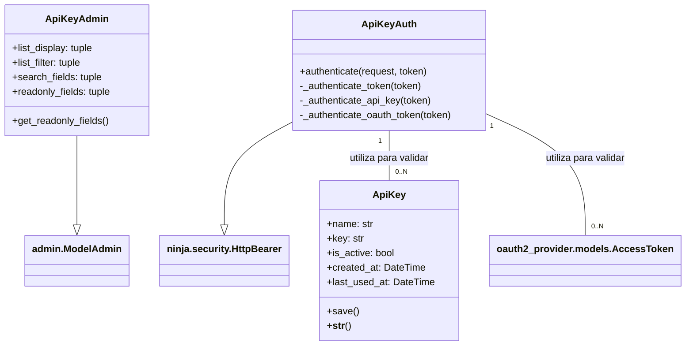
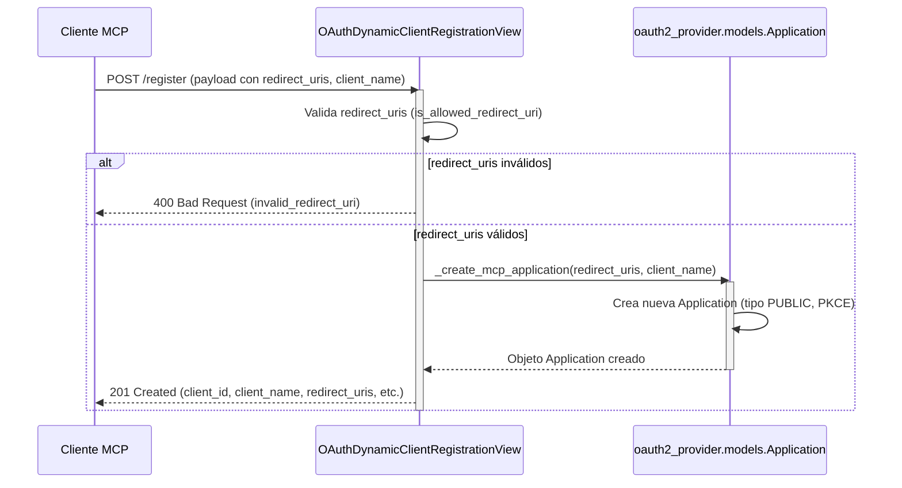

# Autenticación Central del API de Shopify

El módulo `Shopify_API___Schemas_Core_Auth` es fundamental para asegurar las interacciones con el API de Shopify, proporcionando mecanismos robustos para la autenticación de usuarios y aplicaciones. Este módulo gestiona claves API, autenticación basada en sesión para editores del CMS, y la funcionalidad de descubrimiento y registro dinámico de clientes OAuth 2.0.

## Propósito y Funcionalidad Principal

Este módulo tiene como objetivo principal:
*   **Gestión de Claves API**: Permitir la creación y gestión de claves API para autenticación de servicios.
*   **Autenticación de Sesión**: Habilitar el acceso autenticado para usuarios del CMS (editores, staff, superusuarios) a través de sesiones de Django.
*   **Autenticación de Tokens Bearer**: Validar solicitudes API utilizando claves API o tokens de acceso OAuth 2.0.
*   **Registro Dinámico de Clientes OAuth 2.0**: Facilitar que aplicaciones cliente se registren automáticamente y obtengan credenciales para interactuar con el API usando OAuth 2.0 (RFC 7591).
*   **Descubrimiento de OAuth 2.0**: Proporcionar metadatos para que los clientes OAuth descubran los puntos finales y capacidades del servidor de autorización y los recursos protegidos.

## Arquitectura y Relaciones de Componentes

El módulo `Shopify_API___Schemas_Core_Auth` se integra con el framework de Django y `django-oauth-toolkit` para ofrecer un conjunto completo de funcionalidades de autenticación.

### Diagrama de Clases (Gestión de Claves API)


*   `ApiKey`: Modelo de Django que representa una clave API única. Es la entidad central para la autenticación basada en claves.
*   `ApiKeyAdmin`: Interfaz de administración de Django para la gestión de objetos `ApiKey`, permitiendo a los administradores activar/desactivar, nombrar y ver el uso de las claves.
*   `ApiKeyAuth`: Clase de autenticación que valida tokens bearer. Puede autenticar tanto claves API almacenadas en el modelo `ApiKey` como tokens de acceso OAuth 2.0 proporcionados por `django-oauth-toolkit`.

### Flujo de Autenticación Principal

```mermaid
graph TD
    A[Solicitud del Cliente al API] --> B{Cabecera Authorization Bearer?}
    B -- Sí --> C{Es token de sesión?}
    C -- No --> D[ApiKeyAuth]
    C -- Sí (Sesión de Editor) --> E{Usuario es editor CMS?}
    E -- Sí --> F[Autenticación Exitosa (Editor CMS)]
    E -- No --> G[Autenticación Fallida]
    D --> H{Validar ApiKey?}
    H -- Sí --> I[Actualizar last_used_at de ApiKey]
    I --> J[Autenticación Exitosa (ApiKey)]
    H -- No --> K{Validar token OAuth?}
    K -- Sí --> L[Autenticación Exitosa (OAuth Access Token)]
    K -- No --> G
    G --> M[Acceso Denegado (401 Unauthorized)]
```
1.  **Solicitud del Cliente**: El cliente envía una solicitud al API.
2.  **Verificación de Bearer Token**: El sistema verifica si la solicitud incluye una cabecera `Authorization: Bearer <token>`.
3.  **Autenticación de Sesión (SessionEditorAuth)**: Si no es un token bearer explícito o para ciertas rutas, `SessionEditorAuth` intenta autenticar al usuario basándose en la sesión de Django. Si el usuario está autenticado como editor del CMS (staff, superusuario o miembro del grupo `cms_editors`), la autenticación es exitosa.
4.  **Autenticación de Clave API (ApiKeyAuth)**: Si no se autentica por sesión o si se usa un token bearer:
    *   `ApiKeyAuth` primero intenta validar el token como una `ApiKey` activa. Si tiene éxito, actualiza `last_used_at` de la clave.
    *   Si no es una `ApiKey`, intenta validar el token como un `AccessToken` de OAuth 2.0 (gestionado por `django-oauth-toolkit`), comprobando los ámbitos requeridos (`MCP_OAUTH_REQUIRED_SCOPES`).
5.  **Resultado**: Si alguna de las autenticaciones es exitosa, se concede el acceso. De lo contrario, la solicitud es denegada con un error 401 Unauthorized.

### Flujo de Registro Dinámico de Clientes OAuth 2.0


*   **Cliente MCP**: Una aplicación de cliente que necesita interactuar con el API de Shopify.
*   **`OAuthDynamicClientRegistrationView`**: Recibe una solicitud POST para registrar un nuevo cliente. Valida los `redirect_uris` proporcionados contra una lista blanca.
*   **`oauth2_provider.models.Application`**: Si los `redirect_uris` son válidos, se crea una nueva instancia de `Application` en la base de datos, configurada como cliente público (PKCE) sin secreto de cliente.
*   **Respuesta**: El cliente recibe los detalles del `client_id` y otra información de registro necesaria.

### Descubrimiento de Metadatos OAuth

El módulo expone dos puntos finales importantes para el descubrimiento de metadatos de OAuth:
*   `oauth_authorization_server_metadata`: (Función auxiliar) Proporciona metadatos estándar del servidor de autorización OAuth 2.0, incluyendo `issuer`, `authorization_endpoint`, `token_endpoint`, `registration_endpoint` y `scopes_supported`.
*   `OAuthProtectedResourceMetadataView`: Sirve metadatos específicos del recurso protegido (`/api/v1/mcp`), indicando los servidores de autorización asociados y los ámbitos soportados.

## Componentes Clave

*   `api/admin.py::ApiKeyAdmin`
    *   **Descripción**: Clase de administración de Django para el modelo `ApiKey`. Permite a los administradores gestionar claves API a través de la interfaz de administración de Django, incluyendo la visualización, activación/desactivación y seguimiento del último uso.
    *   **Uso**: Registrado para el modelo `ApiKey` para proporcionar una interfaz de usuario para la gestión de claves.

*   `api/apps.py::ApiConfig`
    *   **Descripción**: Configuración de la aplicación Django para el módulo `api`. Define el nombre de la aplicación y la configuración de campo `default_auto_field`. También importa `api.ninja_compat` y `api.wagtail_hooks` en el método `ready()` para asegurar que se carguen las configuraciones y señales relacionadas.
    *   **Relación**: Es el punto de entrada de configuración para toda la aplicación `api`.

*   `api/auth.py::ApiKeyAuth`
    *   **Descripción**: Una clase de autenticación `HttpBearer` (del framework `django-ninja`) que implementa la lógica para validar tokens bearer. Busca el token tanto en el modelo `ApiKey` como en los tokens de acceso de OAuth 2.0 (`django-oauth-toolkit`).
    *   **Uso**: Se utiliza en `API_AUTH` para proteger puntos finales API que requieren autenticación con clave API o token OAuth.

*   `api/auth.py::SessionEditorAuth`
    *   **Descripción**: Una clase de autenticación `SessionAuth` (del framework `django-ninja`) que permite la autenticación para usuarios autenticados del CMS (staff, superusuarios o miembros del grupo `cms_editors`) a través de la sesión de Django.
    *   **Uso**: Se utiliza en `API_AUTH` para proteger puntos finales API accesibles por editores del CMS desde el mismo origen.

*   `api/migrations/0001_initial.py::Migration`
    *   **Descripción**: La migración inicial de la base de datos para el módulo `api`. Crea la tabla para el modelo `ApiKey`, definiendo sus campos como `name`, `key`, `is_active`, `created_at` y `last_used_at`.
    *   **Relación**: Define la estructura de la base de datos para la gestión de claves API.

*   `api/models.py::ApiKey`
    *   **Descripción**: Modelo de Django que representa una clave API. Incluye campos para un nombre descriptivo, la clave generada de forma segura, un indicador de actividad, y marcas de tiempo de creación y último uso. El método `save()` genera automáticamente una clave segura si no se proporciona una.
    *   **Relación**: Es el modelo de datos subyacente para la funcionalidad de `ApiKeyAdmin` y `ApiKeyAuth`.

*   `api/models.py::ApiKey.Meta`
    *   **Descripción**: Clase meta interna para el modelo `ApiKey` que define opciones a nivel de modelo, como `verbose_name` y `verbose_name_plural` para la interfaz de administración.

*   `api/oauth_discovery.py::OAuthProtectedResourceMetadataView`
    *   **Descripción**: Una vista de Django que proporciona metadatos para el recurso protegido de OAuth 2.0, permitiendo a los clientes descubrir cómo acceder a los recursos protegidos (por ejemplo, el endpoint del API `mcp`). Incluye información sobre los servidores de autorización y los ámbitos soportados.
    *   **Uso**: Accesible públicamente por clientes OAuth para configuración automática.

*   `api/oauth_registration.py::OAuthDynamicClientRegistrationView`
    *   **Descripción**: Una vista de Django que implementa el estándar RFC 7591 para el registro dinámico de clientes OAuth 2.0. Permite a los clientes públicos (usando PKCE) registrarse en el sistema, proporcionando `redirect_uris` válidos.
    *   **Uso**: Punto final al que los clientes de terceros (como los agentes de Cursor/Claude) pueden enviar solicitudes para registrarse y obtener un `client_id`.

## Cómo el Módulo Encaja en el Sistema General

El módulo `Shopify_API___Schemas_Core_Auth` es un pilar de seguridad y accesibilidad para el API de Shopify.

*   **Integración con el API de Contenido (Shopify_API___Schemas)**: Este módulo proporciona las capas de seguridad para el API de contenido, asegurando que solo los clientes y usuarios autorizados puedan acceder a los esquemas y datos definidos en otros submódulos de `Shopify_API___Schemas`. Por ejemplo, los agentes de IA o las aplicaciones cliente que interactúan con esquemas como [Shopify_API___Schemas_Article_Content](Shopify_API___Schemas_Article_Content.md) o [Shopify_API___Schemas_Product_Content](Shopify_API___Schemas_Product_Content.md) se autenticarán a través de este módulo.
*   **Gestión de Agentes (Shopify_API___Schemas_Agent_Capabilities)**: La autenticación de `ApiKeyAuth` es crucial para la integración con los agentes de IA, como los de Cursor o Claude, que se describen en [Shopify_API___Schemas_Agent_Capabilities](Shopify_API___Schemas_Agent_Capabilities.md). Estos agentes usarán las claves API o tokens OAuth gestionados por este módulo para acceder a las capacidades del API.
*   **Interacción con el CMS (Shopify_Content_Management)**: `SessionEditorAuth` es vital para los usuarios que acceden al CMS, probablemente interactuando con las funciones de edición y sincronización de contenido descritas en [Shopify_Content_Management](../Shopify_Content_Management.md).
*   **Base para OAuth 2.0**: Al integrarse con `django-oauth-toolkit`, este módulo proporciona los puntos finales de OAuth 2.0 necesarios para aplicaciones externas, habilitando flujos de autorización modernos y seguros.
*   **Configuración del Sistema**: La `ApiConfig` asegura que la aplicación `api` esté correctamente configurada dentro del proyecto Django, cargando cualquier integración adicional necesaria (como `api.ninja_compat` y `api.wagtail_hooks`).

En resumen, este módulo establece el marco de confianza y acceso para todo el ecosistema del API de Shopify, controlando quién puede interactuar con los datos y funcionalidades del sistema.