# Contenido del Glosario de Schemas de la API de Shopify

Este documento describe el módulo `Shopify_API___Schemas_Glossary_Content`, que define los esquemas Pydantic para la gestión de términos de glosario a través de la API. Estos esquemas son cruciales para la interacción entre los servicios de frontend/cliente y el backend del sistema de gestión de contenido, facilitando las operaciones CRUD (Crear, Leer, Actualizar, Eliminar) para los términos del glosario.

## Propósito y Funcionalidad Principal

El módulo `Shopify_API___Schemas_Glossary_Content` proporciona un conjunto estandarizado de modelos de datos para representar términos de glosario. Estos modelos aseguran que los datos intercambiados con la API sean consistentes y válidos, soportando la creación, modificación y recuperación de términos de glosario con sus atributos asociados, como definiciones, enlaces relacionados, metadatos SEO e información de sincronización con Shopify. Constituye la interfaz de datos para la gestión de la página `GlossaryTermPage` dentro de Wagtail, como se describe en [Modelos de Contenido de Shopify_Content](../Shopify_Content_Management/Shopify_Content_Models.md).

## Modelos de Datos (Esquemas Pydantic)

Los siguientes esquemas Pydantic definen la estructura de los datos para los términos del glosario:

### `GlossaryTermIn`

Este esquema se utiliza para la creación de nuevos términos de glosario. Define los campos que se esperan cuando se envía una solicitud POST a la API para añadir un nuevo término. Hereda de `LocaleCreateFields` para la gestión de la localización. Los campos clave incluyen:

*   `term`: El texto del término del glosario, también utilizado como título de la página Wagtail.
*   `shopify_id`: El GID del metaobjeto de Shopify, se rellena automáticamente después de la primera sincronización.
*   `handle`: El *slug* de la URL del metaobjeto de Shopify, se genera por defecto a partir del término.
*   `definition`: El contenido de la definición del término en formato HTML *rich text*.
*   `image_id`: El ID de la imagen de Wagtail asociada al término.
*   `shopify_image_id`: El GID del archivo/imagen multimedia de Shopify para la imagen del metaobjeto.
*   `seo_title`: Título SEO de la página.
*   `search_description`: Meta descripción SEO.
*   `locale_code`: Código de idioma de Shopify ('en', 'es', 'fr').
*   `related_links`: Enlaces internos a otros contenidos (productos, colecciones, artículos, metaobjetos).
*   `external_links`: Enlaces de referencia externos.
*   `synonyms`: Sinónimos, acrónimos o variantes del término.
*   `same_as`: URLs de entidades externas canónicas.
*   `sync_enabled`: Indica si la publicación activa la sincronización saliente con Shopify.
*   `parent_page_id`: ID de la página padre de Wagtail, normalmente `ShopifyRootPage` con slug `glossary`.

### `GlossaryTermPatch`

Este esquema se utiliza para la actualización parcial de términos de glosario existentes. Permite modificar campos específicos sin tener que enviar el objeto completo. Hereda de `LocalePatchFields` para la gestión de la localización. Incluye campos similares a `GlossaryTermIn`, pero todos son opcionales, permitiendo actualizaciones incrementales. Además, introduce el campo `publish` para controlar la publicación del término.

### `GlossaryTermListOut`

Este esquema define la estructura de los datos devueltos cuando se solicita una lista de términos del glosario. Proporciona una vista resumida de cada término, ideal para listados o tablas. Los campos clave son:

*   `id`: ID de la página Wagtail.
*   `shopify_id`: GID del metaobjeto de Shopify (vacío si no se ha sincronizado).
*   `term`: Texto del término del glosario.
*   `handle`: *Slug* del metaobjeto de Shopify.
*   `slug`: *Slug* de la página Wagtail.
*   `locale_code`: Código de idioma de Shopify.
*   `live`: Indica si el término está publicado en Wagtail.
*   `last_synced_at`: Marca de tiempo UTC de la última sincronización exitosa con Shopify.

### `GlossaryTermOut`

Este esquema define la representación completa de un término de glosario cuando se recupera individualmente. Proporciona todos los detalles asociados al término, incluyendo URLs de la tienda y campos de localización, heredando de `StorefrontUrlOutFields` y `LocaleOutFields`. Incluye la lógica para resolver la URL de la imagen, expandir el *rich text* de la definición, y serializar los enlaces relacionados y externos. Los campos clave son:

*   `id`: ID de la página Wagtail.
*   `shopify_id`: GID del metaobjeto de Shopify.
*   `term`: Texto del término del glosario.
*   `title`: Título de la página Wagtail (refleja el término).
*   `handle`: *Slug* del metaobjeto de Shopify.
*   `slug`: *Slug* de la página Wagtail.
*   `definition`: HTML de la definición (con referencias Wagtail expandidas).
*   `image_id`: ID de la imagen de Wagtail.
*   `image_url`: URL absoluta de la imagen CDN de Shopify.
*   `image_alt_text`: Texto alternativo de la imagen.
*   `shopify_image_id`: GID del archivo/imagen multimedia de Shopify.
*   `seo_title`: Título SEO.
*   `search_description`: Meta descripción SEO.
*   `locale_code`: Código de idioma de Shopify.
*   `related_links`: Enlaces internos resueltos (manuales + automáticos).
*   `external_links`: Enlaces externos sincronizados con Shopify.
*   `synonyms`: Sinónimos sincronizados con Shopify.
*   `same_as`: URLs `same-as` sincronizadas con Shopify.
*   `sync_enabled`: Estado de la sincronización saliente.
*   `last_synced_at`: Marca de tiempo de la última sincronización.
*   `live`: Indica si el término está publicado en Wagtail.
*   `locale`: Código de idioma de Shopify (refleja `locale_code`).
*   `url`: URL pública de la página (si el sitio está configurado).
*   `first_published_at`: Marca de tiempo de la primera publicación.
*   `last_published_at`: Marca de tiempo de la publicación más reciente.

## Arquitectura y Relaciones de Componentes

El módulo `Shopify_API___Schemas_Glossary_Content` se integra en la capa de API de `Shopify_API___Schemas` y depende de varios componentes para su funcionalidad. La siguiente arquitectura muestra cómo se relaciona con otros módulos y esquemas:

```mermaid
graph TD
    subgraph Shopify_API___Schemas
        subgraph Shopify_API___Schemas_Glossary_Content
            GlossaryTermIn[GlossaryTermIn] --> GlossaryTermOut
            GlossaryTermPatch[GlossaryTermPatch] --> GlossaryTermOut
            GlossaryTermListOut[GlossaryTermListOut]
            GlossaryTermOut[GlossaryTermOut]
        end
        GlossaryTermIn -- hereda --> LocaleCreateFields
        GlossaryTermPatch -- hereda --> LocalePatchFields
        GlossaryTermOut -- hereda --> StorefrontUrlOutFields
        GlossaryTermOut -- hereda --> LocaleOutFields
    end

    subgraph Shopify_Content_Management
        GlossaryTermPage[shopify_content/models/glossary.py::GlossaryTermPage]
        ContentStore[Content Store]
        SemanticLinks[Semantic Links Service]
    end

    LocaleCreateFields[api/schemas/common.py::LocaleCreateFields]
    LocalePatchFields[api/schemas/common.py::LocalePatchFields]
    LocaleOutFields[api/schemas/common.py::LocaleOutFields]
    RelatedLinkSchema[api/schemas/common.py::RelatedLinkSchema]
    ExternalLinkSchema[api/schemas/common.py::ExternalLinkSchema]
    StorefrontUrlOutFields[api/schemas/common.py::StorefrontUrlOutFields]

    GlossaryTermOut -- resuelve datos de --> GlossaryTermPage
    GlossaryTermOut -- utiliza --> RelatedLinkSchema
    GlossaryTermOut -- utiliza --> ExternalLinkSchema
    GlossaryTermIn -- utiliza --> RelatedLinkSchema
    GlossaryTermIn -- utiliza --> ExternalLinkSchema
    GlossaryTermPatch -- utiliza --> RelatedLinkSchema
    GlossaryTermPatch -- utiliza --> ExternalLinkSchema

    GlossaryTermPage -- gestionado por --> ContentStore
    GlossaryTermPage -- enlaces a --> SemanticLinks

    click GlossaryTermPage "Shopify_Content_Management/Shopify_Content_Models.md"
    click LocaleCreateFields "Shopify_API___Schemas/Shopify_API___Schemas_Common_Data_Models.md"
    click LocalePatchFields "Shopify_API___Schemas/Shopify_API___Schemas_Common_Data_Models.md"
    click LocaleOutFields "Shopify_API___Schemas/Shopify_API___Schemas_Common_Data_Models.md"
    click RelatedLinkSchema "Shopify_API___Schemas/Shopify_API___Schemas_Common_Data_Models.md"
    click ExternalLinkSchema "Shopify_API___Schemas/Shopify_API___Schemas_Common_Data_Models.md"
    click StorefrontUrlOutFields "Shopify_API___Schemas/Shopify_API___Schemas_Common_Data_Models.md"
```

## Integración con el Sistema General

Los esquemas de glosario son una parte integral del sistema de gestión de contenido de Shopify y se integran de la siguiente manera:

1.  **Capa de API**: Estos esquemas son consumidos por los puntos finales de la API que exponen la funcionalidad CRUD para los términos del glosario. Las solicitudes entrantes se validan contra `GlossaryTermIn` o `GlossaryTermPatch`, y las respuestas salientes se formatean utilizando `GlossaryTermListOut` o `GlossaryTermOut`.
2.  **Modelos de Contenido de Wagtail**: Los esquemas se mapean directamente a los modelos de página de Wagtail, específicamente `GlossaryTermPage` (ver [Modelos de Contenido de Shopify_Content](../Shopify_Content_Management/Shopify_Content_Models.md)). La información contenida en los esquemas se utiliza para crear, actualizar y recuperar instancias de `GlossaryTermPage`.
3.  **Sincronización con Shopify**: El campo `shopify_id` y otros campos específicos de Shopify en los esquemas (`handle`, `shopify_image_id`, `locale_code`, `seo_title`, `search_description`, `synonyms`, `same_as`) facilitan la sincronización de los términos del glosario como metaobjetos en la plataforma Shopify. La activación de `sync_enabled` en la publicación asegura que los cambios se reflejen en Shopify.
4.  **Enlaces Semánticos y Relacionados**: Los campos `related_links` y `external_links` permiten la creación de conexiones ricas entre los términos del glosario y otros contenidos dentro y fuera de Shopify. La resolución de `related_links` en `GlossaryTermOut` utiliza servicios de enlaces semánticos, como se describe en [Lógica de Enlaces Semánticos y URL de Contenido](../Shopify_Content_Management/Content_URL___Semantic_Linking_Logic.md).
5.  **Localización**: La herencia de `LocaleCreateFields`, `LocalePatchFields` y `LocaleOutFields` garantiza que los términos del glosario puedan gestionarse en diferentes idiomas, con `locale_code` indicando la configuración regional de Shopify para la sincronización.

En resumen, este módulo actúa como un contrato de datos fundamental para la gestión de contenido del glosario, asegurando la integridad de los datos y la interoperabilidad en todo el ecosistema de Shopify.