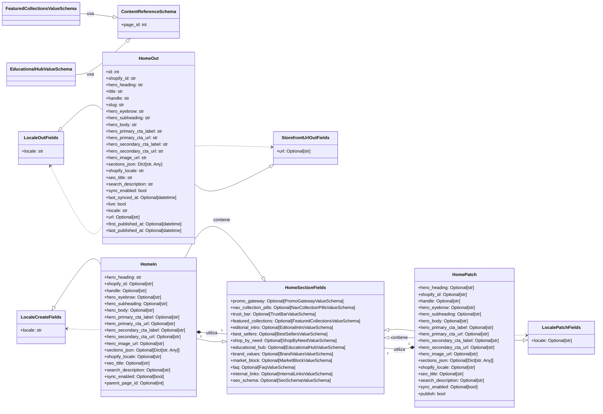
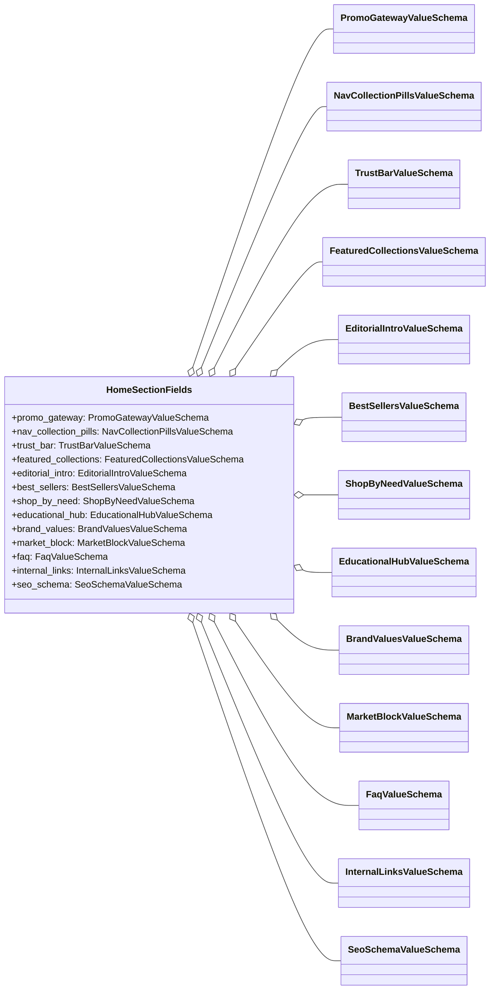
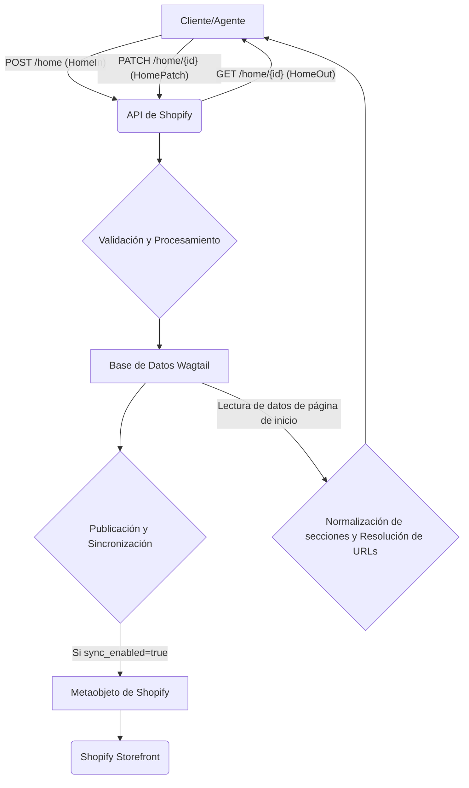

# Contenido de la Página de Inicio de Shopify API Schemas

Este módulo define los esquemas de datos utilizados para gestionar el contenido de las páginas de inicio dentro de la API de Shopify. Proporciona estructuras para la entrada, salida y actualización de los datos de la página de inicio, incluyendo varias secciones configurables que componen el diseño de la página de inicio.

## Propósito y Funcionalidad Principal

El módulo `Shopify_API___Schemas_Home_Content` se centra en la serialización y deserialización de los datos de la página de inicio. Define la estructura de los datos que pueden ser enviados a la API para crear o actualizar una página de inicio, y la estructura de los datos que son devueltos por la API.

Los componentes principales son:

*   `HomeIn`: Define el esquema para la entrada de datos al crear una nueva página de inicio o para la actualización completa. Incluye campos para el contenido principal (como el encabezado y el cuerpo del héroe), los campos de localización y las distintas secciones de la página de inicio.
*   `HomeOut`: Representa el esquema de salida de datos para una página de inicio. Contiene todos los campos de `HomeIn` junto con campos de solo lectura como `id`, `shopify_id`, `handle`, `slug`, `last_synced_at` y `url` de la página publicada.
*   `HomePatch`: Especifica el esquema para la actualización parcial de una página de inicio. Permite enviar solo los campos que necesitan ser modificados, haciendo que las operaciones de actualización sean más flexibles.
*   `HomeSectionFields`: Es un esquema base que agrupa todos los tipos de secciones configurables de la página de inicio. Estos campos de "primera clase" permiten a los agentes enviar directamente los datos de una sección para su fusión en el `sections_json` de la página.
*   `*ValueSchema`: Una serie de esquemas individuales (por ejemplo, `BestSellersValueSchema`, `EditorialIntroValueSchema`) que definen la estructura de datos para cada tipo específico de sección de la página de inicio.

## Arquitectura y Relaciones entre Componentes

Los esquemas de la página de inicio (`HomeIn`, `HomeOut`, `HomePatch`) se construyen a partir de esquemas comunes, lo que promueve la reutilización y consistencia de los datos en toda la API de Shopify.

### Relaciones de Herencia y Composición

Los esquemas de la sección de la página de inicio son un conjunto de esquemas de valor que definen la estructura de cada componente de la página de inicio.

### Dependencias Externas

*   **Esquemas Comunes**: Los esquemas de la página de inicio dependen de los esquemas definidos en `api/schemas/common.py` para campos de localización (`LocaleCreateFields`, `LocalePatchFields`, `LocaleOutFields`) y URLs de la tienda (`StorefrontUrlOutFields`, `ContentReferenceSchema`). Para más detalles, consulte [Shopify_API___Schemas_Common_Data_Models.md](Shopify_API___Schemas_Common_Data_Models.md).
*   **Wagtail**: Las descripciones de los campos `RICH_TEXT_DESCRIPTION` y `SECTIONS_JSON_WRITE_DESCRIPTION` mencionan la integración con Wagtail. El campo `hero_body` utiliza `expand_db_html` de `wagtail.rich_text` para expandir referencias internas de Wagtail a URLs. `HomeOut` también resuelve `title` y `url` de un objeto Wagtail.
*   **Normalización de Secciones de Inicio**: `HomeOut` utiliza `normalize_sections_json` de `shopify_content.home_sections_normalization` para asegurar que el `sections_json` de salida tenga un formato consistente.
*   **Utilidades de Localización**: `HomeOut` resuelve `translation_page_ids` utilizando `resolve_translation_page_ids` de `api.locale_utils`.

### Flujo de Datos y Proceso

El flujo de datos para la gestión del contenido de la página de inicio sigue un patrón de RESTful API:

1.  **Creación/Actualización (Entrada)**: Un cliente (como un agente) envía datos al endpoint `/home`. Para una nueva página, se utiliza el esquema `HomeIn`. Para actualizaciones parciales, se utiliza `HomePatch`. Los campos de las secciones de la página de inicio pueden enviarse directamente a través de los campos de "primera clase" definidos en `HomeSectionFields`, o como un objeto `sections_json` más genérico. La API fusionará estos datos con los valores existentes y los normalizará.
2.  **Procesamiento Interno**: Los datos recibidos son validados contra los esquemas. Para los campos de texto enriquecido, las referencias internas de Wagtail se manejan adecuadamente. Si `sync_enabled` es `True`, la publicación de la página de inicio activará una sincronización saliente con el metaobjeto de Shopify.
3.  **Consulta (Salida)**: Cuando un cliente solicita los datos de una página de inicio, se devuelve una respuesta con el esquema `HomeOut`. Este esquema presenta los datos de la página de inicio en un formato enriquecido, incluyendo URLs generadas, títulos resueltos y el `sections_json` normalizado.

## Cómo encaja el módulo en el sistema general

El módulo `Shopify_API___Schemas_Home_Content` es una parte crucial de la capa API que permite la gestión programática del contenido de la página de inicio para una tienda Shopify.

*   **Integración con Shopify API**: Sirve como la interfaz de contrato de datos para interactuar con los metaobjetos de Shopify relacionados con el contenido de la página de inicio. Esto facilita que los sistemas externos (como los agentes o las herramientas de automatización) puedan crear, actualizar y recuperar el contenido de la página de inicio de manera estandarizada.
*   **Integración con Wagtail CMS**: Los esquemas están diseñados teniendo en cuenta el backend de Wagtail CMS. Esto se evidencia por el uso de `Wagtail page ID`, la expansión de `Wagtail rich text` y la referencia a `ShopifyRootPage`. El módulo actúa como un puente, traduciendo entre el modelo de datos interno de Wagtail y el formato de API externo deseado para Shopify.
*   **Sincronización de Contenido**: El campo `sync_enabled` y la referencia a `shopify_content.home_sections_normalization` indican que este módulo es un componente integral del sistema de sincronización de contenido entre Wagtail y Shopify. Garantiza que los cambios realizados a través de la API se reflejen correctamente en la tienda Shopify.
*   **Reutilización de Esquemas**: Al heredar de esquemas comunes ([Shopify_API___Schemas_Common_Data_Models.md](Shopify_API___Schemas_Common_Data_Models.md)), se asegura la coherencia en la representación de datos como la localización y las URLs en toda la API, lo que reduce la duplicación y mejora la mantenibilidad.
*   **Experiencia de Usuario (Home Sections)**: La granularidad proporcionada por `HomeSectionFields` y los esquemas de valores individuales permite una gestión detallada de cada componente visual y funcional de la página de inicio. Esto es esencial para construir experiencias de usuario ricas y personalizables en la tienda.
