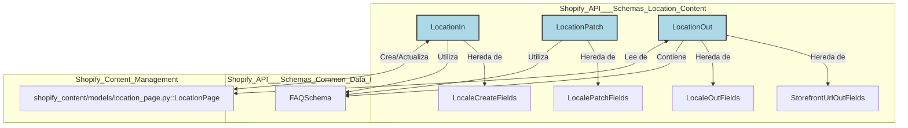

# Contenido de Ubicación del Esquema de la API de Shopify

Este módulo define los esquemas de datos para gestionar el contenido de ubicaciones dentro del sistema Shopify. Proporciona estructuras para la creación, recuperación y actualización de información de ubicaciones, asegurando una interacción de datos consistente con la API de Shopify. Se basa en esquemas comunes para campos de localización y URLs de escaparate, y utiliza tipos de campos enriquecidos para descripciones y contenido. En este documento se detallan los esquemas `LocationIn`, `LocationOut` y `LocationPatch`.

## Arquitectura y Relaciones de Componentes

Los esquemas de ubicación (`LocationIn`, `LocationOut`, `LocationPatch`) forman parte del conjunto de esquemas de la API de Shopify, que residen en `api/schemas/`. Estos esquemas son fundamentales para la serialización y deserialización de datos cuando se interactúa con los puntos finales de la API relacionados con ubicaciones. Se integran con el módulo [Shopify_Content_Management/Shopify_Content_Models.md](../Shopify_Content_Management/Shopify_Content_Models.md) a través del modelo `LocationPage`, que representa una página de ubicación en Wagtail y se sincroniza con los metaobjetos de Shopify.

El módulo depende de los esquemas definidos en [Shopify_API___Schemas/Shopify_API___Schemas_Common_Data_Models.md](Shopify_API___Schemas_Common_Data_Models.md) para campos comunes como `FAQSchema`, `LocaleCreateFields`, `LocalePatchFields`, `LocaleOutFields` y `StorefrontUrlOutFields`.

## Esquemas de Ubicación

### `LocationIn`

El esquema `LocationIn` se utiliza para la creación inicial de un objeto de ubicación. Define los campos requeridos y opcionales para la entrada de datos. Hereda de `LocaleCreateFields` de `common.py`.

**Campos Clave:**

*   `titulo`: Título principal de la página de ubicación, también utilizado como `Page.title` de Wagtail.
*   `shopify_id`: GID del metaobjeto de Shopify (opcional, generado automáticamente).
*   `handle`: Ignorado, se deriva automáticamente.
*   `subtitulo`: Subtítulo del héroe.
*   `intro`, `content_2`, `content_3`, `brand_section_content`, `map_content`, `after_page_content`: Campos de texto enriquecido HTML.
*   `country`, `state`, `city`: Información geográfica.
*   `shopify_locale`: Campo de localización del metaobjeto de Shopify.
*   `seo_title`, `search_description`: Campos para SEO.
*   `faqs`: Lista de preguntas frecuentes utilizando `FAQSchema`.
*   `sync_enabled`: Booleano para habilitar la sincronización con Shopify.
*   `parent_page_id`: ID de la página padre de Wagtail.

### `LocationPatch`

El esquema `LocationPatch` se utiliza para actualizaciones parciales de un objeto de ubicación existente. Todos los campos son opcionales, permitiendo la modificación de atributos específicos sin afectar a los demás. Hereda de `LocalePatchFields` de `common.py`.

**Campos Clave (todos opcionales para actualización):**

*   `titulo`: Actualiza el título principal.
*   `shopify_id`: Establece o actualiza el GID del metaobjeto de Shopify.
*   `handle`: Ignorado (solo lectura).
*   `intro`, `content_2`, `content_3`, `brand_section_content`, `map_content`, `after_page_content`: Actualiza el contenido de texto enriquecido.
*   `country`, `state`, `city`: Actualiza la información geográfica.
*   `shopify_locale`: Actualiza la localización de Shopify.
*   `seo_title`, `search_description`: Actualiza los campos de SEO.
*   `faqs`: Reemplaza todas las preguntas frecuentes (pasar `[]` para borrar).
*   `sync_enabled`: Habilita o deshabilita la sincronización.
*   `publish`: Booleano para publicar después de guardar.

### `LocationOut`

El esquema `LocationOut` representa la estructura de salida de un objeto de ubicación cuando se recupera de la API. Incluye todos los campos de datos, así como metadatos adicionales y URLs. Hereda de `StorefrontUrlOutFields` y `LocaleOutFields` de `common.py`.

**Campos Clave:**

*   `id`: ID de la página de Wagtail.
*   `shopify_id`: GID del metaobjeto de Shopify.
*   `titulo`: Título principal (héroe).
*   `title`: Título de la página de Wagtail (espejo de `titulo`).
*   `handle`, `slug`: Identificadores derivados de la localización y la ciudad.
*   `subtitulo`, `intro`, `country`, `state`, `city`, `titulo_2`, `subtitulo_h2`, `content_2`, `titulo_3`, `subtitulo_3`, `content_3`, `brand_section_title`, `brand_section_subtitle`, `brand_section_content`, `map_title`, `map_content`, `after_page_content`: Todos los campos de contenido y metadatos.
*   `shopify_locale`, `seo_title`, `search_description`: Campos de localización y SEO.
*   `faqs`: Lista de preguntas frecuentes.
*   `sync_enabled`: Estado de sincronización.
*   `last_synced_at`: Marca de tiempo de la última sincronización exitosa.
*   `live`: Booleano que indica si está publicado en Wagtail.
*   `locale`: Código de localización de Wagtail.
*   `url`: URL pública de la página.
*   `first_published_at`, `last_published_at`: Marcas de tiempo de publicación.

**Métodos Estáticos para Resolución:**

*   `resolve_translation_page_ids`: Resuelve IDs de páginas de traducción.
*   `_expand_richtext`: Expande el HTML de texto enriquecido.
*   `resolve_intro`, `resolve_content_2`, `resolve_content_3`, `resolve_brand_section_content`, `resolve_map_content`, `resolve_after_page_content`: Resuelven campos de texto enriquecido expandiendo el HTML.
*   `resolve_faqs`: Resuelve los elementos de preguntas frecuentes.
*   `resolve_locale`: Resuelve el código de localización de Wagtail.
*   `resolve_url`: Resuelve la URL pública de la página.
*   `resolve_title`: Resuelve el título de la página de Wagtail.
