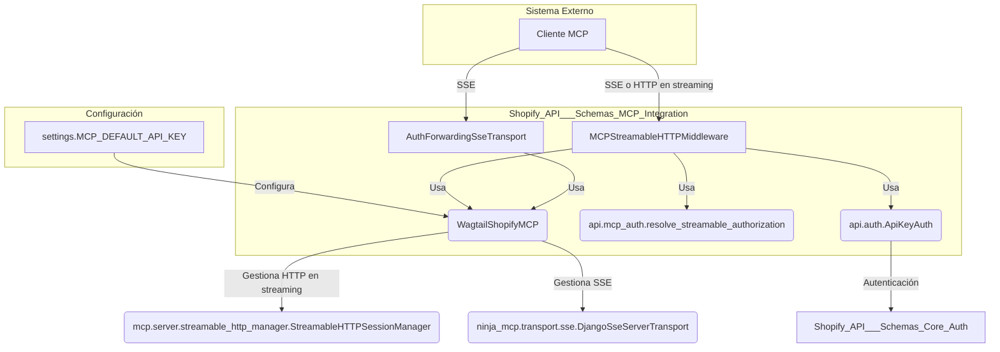
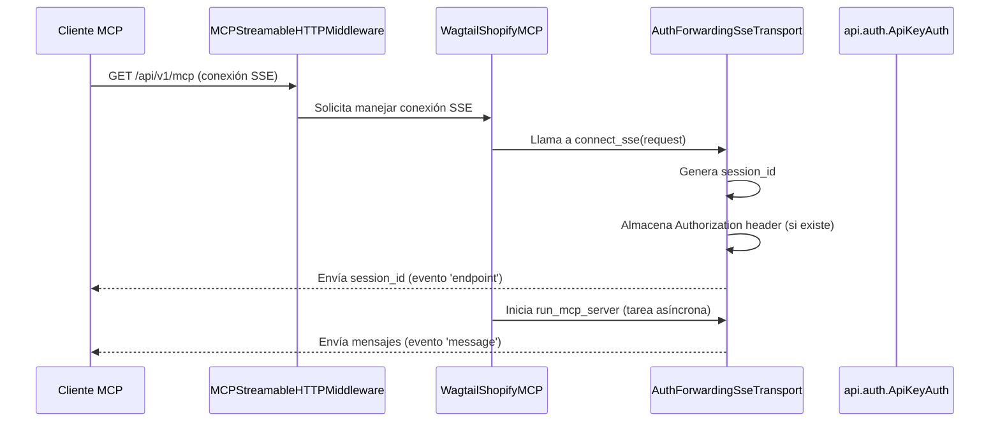
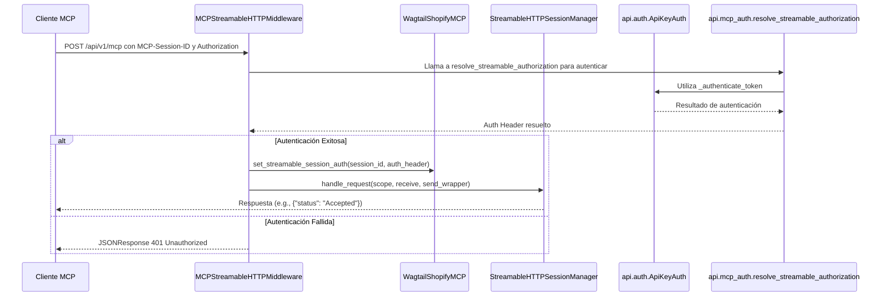

# Integración MCP de Shopify API Schemas

Este documento detalla el módulo `Shopify_API___Schemas_MCP_Integration`, que facilita la comunicación entre la aplicación y el Content API de Shopify (MCP - Micro-Content Platform) utilizando tanto Server-Sent Events (SSE) como el transporte HTTP en streaming. Este módulo es crucial para la sincronización y gestión de contenido, permitiendo una interacción fluida y autenticada con la plataforma de contenido de Shopify.

## Componentes Principales

### AuthForwardingSseTransport
Este componente extiende `DjangoSseServerTransport` y es responsable de gestionar las conexiones SSE. Su característica principal es la capacidad de almacenar y reenviar encabezados de autorización por sesión para las llamadas API internas.

*   **Propósito**: Manejar la conexión SSE con reenvió de autenticación.
*   **Funcionalidad clave**:
    *   `_serialize_sse_payload`: Serializa los mensajes para el transporte SSE.
    *   `handle_post_message`: Procesa los mensajes POST recibidos a través de la conexión SSE.
    *   `connect_sse`: Establece una nueva conexión SSE, genera un `session_id` único y almacena el encabezado de autorización de la solicitud.

### WagtailShopifyMCP
Esta clase es la implementación del servidor MCP para la aplicación Wagtail-Shopify. Hereda de `NinjaMCP` y se encarga de montar los puntos finales de la API para las conexiones SSE y los mensajes POST, así como de gestionar la autenticación para las solicitudes salientes.

*   **Propósito**: Servidor principal del Content API de Shopify (MCP).
*   **Funcionalidad clave**:
    *   `set_streamable_session_auth`: Almacena el encabezado de autorización para sesiones HTTP en streaming.
    *   `default_auth_header`: Proporciona un encabezado de autorización predeterminado, típicamente utilizando una clave API configurada en los ajustes de Django (`settings.MCP_DEFAULT_API_KEY`).
    *   `mount`: Configura los puntos finales `/mcp/messages/` (para SSE) y `/{session_id}` (para POST de mensajes) en la API de Django Ninja.
    *   `_request`: Sobrescribe el método de solicitud para inyectar el encabezado de autorización correcto basado en la sesión activa (SSE o HTTP en streaming) o el valor predeterminado.
*   **Relación con otros componentes**: Utiliza `AuthForwardingSseTransport` para la gestión de SSE.

### MCPStreamableHTTPMiddleware
Este es un middleware ASGI que intercepta las solicitudes HTTP destinadas al punto final `/api/v1/mcp`. Es responsable de autenticar estas solicitudes y de dirigir el tráfico hacia el gestor de sesiones HTTP en streaming del MCP.

*   **Propósito**: Middleware ASGI para el transporte HTTP en streaming del MCP.
*   **Funcionalidad clave**:
    *   `_is_streamable_http_request`: Determina si una solicitud HTTP es para el transporte HTTP en streaming del MCP.
    *   `_handle_lifespan`: Gestiona los eventos de `lifespan` de ASGI (inicio y cierre de la aplicación) para el gestor de sesiones HTTP en streaming.
    *   `_start_session_manager` / `_stop_session_manager`: Inicia y detiene el `StreamableHTTPSessionManager`.
    *   `_handle_streamable`: Autentica la solicitud HTTP en streaming y la pasa al `StreamableHTTPSessionManager`.
*   **Dependencias**: Depende de `api.mcp.get_mcp_server` para obtener la instancia del servidor MCP y de `api.mcp_auth.resolve_streamable_authorization` y `api.auth.ApiKeyAuth` para la autenticación.

## Arquitectura y Relaciones

El módulo `Shopify_API___Schemas_MCP_Integration` se integra estrechamente con el framework Django Ninja y Starlette (para el middleware ASGI), así como con la implementación del Content API de Shopify (`mcp` library).

### Diagrama de Componentes

### Flujo de Conexión SSE

Este diagrama muestra cómo se establece una conexión SSE y cómo se maneja la autenticación.

### Flujo de Mensajes HTTP en Streaming

Este diagrama ilustra el proceso para enviar mensajes POST a través del transporte HTTP en streaming.

## Integración con el Sistema General

El módulo `Shopify_API___Schemas_MCP_Integration` es una pieza fundamental para la comunicación con el Content API de Shopify.

*   **[Shopify_API___Schemas_Core_Auth](Shopify_API___Schemas_Core_Auth.md)**: La autenticación de las solicitudes MCP, especialmente en el `MCPStreamableHTTPMiddleware`, depende del módulo `Shopify_API___Schemas_Core_Auth` para validar los tokens de autorización a través de `ApiKeyAuth`. Esto asegura que solo los clientes autorizados puedan interactuar con el servidor MCP.
*   **[Build___Configuration](../Build___Configuration.md)**: El `WagtailShopifyMCP` utiliza la configuración de Django (`settings.MCP_DEFAULT_API_KEY`) para establecer un encabezado de autorización predeterminado, lo que vincula directamente el comportamiento del módulo con las configuraciones del entorno.
*   **[Shopify_Content_Management](../Shopify_Content_Management.md)**: Este módulo probablemente sirve como la interfaz de comunicación para que el módulo `Shopify_Content_Management` sincronice y publique contenido hacia y desde Shopify, aunque la interacción directa con los modelos de contenido no está explícitamente en este módulo, sino que se gestiona a través de los mensajes del MCP.

## Cómo el Módulo Encaja en el Sistema General

Este módulo actúa como el "puente" entre la aplicación Wagtail y el Content API de Shopify. Permite:
1.  **Sincronización de Contenido**: Facilitar la importación y exportación de contenido entre Wagtail y Shopify.
2.  **Operaciones en Tiempo Real**: Soporta la comunicación bidireccional mediante SSE para actualizaciones o notificaciones en tiempo real desde Shopify.
3.  **Extensibilidad**: Proporciona una base para que otros módulos (como los de gestión de contenido) interactúen con el Content API de Shopify de manera estandarizada y segura.