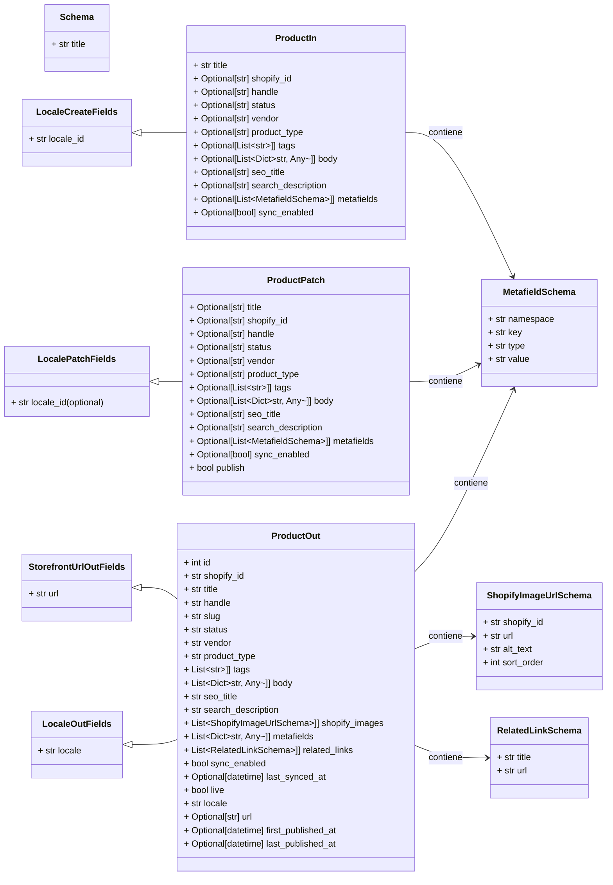

# Esquemas de Contenido de Producto de Shopify API

Este módulo, `Shopify_API___Schemas_Product_Content`, define los esquemas de datos utilizados para representar la información de productos dentro de la integración de Shopify. Estos esquemas son cruciales para la creación, actualización y recuperación de datos de productos a través de la API, asegurando una estructura de datos consistente y validada para la interacción con el sistema de gestión de contenido (CMS) y Shopify.

## Propósito y Funcionalidad Principal

El módulo facilita la gestión de productos al proporcionar definiciones de esquemas Pydantic para:
*   **Creación/Actualización Completa de Productos (`ProductIn`)**: Define la estructura de datos para enviar información completa de un producto al sistema.
*   **Actualizaciones Parciales de Productos (`ProductPatch`)**: Permite realizar modificaciones específicas en campos de un producto existente sin necesidad de enviar el objeto completo.
*   **Representación de Productos (`ProductOut`)**: Describe cómo se presenta la información de un producto cuando se recupera del sistema, incluyendo detalles sobre su estado, contenido y metadatos.

Estos esquemas se integran con otros esquemas comunes de la API para manejar metadatos, enlaces relacionados, URLs de imágenes y campos de localización, promoviendo la reutilización y la coherencia en todo el sistema.

## Arquitectura y Relaciones entre Componentes

Los esquemas de producto se basan en esquemas comunes para heredar funcionalidades y mantener la uniformidad.

### Componentes Core

A continuación, se detallan los componentes core definidos en `api/schemas/product.py`:

#### `ProductIn`
Este esquema se utiliza para la entrada de datos al crear un nuevo producto o realizar una actualización completa. Hereda de `LocaleCreateFields` para la gestión de campos de localización.

**Campos Clave**:
*   `title` (str): Título del producto.
*   `shopify_id` (str, opcional): GID de Shopify que vincula la página de Wagtail a un producto de Shopify.
*   `handle` (str, opcional): Handle (slug) de la URL de Shopify para el producto.
*   `status` (str, opcional): Estado del producto en Shopify ('ACTIVE', 'DRAFT', 'ARCHIVED').
*   `vendor` (str, opcional): Nombre del proveedor o marca del producto.
*   `product_type` (str, opcional): Tipo de producto de Shopify.
*   `tags` (List[str], opcional): Lista de etiquetas del producto.
*   `body` (List[Dict[str, Any]], opcional): Descripción del producto como una lista de bloques StreamField de Wagtail.
*   `seo_title` (str, opcional): Título SEO de la página.
*   `search_description` (str, opcional): Meta descripción SEO.
*   `metafields` (List[MetafieldSchema], opcional): Lista de metafields de Shopify.
*   `sync_enabled` (bool, opcional): Habilita o deshabilita la sincronización saliente a Shopify al publicar la página.

#### `ProductPatch`
Este esquema se utiliza para realizar actualizaciones parciales de productos. Hereda de `LocalePatchFields`.

**Campos Clave (todos opcionales para la actualización)**:
*   `title` (str, opcional): Actualiza el título del producto.
*   `shopify_id` (str, opcional): Establece o actualiza el GID de Shopify.
*   `handle` (str, opcional): Actualiza el handle de la URL de Shopify.
*   `status` (str, opcional): Actualiza el estado del producto en Shopify.
*   `vendor` (str, opcional): Actualiza el nombre del proveedor/marca.
*   `product_type` (str, opcional): Actualiza el tipo de producto.
*   `tags` (List[str], opcional): Reemplaza la lista completa de etiquetas.
*   `body` (List[Dict[str, Any]], opcional): Reemplaza los bloques StreamField del cuerpo.
*   `seo_title` (str, opcional): Actualiza el título SEO.
*   `search_description` (str, opcional): Actualiza la meta descripción SEO.
*   `metafields` (List[MetafieldSchema], opcional): Reemplaza todos los metafields.
*   `sync_enabled` (bool, opcional): Habilita o deshabilita la sincronización de Shopify al publicar.
*   `publish` (bool): Si es `True`, publica la página después de guardar los cambios.

#### `ProductOut`
Este esquema representa la salida de datos de un producto, utilizado para devolver información del producto desde la API. Hereda de `StorefrontUrlOutFields` y `LocaleOutFields`.

**Campos Clave**:
*   `id` (int): ID de la página de Wagtail.
*   `shopify_id` (str): GID de Shopify para este producto.
*   `title` (str): Título del producto.
*   `handle` (str): Handle de la URL de Shopify.
*   `slug` (str): Slug de la página de Wagtail (espejo del handle).
*   `status` (str): Estado del producto en Shopify.
*   `vendor` (str): Proveedor o marca del producto.
*   `product_type` (str): Tipo de producto de Shopify.
*   `tags` (List[str]): Lista de etiquetas.
*   `body` (List[Dict[str, Any]]): Bloques StreamField del cuerpo.
*   `seo_title` (str): Título SEO.
*   `search_description` (str): Meta descripción SEO.
*   `shopify_images` (List[ShopifyImageUrlSchema]): URLs de imágenes del producto de Shopify.
*   `metafields` (List[Dict[str, Any]]): Metafields adjuntos.
*   `related_links` (List[RelatedLinkSchema]): Enlaces internos semánticos.
*   `sync_enabled` (bool): Indica si la sincronización de Shopify está habilitada.
*   `last_synced_at` (datetime, opcional): Marca de tiempo UTC de la última sincronización.
*   `live` (bool): `True` si la página está publicada en Wagtail.
*   `locale` (str): Código de localización de Wagtail.
*   `url` (str, opcional): URL pública completa de la página.
*   `first_published_at` (datetime, opcional): Marca de tiempo de la primera publicación.
*   `last_published_at` (datetime, opcional): Marca de tiempo de la publicación más reciente.

**Métodos Estáticos de Resolución**:
Los métodos estáticos como `resolve_translation_page_ids`, `resolve_tags`, `resolve_body`, `resolve_shopify_images`, `resolve_metafields`, `resolve_related_links`, `resolve_locale`, y `resolve_url` se utilizan para transformar los datos del objeto Wagtail en el formato de salida esperado por el esquema `ProductOut`.

### Diagrama de Clases

## Cómo Encaja el Módulo en el Sistema General

El módulo `Shopify_API___Schemas_Product_Content` sirve como la capa de definición de datos para la interacción con la información de productos en el contexto de un sistema integrado con Shopify.

1.  **Integración con CMS (Wagtail)**: Los esquemas, particularmente `ProductIn` y `ProductPatch`, son utilizados por el CMS (presumiblemente Wagtail, dado el uso de StreamField en el campo `body`) para validar y estructurar los datos de productos creados o editados por los administradores de contenido. El campo `body` que acepta `List[Dict[str, Any]]` y se describe como "Wagtail StreamField block list" es una fuerte indicación de esto. La existencia de `ProductPage` en [Shopify_Content_Management/Shopify_Content_Models.md](../Shopify_Content_Management/Shopify_Content_Models.md) confirma esta integración.
2.  **Comunicación con la API de Shopify**: `ProductIn` se usa para enviar nuevos productos o actualizaciones completas a la API de Shopify. `ProductPatch` se usa para enviar actualizaciones parciales. `ProductOut` se usa para deserializar las respuestas de la API de Shopify o para representar datos de productos recuperados de la base de datos del CMS antes de ser enviados a un frontend.
3.  **Sincronización de Contenido**: El campo `sync_enabled` en `ProductIn` y `ProductPatch` indica que estos esquemas juegan un papel directo en el proceso de sincronización bidireccional entre el CMS y Shopify. Cuando `sync_enabled` es `True`, las publicaciones en el CMS desencadenan una sincronización saliente a Shopify.
4.  **Localización**: La herencia de `LocaleCreateFields`, `LocalePatchFields`, y `LocaleOutFields` de [Shopify_API___Schemas/Shopify_API___Schemas_Common_Data_Models.md](Shopify_API___Schemas_Common_Data_Models.md) demuestra que la gestión de productos soporta múltiples localizaciones.
5.  **Metadatos y SEO**: La inclusión de campos para `seo_title`, `search_description`, y `metafields` permite una gestión completa de la información de SEO y metadatos personalizados para los productos, que luego se mapean a los campos correspondientes en Shopify.

En resumen, este módulo define la interfaz de datos fundamental para la gestión de productos, permitiendo una interacción estructurada y validada entre un CMS y la plataforma Shopify, con soporte para sincronización, localización y SEO.
