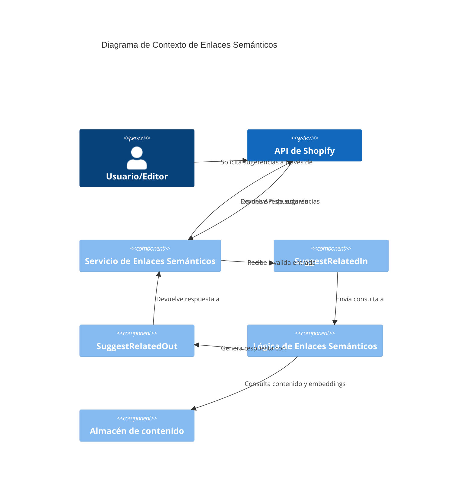
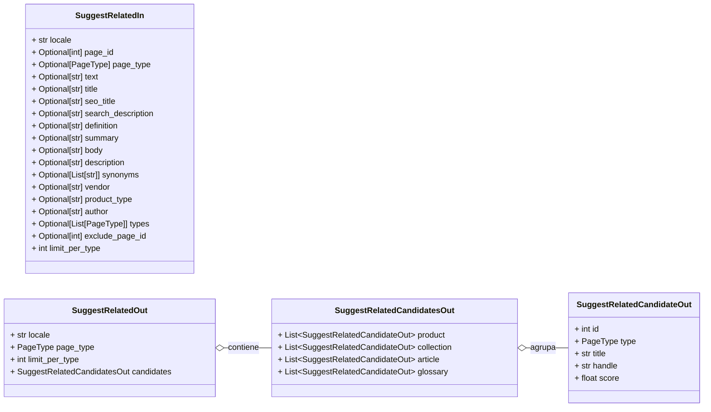

# Enlaces Semánticos de Shopify API Schemas


Este módulo define los esquemas de Pydantic utilizados para la funcionalidad de sugerencia de enlaces semánticos dentro de la API de Shopify. Facilita la entrada y salida de datos para la identificación de contenido relacionado, como productos, colecciones, artículos y términos de glosario, basándose en varios criterios de búsqueda.

### Componentes principales

*   `SuggestRelatedCandidateOut`: Representa un candidato de enlace relacionado individual.
*   `SuggestRelatedCandidatesOut`: Agrupa los candidatos sugeridos por tipo de página.
*   `SuggestRelatedIn`: Define la estructura de la entrada para solicitar sugerencias de enlaces relacionados.
*   `SuggestRelatedOut`: Define la estructura de la respuesta para las sugerencias de enlaces relacionados.


## Propósito y Funcionalidad Principal

El módulo `Shopify_API___Schemas_Semantic_Links` proporciona los contratos de datos para interactuar con la funcionalidad de sugerencia de enlaces semánticos. Esto permite a los sistemas externos, o a las partes internas de la aplicación, solicitar y recibir sugerencias de contenido relacionado (productos, colecciones, artículos, glosario) basado en el contenido de una página existente o texto libre.

Este módulo es crucial para características como:

*   **Generación de enlaces de contenido inteligente**: Sugerir enlaces relevantes a otros contenidos para mejorar la navegación del usuario y el SEO.
*   **Edición de contenido asistida por IA**: Ayudar a los editores a encontrar rápidamente contenido relacionado para enriquecer las páginas.

### `PageType`

Este `Literal` define los tipos de página posibles que pueden ser enlazados semánticamente.

```python
PageType = Literal['product', 'collection', 'article', 'glossary']
```

## Arquitectura y Relaciones de Componentes

Los esquemas de este módulo están diseñados para modelar las solicitudes y respuestas de una API de sugerencia de enlaces semánticos.







## Detalles de los Componentes

### `SuggestRelatedIn`

Este esquema define la carga útil de la solicitud para el endpoint de sugerencia de enlaces relacionados. Permite especificar la página de origen de varias maneras, ya sea a través de un `page_id` existente en Wagtail o proporcionando directamente varios campos de texto que describen el contenido de la página.

**Campos:**

*   `locale` (str): El locale utilizado para filtrar los candidatos.
*   `page_id` (Optional[int]): El ID de la página existente de Wagtail. El texto de la consulta se extrae de esta página.
*   `page_type` (Optional[PageType]): El tipo de página de origen. Requerido cuando se usan campos de texto o texto libre.
*   `text` (Optional[str]): Consulta de texto libre para una página que aún no existe.
*   `title` (Optional[str]): Título o encabezado utilizado en el texto de la consulta.
*   `seo_title` (Optional[str]): Título SEO utilizado en el texto de la consulta.
*   `search_description` (Optional[str]): Meta descripción SEO utilizada en el texto de la consulta.
*   `definition` (Optional[str]): HTML/texto de la definición del glosario.
*   `summary` (Optional[str]): Resumen del artículo utilizado en el texto de la consulta.
*   `body` (Optional[str]): Cuerpo del producto/artículo utilizado en el texto de la consulta.
*   `description` (Optional[str]): Descripción de la colección utilizada en el texto de la consulta.
*   `synonyms` (Optional[List[str]]): Sinónimos del glosario utilizados en el texto de la consulta.
*   `vendor` (Optional[str]): Proveedor del producto utilizado en el texto de la consulta.
*   `product_type` (Optional[str]): Tipo de producto de Shopify utilizado en el texto de la consulta.
*   `author` (Optional[str]): Autor del artículo utilizado en el texto de la consulta.
*   `types` (Optional[List[PageType]]): Tipos de candidatos a buscar. Por defecto, busca en todos los tipos enlazables (product, collection, article, glossary).
*   `exclude_page_id` (Optional[int]): Un ID de página adicional para excluir de los resultados. El `page_id` de origen siempre se excluye cuando se proporciona.
*   `limit_per_type` (int): El número máximo de candidatos por tipo para esta vista previa (por defecto 20, máximo 100).

### `SuggestRelatedCandidateOut`

Este esquema representa un solo candidato de enlace sugerido por el servicio de enlaces semánticos.

**Campos:**

*   `id` (int): ID de la página de Wagtail del candidato.
*   `type` (PageType): Tipo de página enlazable del candidato.
*   `title` (str): Título a mostrar (término del glosario cuando corresponda).
*   `handle` (str): Handle o slug de Shopify/Wagtail.
*   `score` (float): Similitud coseno (1 - distancia) de pgvector; un valor más alto indica mayor similitud.

### `SuggestRelatedCandidatesOut`

Este esquema agrega los candidatos de enlaces relacionados, agrupándolos por su `PageType`.

**Campos:**

*   `product` (List[SuggestRelatedCandidateOut]): Lista de candidatos de tipo 'product'.
*   `collection` (List[SuggestRelatedCandidateOut]): Lista de candidatos de tipo 'collection'.
*   `article` (List[SuggestRelatedCandidateOut]): Lista de candidatos de tipo 'article'.
*   `glossary` (List[SuggestRelatedCandidateOut]): Lista de candidatos de tipo 'glossary'.

### `SuggestRelatedOut`

Este esquema define la estructura de la respuesta del endpoint de sugerencia de enlaces relacionados.

**Campos:**

*   `locale` (str): El locale de Wagtail utilizado para filtrar los candidatos.
*   `page_type` (PageType): El tipo de página de origen utilizado para ensamblar el texto de la consulta.
*   `limit_per_type` (int): El límite por tipo aplicado a esta vista previa.
*   `candidates` (SuggestRelatedCandidatesOut): Vecinos agrupados por tipo, cada uno ordenado por puntuación descendente.

## Cómo encaja en el Sistema General

El módulo `Shopify_API___Schemas_Semantic_Links` es una parte integral del subsistema de [Shopify_API___Schemas](../Shopify_API___Schemas.md), que define los esquemas de datos para diversas funcionalidades de la API. Se basa en el servicio de enlaces semánticos definido en [Content_URL___Semantic_Linking_Logic](../Shopify_Content_Management/Content_URL___Semantic_Linking_Logic.md), específicamente `shopify_content.semantic_links.service`, para la lógica de negocio subyacente que genera las sugerencias de enlaces.

Este módulo actúa como una interfaz entre la capa de API y la lógica de negocio de enlaces semánticos, asegurando que los datos se estructuren y validen correctamente tanto para las solicitudes como para las respuestas. Es consumido por cualquier cliente que necesite acceder a la funcionalidad de sugerencia de enlaces semánticos, como el CMS o herramientas de edición.
