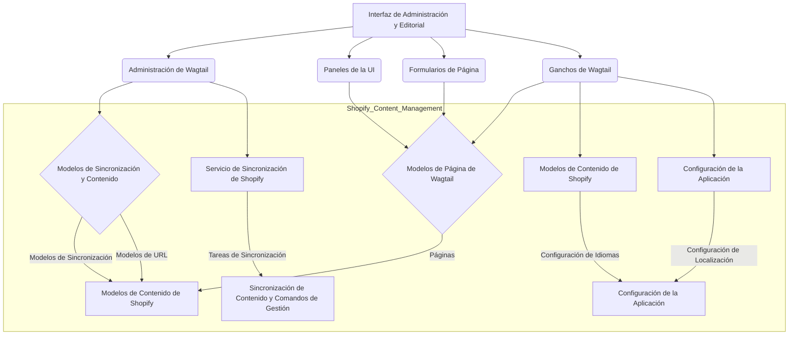

# Interfaz de Administración y Editorial

## Introducción

El módulo `Admin_and_Editorial_UI` es un componente crucial dentro del sistema de gestión de contenido de Shopify, proporcionando la interfaz de usuario y la lógica de administración necesarias para que los editores y administradores gestionen el contenido. Facilita la sincronización de contenido desde y hacia Shopify, la gestión de URLs de escaparate, la personalización de formularios de página de Wagtail y la extensión de la funcionalidad del panel de administración de Wagtail a través de ganchos.

Este módulo se integra con el framework Wagtail CMS y el ecosistema de Shopify, permitiendo una experiencia de edición de contenido fluida y la gestión de la visibilidad del contenido en la tienda de Shopify.

## Arquitectura

El módulo `Admin_and_Editorial_UI` se compone de varias partes que interactúan entre sí y con otros módulos del sistema para proporcionar una experiencia de administración de contenido completa.

## Componentes Principales y Funcionalidad

Este módulo abarca la administración de Wagtail, paneles de interfaz de usuario personalizados, formularios para tipos de página de contenido de Shopify y ganchos que extienden la funcionalidad del CMS.

### Administración de Wagtail

Esta sección gestiona las interfaces de administración para la sincronización de Shopify, los índices de URL de contenido y los comandos incrustados.

Más detalles en: [Administración Wagtail](Admin_and_Editorial_UI/Admin_and_Editorial_UI_Wagtail_Admin.md)

### Paneles de la Interfaz de Usuario

Define paneles personalizados para mostrar información relevante en las páginas de edición de Wagtail, como las URLs de escaparate de Shopify.

Más detalles en: [Paneles UI](Admin_and_Editorial_UI/Admin_and_Editorial_UI_UI_Panels.md)

### Formularios de Página

Proporciona formularios de Wagtail personalizados para la gestión de varios tipos de páginas de contenido, incluyendo la lógica para campos de solo lectura editorial y la selección de configuraciones regionales disponibles.

Más detalles en: [Formularios de Página](Admin_and_Editorial_UI/Admin_and_Editorial_UI_Formularios_Pagina.md)

### Ganchos de Wagtail

Implementa ganchos de Wagtail para extender y modificar el comportamiento del panel de administración, incluyendo la adición de elementos al menú, el manejo de la retroalimentación de sincronización y el filtrado del selector de páginas por configuración regional.

Más detalles en: [Ganchos de Wagtail](Admin_and_Editorial_UI/Admin_and_Editorial_UI_Ganchos_Wagtail.md)
