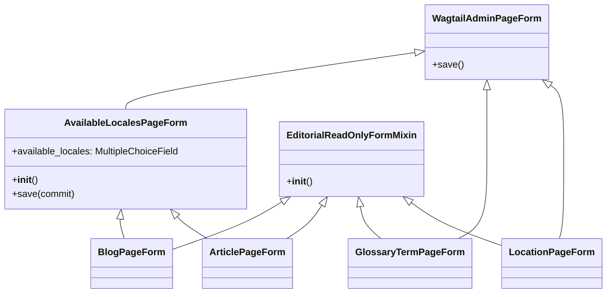

# Formularios de Página de la UI de Administración y Editorial

El módulo `Admin_and_Editorial_UI_Formularios_Pagina` gestiona los formularios personalizados utilizados en la interfaz de administración de Wagtail para varios tipos de páginas de contenido de Shopify. Estos formularios mejoran la experiencia de edición al proporcionar control sobre la disponibilidad de los locales y al aplicar restricciones de solo lectura para el contenido gestionado por Git.

## Propósito y Funcionalidad Principal

Este módulo define las siguientes clases de formulario y un mixin:

*   **`AvailableLocalesPageForm`**: Extiende `WagtailAdminPageForm` para permitir a los editores seleccionar las configuraciones regionales (locales) en las que el contenido de una página debe estar disponible en la tienda. Utiliza un campo de selección múltiple con casillas de verificación (`CheckboxSelectMultiple`) respaldado por un `JSONField` en el modelo de página.
*   **`EditorialReadOnlyFormMixin`**: Un mixin que, bajo ciertas condiciones (específicamente cuando el sistema opera en modo `git_authoritative`), hace que los campos editoriales designados sean de solo lectura en la interfaz de administración de Wagtail. Esto asegura que el contenido principal gestionado por Git solo se edite a través del flujo de trabajo de Git, mostrando los valores de Git o los valores de la base de datos para la compatibilidad o reversión.
*   **`BlogPageForm`**: El formulario de administración para las páginas de tipo `BlogPage`. Hereda funcionalidad de `EditorialReadOnlyFormMixin` y `AvailableLocalesPageForm`.
*   **`ArticlePageForm`**: El formulario de administración para las páginas de tipo `ArticlePage`. Hereda funcionalidad de `EditorialReadOnlyFormMixin` y `AvailableLocalesPageForm`.
*   **`GlossaryTermPageForm`**: El formulario de administración para las páginas de tipo `GlossaryTermPage`. Hereda funcionalidad de `EditorialReadOnlyFormMixin` y `WagtailAdminPageForm`.
*   **`LocationPageForm`**: El formulario de administración para las páginas de tipo `LocationPage`. Hereda funcionalidad de `EditorialReadOnlyFormMixin` y `WagtailAdminPageForm`.

## Arquitectura y Relaciones de Componentes

Los formularios de este módulo se integran con el framework de administración de Wagtail y las configuraciones del proyecto para proporcionar una experiencia de edición de contenido robusta.

### Diagrama de Clases

El siguiente diagrama de clases ilustra la jerarquía y las relaciones entre los formularios y mixins definidos en este módulo.



### Dependencias

*   **`wagtail.admin.forms.WagtailAdminPageForm`**: La clase base para todos los formularios de página de Wagtail.
*   **`django.forms`**: Utilizado para la definición de campos de formulario como `MultipleChoiceField` y widgets como `CheckboxSelectMultiple`.
*   **`config.settings.ALLOWED_LOCALE_CODES`**: Una configuración del proyecto que define los códigos de locales permitidos, utilizada por `AvailableLocalesPageForm` para poblar las opciones de selección.
*   **`shopify_content.content_store.accessors`**: Este módulo proporciona la lógica para determinar si el contenido es autoritario de Git (`is_git_authoritative`) y qué campos editoriales deben considerarse (`EDITORIAL_FIELDS`, `GIT_NATIVE_FIELDS`). Puede encontrar más detalles en [Content_Store___Markdown_Processing/Content_Store___Markdown_Processing_Dominio_y_Localizacion.md](../Content_Store___Markdown_Processing/Content_Store___Markdown_Processing_Dominio_y_Localizacion.md).

## Flujo de Datos y Operación

### Gestión de Locales con `AvailableLocalesPageForm`

Cuando un editor interactúa con un formulario que utiliza `AvailableLocalesPageForm`:

1.  El formulario se inicializa con los locales ya seleccionados para la página (`instance.available_locales`) o, si no hay ninguno, con el `locale.language_code` de la instancia.
2.  El editor selecciona o deselecciona los locales disponibles utilizando las casillas de verificación.
3.  Al guardar, el método `save` del formulario sobrescribe la lista `available_locales` de la página con los valores seleccionados.

### Campos de Solo Lectura con `EditorialReadOnlyFormMixin`

El `EditorialReadOnlyFormMixin` implementa una lógica condicional para proteger la integridad del contenido gestionado externamente:

```mermaid
flowchart TD
    A[Inicio del Mixin] --> B{¿is_git_authoritative() es verdadero?};
    B -- No --> C[No hacer nada, campos editables];
    B -- Sí --> D{Obtener label_lower de la instancia};
    D -- Sin label --> C;
    D -- Con label --> E[Iterar sobre EDITORIAL_FIELDS];
    E --> F{¿content_type coincide con label?};
    F -- No --> E;
    F -- Sí --> G{¿Campo existe en el formulario?};
    G -- No --> E;
    G -- Sí --> H[Deshabilitar el campo];
    H --> I{¿Campo está en GIT_NATIVE_FIELDS?};
    I -- Sí --> J[Establecer texto de ayuda para Git Markdown nativo];
    I -- No --> K[Establecer texto de ayuda para contenido gestionado por Git];
    K --> L{¿La instancia tiene PK?};
    J --> L;
    L -- No --> M[Continuar];
    L -- Sí --> N[Intentar cargar initial[field_key] desde instance.editorial];
    N -- Éxito --> M;
    N -- Error --> M;
    M --> E;
    E -- Fin de iteración --> O[Fin del Mixin];
```

Este flujo garantiza que si el modo `git_authoritative` está activo, los campos de contenido editorial no puedan ser modificados directamente a través del panel de administración de Wagtail, dirigiendo a los editores a utilizar el flujo de trabajo de Git para esos cambios.

## Cómo el Módulo Encaja en el Sistema General

Este módulo es una parte crucial de la [Admin_and_Editorial_UI](../Admin_and_Editorial_UI.md) al proporcionar los medios para que los administradores de contenido interactúen con los modelos de página de Shopify a través de la interfaz de Wagtail. Al centralizar la lógica de formularios, se asegura una experiencia de usuario consistente y se refuerzan las reglas de negocio, como la gestión de locales y la autoridad del contenido por parte de Git.

Los formularios aquí definidos trabajan directamente con los modelos de página de contenido, como `ArticlePage`, `BlogPage`, `GlossaryTermPage`, y `LocationPage`, que se encuentran en el módulo [Shopify_Content_Models](../Shopify_Content_Models.md). La integración con el sistema de gestión de contenido de Git y los locales se realiza a través de las dependencias mencionadas, asegurando que las ediciones manuales en Wagtail no sobrescriban el contenido gestionado por Git y que el contenido esté correctamente configurado para los mercados de Shopify.
