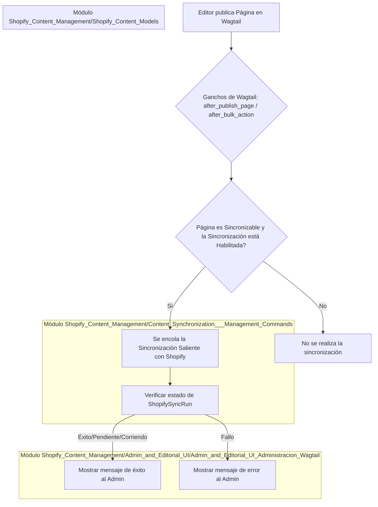
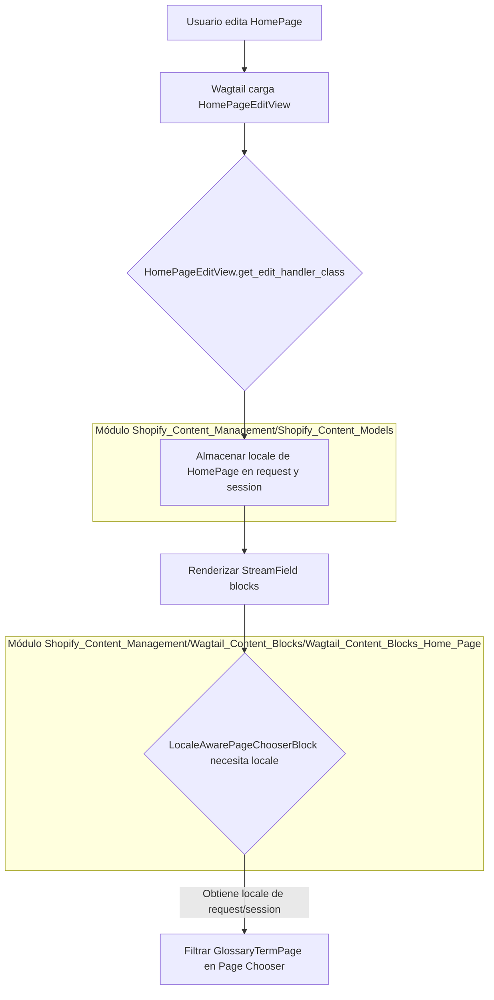

# Ganchos de Wagtail para la Interfaz de Administración y Editorial


Este módulo (`shopify_content/wagtail_hooks.py`) define una serie de ganchos (hooks) de Wagtail que extienden y personalizan la interfaz de administración y editorial. Su objetivo principal es integrar funcionalidades relacionadas con la sincronización de contenido con Shopify y mejorar la experiencia de edición para las páginas de inicio y los términos de glosario, especialmente en entornos multi-idioma.

## Propósito y Funcionalidad Principal

El módulo `Admin_and_Editorial_UI_Ganchos_Wagtail` juega un papel crucial en la integración del CMS Wagtail con la plataforma Shopify, asegurando que los cambios de contenido realizados en Wagtail se reflejen adecuadamente en Shopify, y optimizando la interfaz de usuario para una gestión de contenido eficiente.

Sus funcionalidades clave incluyen:
*   **Gestión de la Sincronización con Shopify:** Proporciona mecanismos para iniciar y monitorear la sincronización de contenido entre Wagtail y Shopify.
*   **Feedback al Administrador:** Muestra mensajes de éxito o error en la interfaz de administración de Wagtail después de la publicación de páginas, informando sobre el estado de la cola de sincronización.
*   **Personalización del Editor de Páginas de Inicio:** Extiende la vista de edición de las `HomePage` para manejar la configuración regional (locale) de manera específica.
*   **Filtrado de Elección de Páginas por Idioma:** Permite filtrar las opciones de `GlossaryTermPage` en el selector de páginas basándose en el idioma de la página de inicio que se está editando.

## Arquitectura y Relaciones entre Componentes

Este módulo se integra con el sistema Wagtail a través de su sistema de ganchos (`wagtail.hooks`). Los componentes definidos aquí interactúan con:
*   Modelos de Wagtail (`Page`).
*   Modelos específicos de contenido de Shopify (`ShopifySyncRun`, `HomePage`, `GlossaryTermPage`).
*   Vistas administrativas de Wagtail.
*   La lógica de sincronización saliente definida en otros módulos de `shopify_content`.

### Diagrama de Flujo de Sincronización Outbound

A continuación, se muestra un diagrama que ilustra cómo los ganchos de Wagtail interactúan con el proceso de sincronización saliente de Shopify.


*   **`_notify_sync_queued`**: Función auxiliar que gestiona los mensajes de feedback al administrador basándose en el estado de `ShopifySyncRun`.
*   **`notify_shopify_sync_on_publish`**: Gancho que se ejecuta después de la publicación de una página individual, mostrando feedback sobre el estado de la sincronización.
*   **`notify_shopify_sync_after_bulk_publish`**: Gancho que se activa tras una acción de publicación masiva, consolidando el feedback para múltiples páginas.

### Diagrama de Interacción de la Vista de Edición de HomePage


*   **`HomePageEditView`**: Una vista de edición personalizada que intercepta la carga de la página `HomePage` para almacenar su información de `locale` en el objeto `request` y en la sesión. Esto es crucial para que los bloques de StreamField dependientes del idioma (como el selector de páginas) puedan operar correctamente.
*   **`use_home_page_edit_view`**: Gancho que registra `HomePageEditView` para las instancias de `HomePage`.

### Diagrama de Flujo de Filtrado del Selector de Páginas por Idioma

```mermaid
graph TD
    A[Usuario abre Page Chooser en HomePage] --> B{Gancho Wagtail: construct_page_chooser_queryset};
    B --> C{Determinar locale del editor (request/session/GET)};
    C -- Si hay locale --> D{Filtrar queryset si es GlossaryTermPage};
    D -- Usa get_homepage_editor_locale y glossary_term_page_filter_q --> E[Mostrar solo GlossaryTermPage del locale correcto];
    C -- No hay locale --> F[No se aplica filtro de locale];

    subgraph Módulo Shopify_Content_Management/Shopify_Content_Models
        C
    end
```
*   **`filter_page_chooser_by_locale`**: Este gancho se encarga de filtrar el queryset del selector de páginas de Wagtail. Se aplica específicamente cuando se edita una `HomePage` y cuando se intenta seleccionar una `GlossaryTermPage`, asegurando que solo se muestren los términos de glosario relevantes para el idioma de la página de inicio en edición.

## Integración con el Sistema General

Este módulo se integra estrechamente con la interfaz de administración de Wagtail y con la gestión de contenido de Shopify.

*   **Administración de Wagtail**: Registra URLs (`register_admin_urls`) y elementos de menú (`register_settings_menu_item`) para la funcionalidad de sincronización, haciendo que la característica sea accesible directamente desde el panel de administración de Wagtail. Ver [Administración Wagtail](Admin_and_Editorial_UI_Administracion_Wagtail.md) para más detalles.
*   **Sincronización de Contenido**: Las funciones de feedback se basan en el éxito o fracaso de las operaciones de sincronización que son gestionadas por el módulo de [Sincronización de Contenido y Comandos de Gestión](../Content_Synchronization___Management_Commands.md).
*   **Modelos de Contenido**: Interactúa con [Modelos de Contenido de Shopify](../Shopify_Content_Models.md) como `ShopifySyncRun`, `HomePage` y `GlossaryTermPage` para leer y escribir datos de estado y configurar el comportamiento del editor.
*   **Bloques de Contenido de Wagtail**: `HomePageEditView` y `filter_page_chooser_by_locale` trabajan en conjunto para mejorar la experiencia de edición de los bloques de StreamField que requieren conciencia del idioma, como se detalla en [Bloques de Contenido de Wagtail - Página de Inicio](../Wagtail_Content_Blocks/Wagtail_Content_Blocks_Home_Page.md).

Las URLs de sincronización (`/shopify-sync/`) están vinculadas a la vista `ShopifySyncView`, que es responsable de orquestar el proceso de sincronización. Este enfoque permite que las acciones del usuario en la UI de Wagtail desencadenen procesos de backend complejos de manera controlada y con feedback apropiado.
