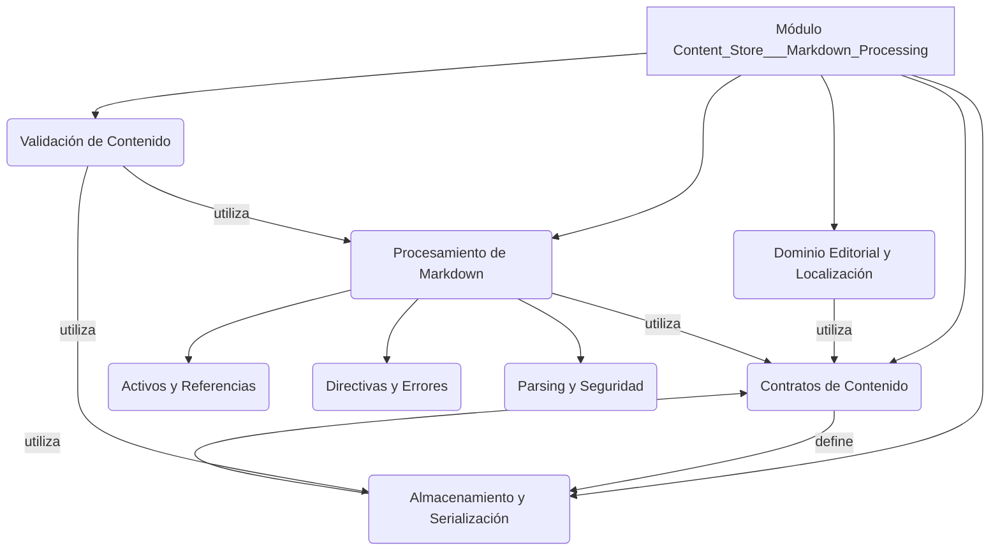

# Módulo Content Store y Procesamiento de Markdown

El módulo `Content_Store___Markdown_Processing` es fundamental para la gestión y el procesamiento del contenido editorial dentro del sistema Shopify. Su propósito principal es almacenar, recuperar y procesar contenido en formato Markdown, incluyendo directivas personalizadas, asegurando la integridad, la correcta serialización y la validación de dicho contenido.

## Arquitectura del Módulo

Este módulo está diseñado con una clara separación de responsabilidades, dividiendo sus funcionalidades en componentes clave que interactúan para proporcionar una gestión robusta del contenido.

### Componentes de Alto Nivel:

*   **[Contratos de Contenido](Content_Store___Markdown_Processing/Content_Store___Markdown_Processing_Content_Store___Markdown_Processing_Contratos.md)**: Define las interfaces y los objetos de valor para representar el contenido editorial, como referencias (`ContentRef`), documentos (`ContentDocument`) y repositorios (`ContentRepository`).
*   **[Almacenamiento y Serialización](Content_Store___Markdown_Processing/Content_Store___Markdown_Processing_Almacenamiento_y_Serializacion.md)**: Implementa la lógica para almacenar y recuperar el contenido editorial en un sistema de archivos y serializarlo/deserializarlo, típicamente utilizando un formato Markdown con *frontmatter* YAML.
*   **[Dominio Editorial y Localización](Content_Store___Markdown_Processing/Content_Store___Markdown_Processing_Dominio_y_Localizacion.md)**: Proporciona mecanismos para acceder al contenido editorial de las páginas y gestiona la normalización de códigos de idioma para su uso en las rutas de contenido.
*   **Procesamiento de Markdown**: Se encarga de analizar, interpretar y potencialmente renderizar el contenido Markdown, incluyendo el manejo de directivas personalizadas y la sanitización de HTML. Este componente se subdivide en:
    *   **[Activos y Referencias](Content_Store___Markdown_Processing/Content_Store___Markdown_Processing_Procesamiento_Markdown_Activos_y_Referencias.md)**: Gestiona las referencias a activos y otros contenidos dentro del Markdown.
    *   **[Directivas y Errores](Content_Store___Markdown_Processing/Content_Store___Markdown_Processing_Procesamiento_Markdown_Directivas_y_Errores.md)**: Define y procesa las directivas personalizadas incrustadas en el Markdown y gestiona los errores de renderizado.
    *   **[Parsing y Seguridad](Content_Store___Markdown_Processing/Content_Store___Markdown_Processing_Content_Store___Markdown_Processing_Procesamiento_Markdown_Parsing_y_Seguridad.md)**: Se ocupa del análisis de la estructura del Markdown y de la sanitización del HTML resultante por motivos de seguridad.
*   **[Validación de Contenido](Content_Store___Markdown_Processing/Content_Store___Markdown_Processing_Content_Store___Markdown_Processing_Validacion.md)**: Realiza validaciones exhaustivas sobre el árbol de contenido desplegado para asegurar su coherencia e integridad.
