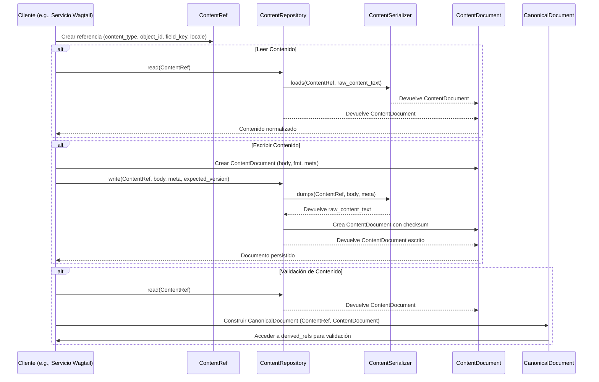

# Contratos del Almacén de Contenido y Procesamiento de Markdown

Este módulo define los contratos (interfaces y objetos de valor) para el almacén de contenido editorial y el procesamiento de Markdown. Su objetivo principal es establecer un conjunto claro y desacoplado de interfaces para interactuar con el contenido, sin acoplarse a implementaciones de backend específicas.

## Arquitectura y Componentes Clave

Los componentes definidos en `shopify_content/content_store/contracts.py` son fundamentales para la representación y gestión del contenido editorial. Estos componentes son:

### `ContentRef`

Una referencia determinista y estable a una carga útil editorial. `ContentRef` se deriva completamente de la identidad duradera de la base de datos (tipo de contenido + clave primaria + campo + configuración regional), asegurando que una referencia no cambie incluso si la ruta física o el slug del contenido lo hacen.

```python
@dataclass(frozen=True)
class ContentRef:
    content_type: str
    object_id: str
    field_key: str
    locale: str
```

-   `content_type`: Por ejemplo, `"shopify_content.blogpage"`. Identifica el tipo de modelo de contenido.
-   `object_id`: Identidad estable de la base de datos (clave primaria), como texto.
-   `field_key`: Por ejemplo, `"description"`. El campo específico del contenido al que se refiere.
-   `locale`: Por ejemplo, `"en-US"`. La configuración regional del contenido.

### `ContentDocument`

Una representación normalizada e independiente del backend de una carga útil editorial. Contiene el valor del dominio (`body`), el formato (`fmt`), metadatos opcionales (`meta`) y un `checksum` para la verificación de integridad.

```python
@dataclass(frozen=True)
class ContentDocument:
    body: str
    fmt: str = "markdown"
    meta: Mapping[str, str] = field(default_factory=dict)
    checksum: str = ""
```

-   `body`: El valor del dominio del contenido (por ejemplo, el texto Markdown).
-   `fmt`: El formato del contenido, como `"markdown"` o `"json"`.
-   `meta`: Un mapeo de metadatos adicionales asociados con el contenido.
-   `checksum`: Un hash utilizado para detectar desajustes entre la fila autorizada de la base de datos y su espejo, NO es la autoridad del contenido.

### `CanonicalDocument`

Un documento de dominio vinculado a un `ContentRef`, representando la capa nativa de Git. Además de la información de `ContentDocument`, incluye `metadata`, `format`, `checksum` y `derived_refs` (referencias a otros contenidos extraídas del `body`).

```python
@dataclass(frozen=True)
class CanonicalDocument:
    ref: ContentRef
    body: str
    metadata: Mapping[str, str] = field(default_factory=dict)
    format: str = "markdown"
    checksum: str = ""
    derived_refs: Tuple[str, ...] = ()

    def as_content_document(self) -> ContentDocument:
        # ...
```

-   `ref`: La referencia `ContentRef` a la que está vinculado este documento.
-   `body`: El contenido principal del documento.
-   `metadata`: Metadatos informativos, que pueden incluir claves de frontmatter.
-   `format`: El formato del contenido.
-   `checksum`: El checksum para la verificación de integridad.
-   `derived_refs`: Una tupla de cadenas que representan referencias a otros contenidos que se encuentran dentro del `body` del documento (por ejemplo, directivas de artículo).
-   `as_content_document()`: Un método para obtener una vista compatible con versiones anteriores de `ContentDocument` sin el `ref`.

### `ContentNotFound`

Excepción que se lanza cuando un `ContentRef` no tiene un documento almacenado en el repositorio.

### `ContentConflict`

Excepción que se lanza en caso de una falta de coincidencia de concurrencia optimista (por ejemplo, cuando la versión esperada de un documento no coincide con la versión actual).

### `InvalidEditorialFrontmatter`

Excepción que se lanza cuando el frontmatter YAML está presente pero no puede ser parseado correctamente.

### `ContentSerializer`

Un protocolo (interfaz) que define cómo serializar y deserializar valores de dominio a y desde texto de archivo. Cada implementación es para un formato específico (ej. Markdown, JSON).

```python
class ContentSerializer(Protocol):
    def dumps(self, ref: ContentRef, value: str, *, meta: Mapping[str, str]) -> str:
        # ...

    def loads(self, ref: ContentRef, raw: str) -> ContentDocument:
        # ...
```

-   `dumps()`: Serializa un valor de dominio a texto de archivo, asegurando que el `value` se conserve sin pérdidas.
-   `loads()`: Parsea el texto de un archivo de nuevo en un `ContentDocument`.

### `ContentRepository`

Un protocolo (interfaz) que define la frontera de almacenamiento para el contenido. Las implementaciones de este protocolo no deben tener conocimiento de los modelos de Django, lo que permite un almacenamiento desacoplado.

```python
class ContentRepository(Protocol):
    def read(self, ref: ContentRef) -> ContentDocument:
        # ...

    def write(
        self,
        ref: ContentRef,
        value: str,
        *,
        meta: Optional[Mapping[str, str]] = None,
        expected_version: Optional[str] = None,
    ) -> ContentDocument:
        # ...

    def delete(self, ref: ContentRef) -> None:
        # ...

    def exists(self, ref: ContentRef) -> bool:
        # ...
```

-   `read()`: Devuelve el documento almacenado para un `ContentRef` dado, o lanza `ContentNotFound`.
-   `write()`: Persiste un `value` de contenido, opcionalmente con `meta` y una `expected_version` para control de concurrencia. Devuelve el `ContentDocument` escrito.
-   `delete()`: Elimina el documento almacenado (idempotente).
-   `exists()`: Comprueba si un documento para el `ContentRef` dado existe.

## Relaciones entre Componentes

El siguiente diagrama de clases ilustra las relaciones entre los contratos clave en el sistema de gestión de contenido:

```mermaid
classDiagram
    direction LR

    ContentRepository <|.. FilesystemContentRepository : Implementa
    ContentRepository "1" -- "*" ContentRef : maneja
    ContentRepository "1" -- "*" ContentDocument : almacena
    ContentSerializer "1" -- "*" ContentDocument : serializa/deserializa

    ContentDocument "1" -- "1" ContentRef : tiene
    CanonicalDocument "1" -- "1" ContentRef : tiene
    CanonicalDocument <|-- ContentDocument : puede ser visto como

    ContentRef : +content_type: str
    ContentRef : +object_id: str
    ContentRef : +field_key: str
    ContentRef : +locale: str

    ContentDocument : +body: str
    ContentDocument : +fmt: str
    ContentDocument : +meta: Map
    ContentDocument : +checksum: str

    CanonicalDocument : +ref: ContentRef
    CanonicalDocument : +body: str
    CanonicalDocument : +metadata: Map
    CanonicalDocument : +format: str
    CanonicalDocument : +checksum: str
    CanonicalDocument : +derived_refs: Tuple
    CanonicalDocument : +as_content_document()

    ContentSerializer : +dumps(ref, value, meta) str
    ContentSerializer : +loads(ref, raw) ContentDocument

    ContentRepository : +read(ref) ContentDocument
    ContentRepository : +write(ref, value, meta, expected_version) ContentDocument
    ContentRepository : +delete(ref)
    ContentRepository : +exists(ref) bool

    ContentNotFound --|> Exception
    ContentConflict --|> Exception
    InvalidEditorialFrontmatter --|> Exception
```

## Flujo de Datos Típico

Cuando se interactúa con el almacén de contenido utilizando estos contratos, el flujo de datos sigue un patrón bien definido, desacoplando la lógica de negocio de los detalles de almacenamiento y serialización.



## Integración con el Sistema General

Los contratos definidos en este módulo son cruciales para la modularidad del sistema de gestión de contenido de Shopify. Proporcionan una abstracción que permite que la lógica de negocio y las interfaces de usuario (como Wagtail) interactúen con el contenido sin necesidad de conocer los detalles de cómo se almacena o serializa el contenido subyacente.

Por ejemplo, el `ContentRepository` es implementado por `FilesystemContentRepository` (ver [Content_Store___Markdown_Processing.md](../Content_Store___Markdown_Processing.md)), lo que permite que el sistema almacene y recupere contenido de un sistema de archivos, posiblemente un repositorio Git. El `ContentSerializer` se encarga de convertir entre el formato almacenado (como Markdown con frontmatter) y el `ContentDocument` normalizado que consume la aplicación.

Esta separación de preocupaciones facilita:

*   **Flexibilidad**: Se pueden intercambiar diferentes backends de almacenamiento (por ejemplo, base de datos, servicio en la nube) simplemente implementando el protocolo `ContentRepository`.
*   **Consistencia**: Asegura una forma uniforme de referenciar y acceder a cualquier tipo de contenido editorial a través de `ContentRef`.
*   **Mantenibilidad**: Aísla los cambios en el formato de almacenamiento o en el parser de Markdown de la lógica principal de la aplicación.

Para obtener más detalles sobre las implementaciones concretas de estos contratos, consulte la documentación del módulo [Content_Store___Markdown_Processing.md](../Content_Store___Markdown_Processing.md).