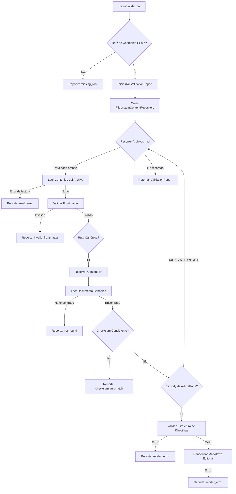

# Validación del Almacén de Contenido y Procesamiento de Markdown

Este módulo, `Content_Store___Markdown_Processing_Validacion`, se encarga de la validación determinista del árbol de contenido editorial desplegado. Su objetivo principal es asegurar la integridad y la corrección estructural del contenido almacenado, especialmente aquellos archivos Markdown que representan páginas editoriales en Shopify.

## Propósito y Funcionalidad Principal

El módulo proporciona herramientas para identificar problemas comunes en el contenido, como archivos faltantes, errores de lectura, frontmatter inválido, inconsistencias de checksum y problemas durante el renderizado de Markdown o la validación de directivas.

Los componentes clave son:

*   **`ValidationIssue`**: Representa un problema individual encontrado durante el proceso de validación.
*   **`ValidationReport`**: Un resumen de todos los problemas encontrados y el estado general de la validación.
*   **`validate_content_tree`**: La función principal que orquesta el proceso de validación de un árbol de contenido.

## Arquitectura y Relaciones entre Componentes

### `ValidationIssue`

La clase `ValidationIssue` es un dataclass simple que encapsula los detalles de un problema de validación.

```python
@dataclass
class ValidationIssue:
    code: str
    path: str
    message: str

    def as_dict(self) -> dict[str, str]:
        return {"code": self.code, "path": self.path, "message": self.message}
```

*   `code`: Un código corto que identifica el tipo de problema (ej., "missing_root", "read_error", "invalid_frontmatter").
*   `path`: La ruta relativa del archivo o recurso donde se encontró el problema.
*   `message`: Un mensaje descriptivo del problema.
*   `as_dict()`: Devuelve el objeto como un diccionario.

### `ValidationReport`

La clase `ValidationReport` consolida los resultados de una ejecución de validación.

```python
@dataclass
class ValidationReport:
    ok: bool
    checked: int = 0
    issues: list[ValidationIssue] = field(default_factory=list)

    def as_dict(self) -> dict[str, Any]:
        return {
            "ok": self.ok,
            "checked": self.checked,
            "issues": [i.as_dict() for i in self.issues],
        }

    def to_json(self) -> str:
        return json.dumps(self.as_dict(), indent=2, sort_keys=True)
```

*   `ok`: Un booleano que indica si la validación general fue exitosa (True si no se encontraron problemas).
*   `checked`: El número de archivos de contenido que fueron revisados.
*   `issues`: Una lista de objetos `ValidationIssue` que detallan cada problema encontrado.
*   `as_dict()`: Devuelve el informe como un diccionario.
*   `to_json()`: Serializa el informe a una cadena JSON.

### `validate_content_tree`

Esta es la función central que recorre un directorio raíz de contenido y aplica varias verificaciones.

```python
def validate_content_tree(root: str | Path) -> ValidationReport:
    # ... implementación ...
```

**Flujo de Validación:**

1.  **Inicialización**: Crea un `ValidationReport` vacío y verifica que la ruta `root` sea un directorio existente. Si no lo es, registra un `missing_root` y termina.
2.  **Repositorio de Contenido**: Instancia un `FilesystemContentRepository` utilizando la ruta raíz proporcionada. Este repositorio se encarga de interactuar con el sistema de archivos para obtener el contenido.
3.  **Recorrido de Archivos Markdown**: Itera sobre todos los archivos `.md` de forma recursiva dentro del directorio raíz.
    *   **Lectura del Archivo**: Intenta leer el contenido del archivo. Si falla, registra un `read_error`.
    *   **Validación de Frontmatter**: Utiliza `split_frontmatter` para verificar que el archivo tenga un frontmatter YAML válido. Si no lo tiene, registra un `invalid_frontmatter`.
    *   **Resolución y Validación de Contenido Canónico**:
        *   Si la ruta del archivo coincide con un diseño canónico (longitud de partes >= 5), intenta resolver una `ContentRef` utilizando `_ref_from_relative`.
        *   Lee el documento canónico (`CanonicalDocument`) del repositorio. Si el documento no se encuentra, registra un `not_found`.
        *   Compara el `checksum` del documento canónico con el de su `ContentDocument` asociado. Si no coinciden, registra un `checksum_mismatch`.
        *   Para el contenido del `body` de las `articlepage`, realiza una validación adicional:
            *   Valida la estructura de las directivas de Markdown con `validate_directive_structure`.
            *   Intenta renderizar el Markdown editorial con `render_editorial_markdown`.
            *   Si cualquiera de estas operaciones falla, registra un `render_error`.

### Diagrama de Flujo de Validación



### Dependencias

Este módulo tiene dependencias con los siguientes componentes y módulos:

*   **[shopify_content/content_store/backends.py::FilesystemContentRepository](Content_Store___Markdown_Processing_Almacenamiento_y_Serializacion.md)**: Provee la interfaz para leer documentos de contenido desde el sistema de archivos.
*   **[shopify_content/content_store/contracts.py::ContentNotFound](Content_Store___Markdown_Processing_Contratos.md)**: Excepción lanzada cuando un documento de contenido no puede ser encontrado.
*   **[shopify_content/content_store/contracts.py::InvalidEditorialFrontmatter](Content_Store___Markdown_Processing_Contratos.md)**: Excepción lanzada cuando el frontmatter de un archivo editorial es inválido.
*   **[shopify_content/content_store/markdown/errors.py::MarkdownRenderError](Content_Store___Markdown_Processing_Procesamiento_Markdown_Directivas_y_Errores.md)**: Excepción base para errores durante el renderizado de Markdown.
*   **[shopify_content/content_store/markdown/renderer.py::render_editorial_markdown](Content_Store___Markdown_Processing_Procesamiento_Markdown_Parsing_y_Seguridad.md)**: Función que renderiza el contenido Markdown.
*   **[shopify_content/content_store/markdown/validation.py::validate_directive_structure](Content_Store___Markdown_Processing_Procesamiento_Markdown_Parsing_y_Seguridad.md)**: Función para validar la estructura de las directivas en el contenido Markdown.
*   **[shopify_content/content_store/serializers.py::split_frontmatter](Content_Store___Markdown_Processing_Almacenamiento_y_Serializacion.md)**: Utilidad para separar el frontmatter de un archivo de contenido.
*   `shopify_content.content_store.content_index_service._ref_from_relative`: Función interna utilizada para obtener una referencia de contenido a partir de una ruta relativa.

## Integración en el Sistema General

El módulo de validación es una parte crítica del flujo de gestión de contenido, asegurando que el contenido editorial que se despliega o se sincroniza cumpla con los estándares esperados.

### Comando de Gestión `content_validate`

Este módulo es la base del comando de gestión `shopify_content.management.commands.content_validate` (ver [Content_Synchronization___Management_Commands.md](../Content_Synchronization___Management_Commands.md)). Este comando permite a los desarrolladores y a los sistemas de CI/CD ejecutar la validación del árbol de contenido.

### Integración con CI/CD

El proceso de validación está integrado en el pipeline de Integración Continua (CI) del repositorio. Específicamente, el archivo `.github/workflows/content-validate.yml` define un flujo de trabajo que se ejecuta en los eventos `push` y `pull_request` que afectan al directorio `content/`, `shopify_content/content_store/`, `shopify_content/tests/` o `requirements.txt`.

El job `validate` en este flujo de trabajo incluye un paso llamado `content_validate (if content tree present)` que ejecuta el comando de gestión `manage.py content_validate --json`. Si el directorio `content` existe, este comando se ejecuta para validar el contenido, y sus resultados pueden ser monitoreados en el contexto de las verificaciones de CI.

#### Diagrama de Integración CI

```mermaid
graph TD
    A[Cambio en Repositorio] --> B{Push o Pull Request en content/** o shopify_content/**};
    B -- Sí --> C[Workflow CI: content-validate.yml];
    C --> D[Paso: Instalar Dependencias];
    D --> E[Paso: Ejecutar Pytest (tests de content store)];
    E --> F{Paso: content_validate (si content tree presente)};
    F -- Si content/ existe --> G[Ejecutar manage.py content_validate --json];
    G --> H[Generar ValidationReport (JSON)];
    H --> I[Revisar estado de CI];
    F -- Si content/ no existe --> I;
```
