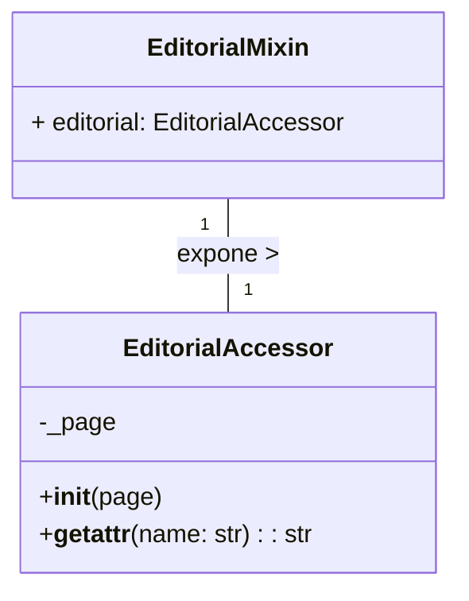

# Dominio y Localización del Procesamiento de Markdown en Content Store

Este módulo, `Content_Store___Markdown_Processing_Dominio_y_Localizacion`, es fundamental para la gestión de contenido editorial y la normalización de las configuraciones regionales dentro del sistema de gestión de contenido de Shopify. Proporciona mecanismos para acceder a campos editoriales de manera canónica y asegura una consistencia en la representación de las configuraciones regionales entre Wagtail y las rutas de contenido.

## Propósito y Funcionalidad Principal

El módulo define la interfaz para acceder a los datos editoriales y gestiona la conversión de códigos de configuración regional.

### Acceso Editorial Canónico

Los componentes `EditorialAccessor` y `EditorialMixin` implementan un patrón de acceso canónico para los campos editoriales de los objetos de página (por ejemplo, páginas de Wagtail). Esto significa que el acceso a los datos editoriales se realiza a través de una interfaz consistente (`.editorial.<campo>`), independientemente de cómo se almacenen o se resuelvan internamente estos datos.

*   **`EditorialMixin`**: Se inyecta en los objetos de dominio (páginas) para exponer la propiedad `.editorial`.
*   **`EditorialAccessor`**: Es un objeto de solo lectura que se vincula a una instancia de página. Permite resolver campos editoriales registrados a través de un `ContentRepository` y un modo de autoridad activa. Esto asegura que los datos editoriales se recuperen de la fuente correcta y en el contexto adecuado.

### Gestión de Configuraciones Regionales (Locales)

El archivo `shopify_content/content_store/locales.py` centraliza la política de mapeo entre los códigos de configuración regional de Wagtail (por ejemplo, `en-US`) y los segmentos de ruta de contenido correspondientes (por ejemplo, `en-us`).

*   **`UnsupportedLocale`**: Una excepción que se lanza cuando se intenta utilizar una configuración regional que no tiene un mapeo configurado a un segmento de ruta de contenido.
*   Las funciones `to_content_locale` y `to_wagtail_locale` proporcionan la lógica para estas conversiones, asegurando que todos los componentes del sistema utilicen una representación coherente de la configuración regional.

## Arquitectura y Relaciones de Componentes

### Diagrama de Clases: Acceso Editorial


El `EditorialMixin` se incrusta en los modelos de página de Wagtail (o cualquier objeto de dominio que necesite acceso editorial). Cuando se accede a `page.editorial`, se devuelve una instancia de `EditorialAccessor`. Este accesor, a su vez, utiliza el nombre del campo para llamar a una función interna (`resolve_editorial`, no detallada aquí pero parte del flujo) que interactúa con un `ContentRepository` para obtener el valor del campo editorial.

### Diagrama de Flujo: Conversión de Configuraciones Regionales

```mermaid
graph TD
    A[Código de Wagtail Locale (e.g., "en-US")] --> B{to_content_locale(wagtail_code)};
    B -- Mapeo existe --> C[Segmento de Ruta de Contenido (e.g., "en-us")];
    B -- Mapeo no existe --> D{Lanzar UnsupportedLocale};
    E[Segmento de Ruta de Contenido (e.g., "en-us")] --> F{to_wagtail_locale(content_code)};
    F -- Mapeo existe --> G[Código de Wagtail Locale (e.g., "en-US")];
    F -- Mapeo no existe --> H{Lanzar UnsupportedLocale};
```

Este flujo ilustra cómo los códigos de configuración regional se transforman entre el formato utilizado por Wagtail y el formato de las rutas de contenido. La gestión centralizada en `locales.py` evita la dispersión de esta lógica y facilita el mantenimiento.

## Integración en el Sistema General

Este módulo se integra con el sistema de gestión de contenido de Shopify de varias maneras:

*   **Modelos de Contenido de Wagtail**: Los modelos de página de Wagtail (definidos en [Shopify Content Models](../Shopify_Content_Models.md)) probablemente incorporan `EditorialMixin` para proporcionar un acceso estandarizado a sus campos editoriales, que pueden almacenarse como Markdown.
*   **Almacenamiento de Contenido**: El `EditorialAccessor` se basa en un `ContentRepository` (ver [Contratos de Procesamiento de Markdown en Content Store](Content_Store___Markdown_Processing_Contratos.md)) para resolver los campos editoriales. Esto implica una interacción con un backend de almacenamiento de contenido, como `FilesystemContentRepository` (definido en [Almacenamiento y Serialización](Content_Store___Markdown_Processing_Almacenamiento_y_Serializacion.md)).
*   **Configuración de Idiomas**: El mapeo de configuraciones regionales se alinea con las configuraciones de idiomas soportadas por Wagtail, que se especifican en `config.settings.WAGTAIL_CONTENT_LANGUAGES`. Esto asegura que el sistema solo opere con locales que tienen una correspondencia clara en la estructura de contenido.
*   **API de Shopify**: Los esquemas de la API de Shopify pueden utilizar campos de configuración regional (como `LocaleCreateFields`, `LocaleOutFields`, `LocalePatchFields` en [Shopify API Schemas Common Data Models](../../Shopify_API___Schemas/Shopify_API___Schemas_Common_Data_Models.md)) que interactúan con la lógica de normalización de configuración regional de este módulo.
*   **Procesamiento de Markdown**: La resolución de contenido editorial está estrechamente ligada al procesamiento de Markdown (parte del módulo padre [Content_Store___Markdown_Processing](../Content_Store___Markdown_Processing.md)), ya que los campos editoriales a menudo contienen contenido en formato Markdown que necesita ser parseado y renderizado.
