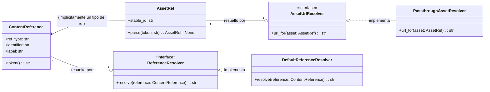

# Procesamiento Markdown de Activos y Referencias

## Introducción
Este módulo se encarga del procesamiento de activos y referencias de contenido dentro del contenido Markdown. Proporciona mecanismos para identificar, representar y resolver referencias a activos (imágenes, archivos) y a otros elementos de contenido (productos, colecciones, páginas) dentro del sistema de gestión de contenido de Shopify. Su objetivo principal es garantizar que las referencias incrustadas en el Markdown sean estables, se puedan resolver y se transformen correctamente en URLs accesibles para el storefront.

## Funcionalidades Clave

### Gestión de Activos

#### `AssetRef`
Representa una referencia inmutable a un activo. Contiene un `stable_id` que identifica de forma única el activo. Permite la serialización y deserialización de referencias de activos desde un formato `asset:<stable-id>`.

#### `AssetUrlResolver`
Un protocolo que define la interfaz para la resolución de `AssetRef` a URLs. Cualquier clase que implemente este protocolo puede ser utilizada para traducir una referencia de activo a su URL correspondiente, lo que permite la flexibilidad en dónde se almacenan y sirven los activos (por ejemplo, CDN).

#### `PassthroughAssetResolver`
Una implementación predeterminada de `AssetUrlResolver` que resuelve las referencias de activos a una ruta CDN genérica `/cdn/assets/{stable_id}`. Sirve como una solución provisional hasta que se configure un mapeo CDN específico de la tienda.

### Gestión de Referencias de Contenido

#### `ContentReference`
Una clase de datos que representa una referencia a un elemento de contenido dentro del sistema. Encapsula el tipo de referencia (`ref_type` como `product`, `collection`, `page`, `asset`, `callout`) y un `identifier` único. También puede incluir una `label` para el texto de visualización. Proporciona un método `token()` para generar una representación en cadena de la referencia.

#### `ReferenceResolver`
Un protocolo que define la interfaz para resolver `ContentReference` a URLs del storefront o fragmentos HTML. Similar a `AssetUrlResolver`, permite la inyección de diferentes estrategias de resolución.

#### `DefaultReferenceResolver`
Una implementación básica de `ReferenceResolver` que resuelve `ContentReference` a URLs predeterminadas del storefront basadas en el `ref_type` y el `identifier`. Por ejemplo, `product:handle` se convierte en `/products/handle`, y `page:/path` se convierte en `/path`.

#### Extracción de Referencias
El módulo incluye funciones como `extract_references` y `extract_reference_tokens` que escanean el contenido Markdown para identificar y extraer todas las instancias de `ContentReference` (incluyendo `AssetRef`s implícitos en imágenes y tokens) y sus representaciones en formato token. Esto es crucial para la indexación de contenido y la verificación de enlaces.

## Arquitectura y Relaciones de Componentes

El módulo establece una clara separación de responsabilidades entre la representación de referencias y su resolución a URLs.



**Flujo de Datos para la Extracción de Referencias**

```mermaid
graph TD
    A[Contenido Markdown] --> B{scan lineas y patrones regex};
    B --> C{Detectar directivas de componente};
    C --> D{Parsear atributos};
    D --> E{Crear ContentReference (producto, colección, página, activo)};
    B --> F{Detectar imágenes con referencias de activos};
    F --> E;
    B --> G{Detectar tokens de activos genéricos};
    G --> E;
    E --> H[Lista de ContentReference];
    H --> I[ContentReference.token()];
    I --> J[Lista de tokens de referencia];
```

## Integración en el Sistema General

Este módulo es una parte fundamental del subsistema de procesamiento de Markdown dentro del [Módulo de Gestión de Contenido de Shopify](../../Shopify_Content_Management.md).

*   **Procesamiento de Contenido:** El componente de [Procesamiento Markdown de Contenido](../Content_Store___Markdown_Processing.md) utiliza las clases `AssetRef` y `ContentReference` para representar los enlaces y activos incrustados. Los resolvedores (`AssetUrlResolver` y `ReferenceResolver`) son invocados durante la fase de renderizado del Markdown para transformar estas referencias estables en URLs reales del storefront.
*   **Validación de Contenido:** Las funciones de extracción de referencias (`extract_references`) son utilizadas por los procesos de validación para asegurar que todas las referencias en el contenido Markdown son válidas y apuntan a recursos existentes. Esto se relaciona con la validación de contenido en [Content_Store___Markdown_Processing_Validacion_de_Contenido.md](./Content_Store___Markdown_Processing_Validacion_de_Contenido.md).
*   **API y Esquemas:** Las referencias de contenido y activos pueden ser expuestas a través de los esquemas API, donde los `identifier`s estables son útiles para la interoperabilidad. Esto se alinea con los esquemas definidos en [Shopify_API___Schemas.md](../../Shopify_API___Schemas.md).
*   **Sincronización de Contenido:** Durante los procesos de importación y sincronización, este módulo ayuda a identificar y procesar las referencias de contenido y activos, asegurando que se mantenga la integridad de los enlaces entre los diferentes tipos de contenido. Esto es relevante para los comandos de gestión de sincronización en [Content_Synchronization___Management_Commands.md](../Content_Synchronization___Management_Commands.md).

Este módulo proporciona los bloques de construcción necesarios para manejar referencias de contenido y activos de una manera robusta y extensible, permitiendo que el contenido Markdown se mantenga actualizado y coherente en todo el ecosistema de Shopify.