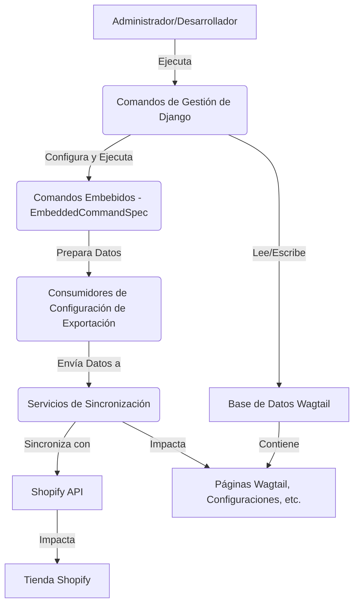

# Comandos de Sincronización y Gestión de Contenido

Este módulo, `Content_Synchronization___Management_Commands`, es el núcleo para la gestión y sincronización de contenido entre Wagtail y Shopify. Proporciona una serie de comandos de gestión de Django que permiten a los administradores y desarrolladores realizar tareas como la configuración inicial, la importación de contenido desde Shopify, la reconstrucción de índices, la gestión de enlaces semánticos y la aplicación de migraciones de datos.

Su propósito principal es automatizar y facilitar la manipulación de grandes volúmenes de contenido, asegurando la coherencia y la eficiencia en la entrega de información a través de la plataforma Shopify.

## Arquitectura General

El módulo se estructura en torno a:
*   **Especificaciones de Comandos Embebidos (`EmbeddedCommandSpec`):** Define los comandos de gestión que pueden ser expuestos y ejecutados a través de la interfaz de la aplicación Shopify.
*   **Consumidores de Configuración de Exportación (`RootIndexConsumer`, `SinglePageListingsConsumer`, etc.):** Se encargan de construir las cargas útiles de los índices precalculados y las configuraciones de `hreflang`/`noindex` para varios tipos de contenido (glosario, ubicaciones, blog). Estos consumidores no interactúan directamente con Shopify, sino que preparan los datos para un escritor externo.
*   **Comandos de Gestión de Django:** Implementan la lógica para diversas operaciones, desde la importación masiva de productos hasta la reconstrucción de índices de búsqueda y la aplicación de definiciones de metaobjetos.

### Diagrama de Arquitectura

*Diagrama 1: Flujo de Interacción General del Módulo de Sincronización y Gestión de Contenido.*

## Funcionalidad de Sub-módulos

A continuación, se describen las funcionalidades clave de los sub-módulos que componen este sistema:

*   **[Comandos Embebidos](Content_Synchronization___Management_Commands/Content_Synchronization___Management_Commands_Comandos_Embebidos.md):** Describe la estructura y el uso de los comandos de gestión que se pueden ejecutar desde la aplicación Shopify integrada.
*   **[Configuración de Exportación de Índices](Content_Synchronization___Management_Commands/Content_Synchronization___Management_Commands_Configuracion_Exportacion_Indices.md):** Detalla cómo se configuran y construyen los índices de contenido (glosario, ubicaciones, blog) para su exportación a Shopify.
*   **[Comandos de Gestión de Configuración Inicial](Content_Synchronization___Management_Commands/Content_Synchronization___Management_Commands_Comandos_Gestion_Setup.md):** Explica los comandos utilizados para la configuración inicial del sistema, como la creación de locales, la programación de tareas y la garantía de definiciones de metaobjetos y metafields.
*   **[Comandos de Gestión de Índices](Content_Synchronization___Management_Commands/Content_Synchronization___Management_Commands_Comandos_Gestion_Indices.md):** Cubre los comandos para reconstruir y actualizar los diversos índices de contenido, incluyendo el índice de URL y el índice vectorial de páginas.
*   **[Comandos de Gestión de Importación](Content_Synchronization___Management_Commands/Content_Synchronization___Management_Commands_Comandos_Gestion_Importacion.md):** Proporciona información sobre los comandos para importar diferentes tipos de contenido (productos, colecciones, blogs, glosario) desde Shopify a Wagtail.
*   **[Comandos de Gestión de Migración y Reparación](Content_Synchronization___Management_Commands/Content_Synchronization___Management_Commands_Comandos_Gestion_Migracion_y_Reparacion.md):** Describe los comandos utilizados para migrar datos, corregir enlaces rotos y materializar contenido editorial en el árbol de contenido de Git.
*   **[Comandos de Gestión de Enlaces Semánticos](Content_Synchronization___Management_Commands/Content_Synchronization___Management_Commands_Comandos_Gestion_Enlaces_Semanticos.md):** Detalla los comandos para la gestión de enlaces internos automáticos y la sincronización de revisiones de enlaces semánticos.
*   **[Validación de Contenido](Content_Synchronization___Management_Commands/Content_Synchronization___Management_Commands_Validacion_Contenido.md):** Explica el comando para validar el contenido editorial basado en Git.

Para una visión más profunda, consulte la documentación detallada de cada sub-módulo.
