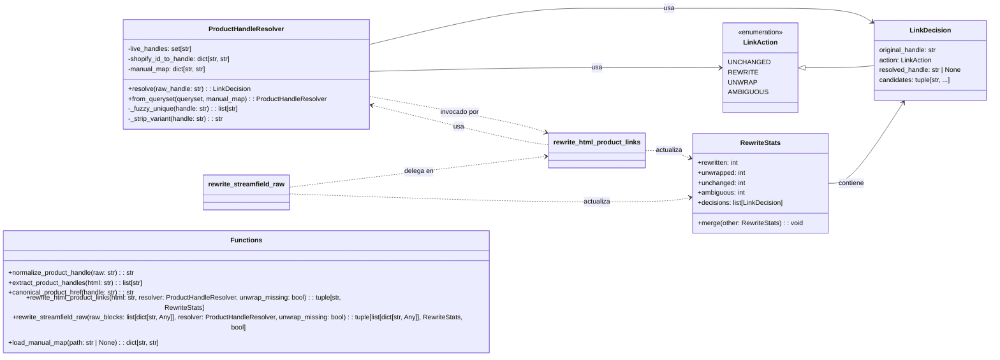
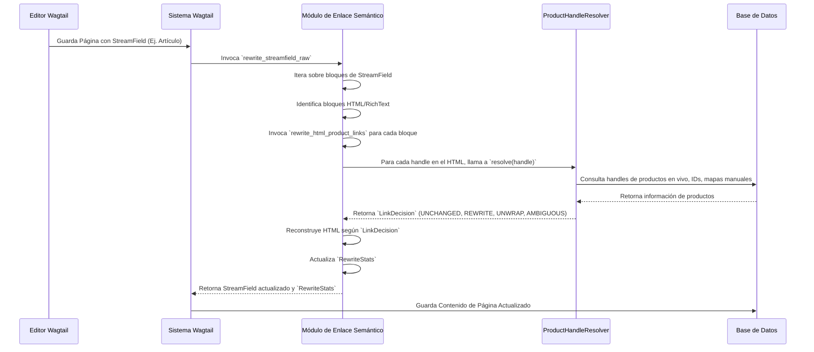

# Lógica de Enlace Semántico de Artículos y Productos

## Introducción

El módulo `Content_URL___Semantic_Linking_Logic_Article_Product_Linking` es un componente vital dentro del sistema de gestión de contenido de Shopify, específicamente diseñado para mantener la integridad y relevancia de los enlaces de productos en el contenido editorial. Su propósito principal es analizar y reescribir las referencias de URL a productos en el HTML de los campos de flujo (StreamFields), asegurando que apunten a los handles de productos en vivo y normalizados en la plataforma Shopify. Esto ayuda a prevenir enlaces rotos y a estandarizar la estructura de las URL, mejorando la experiencia del usuario y la optimización para motores de búsqueda (SEO).

## Propósito y Funcionalidad Principal

Este módulo se enfoca en la identificación, resolución y reescritura de enlaces de productos incrustados en el contenido generado por los editores. Aborda desafíos como handles de productos heredados, errores de formato y la necesidad de una vinculación consistente con los productos activos en Shopify.

### Componentes Principales

*   **`LinkAction`**: Esta enumeración (`enum`) define las posibles acciones que se pueden tomar cuando se evalúa un enlace de producto:
    *   `UNCHANGED`: El enlace es válido y apunta a un handle de producto en vivo, o se normaliza su URL sin cambiar el handle subyacente.
    *   `REWRITE`: El handle del producto necesita ser reescrito a un handle en vivo o canónico.
    *   `UNWRAP`: El enlace no se puede resolver a un producto en vivo y se debe eliminar la etiqueta `<a>`, manteniendo el texto del enlace.
    *   `AMBIGUOUS`: El handle del producto original se resuelve en múltiples candidatos de productos en vivo, lo que requiere intervención manual o una estrategia diferente.

*   **`LinkDecision`**: Una dataclass que almacena la decisión tomada para un enlace de producto específico. Contiene el handle original, la `LinkAction` aplicada, el handle resuelto (si aplica) y una lista de posibles candidatos (en caso de ambigüedad).

*   **`ProductHandleResolver`**: Esta clase es el corazón de la lógica de resolución de handles. Se inicializa con una colección de handles de productos "en vivo" (actualmente existentes en Shopify), un mapa de IDs de Shopify a handles, y un mapa manual de handles antiguos a nuevos. Su método `resolve` toma un handle de producto sin procesar y determina el `LinkDecision` apropiado utilizando varias estrategias, incluyendo:
    *   Coincidencia directa con handles en vivo.
    *   Resolución a través de un mapa manual.
    *   Resolución por ID de Shopify.
    *   Coincidencia "fuzzy" (difusa) para encontrar handles similares o bases de handles.

*   **`RewriteStats`**: Una dataclass utilizada para acumular estadísticas sobre el proceso de reescritura de enlaces. Rastrea cuántos enlaces fueron reescritos, desenvueltos, dejados sin cambios o marcados como ambiguos, además de almacenar una lista de todas las `LinkDecision`s tomadas.

### Normalización y Extracción de Handles

*   **`normalize_product_handle(raw: str) -> str`**: Función que toma una cadena de handle sin procesar (potencialmente de una URL) y la limpia: decodifica el porcentaje de codificación, la convierte a minúsculas, elimina caracteres especiales y estandariza los espacios/guiones.
*   **`extract_product_handles(html: str) -> list[str]`**: Utiliza expresiones regulares para encontrar todas las referencias a `/products/{handle}` en una cadena HTML, normaliza cada handle extraído y devuelve una lista única.

### Reescritura de Enlaces

*   **`rewrite_html_product_links(html: str, resolver: ProductHandleResolver, *, unwrap_missing: bool = True) -> tuple[str, RewriteStats]`**: Esta función es responsable de escanear un bloque de HTML en busca de enlaces de productos (`<a>` tags que apuntan a `/products/...`). Para cada enlace, utiliza el `ProductHandleResolver` para determinar la acción a seguir y reescribe la URL del enlace, o desenvuelve el ancla si el producto no se puede resolver y `unwrap_missing` es `True`.
*   **`rewrite_streamfield_raw(raw_blocks: list[dict[str, Any]] | None, resolver: ProductHandleResolver, *, unwrap_missing: bool = True) -> tuple[list[dict[str, Any]], RewriteStats, bool]`**: Extiende la funcionalidad de reescritura a los datos crudos de StreamField de Wagtail. Itera sobre los bloques de StreamField, identifica los bloques de tipo 'html', 'paragraph' y 'callout', y aplica `rewrite_html_product_links` a sus valores de contenido. Devuelve los bloques modificados, las estadísticas de reescritura y un indicador de si se realizaron cambios.
*   **`load_manual_map(path: str | None) -> dict[str, str]`**: Carga un mapa manual de handles de un archivo JSON, permitiendo a los administradores definir reglas de reescritura específicas.

## Arquitectura y Relaciones entre Componentes

El módulo está diseñado de manera modular, con clases y funciones que tienen responsabilidades claras.

### Diagrama de Clases

El siguiente diagrama ilustra las relaciones entre las principales clases y funciones dentro del módulo:



### Diagrama de Flujo de Reescritura de Enlaces HTML

El siguiente diagrama detalla el flujo de ejecución de la función `rewrite_html_product_links`:

```mermaid
graph TD
    A[Inicio: rewrite_html_product_links] --> B{HTML de entrada vacío?};
    B -- Sí --> C[Retornar HTML original y estadísticas vacías];
    B -- No --> D{Iterar sobre todos los PRODUCT_ANCHOR_RE en HTML};
    D --> E{Para cada anclaje encontrado};
    E --> F[Extraer `raw_handle`];
    F --> G[Llamar a `resolver.resolve(raw_handle)` para obtener `LinkDecision`];
    G --> H[Registrar `LinkDecision` en `RewriteStats`];
    H --> I{Action == UNCHANGED?};
    I -- Sí --> J{URL actual == URL canónica?};
    J -- Sí --> K[Incrementar `unchanged`];
    J -- No --> L[Incrementar `rewritten`, reconstruir anclaje con URL canónica];
    I -- REWRITE --> M[Incrementar `rewritten`, reconstruir anclaje con `resolved_handle`];
    I -- AMBIGUOUS --> N[Incrementar `ambiguous`, dejar anclaje sin cambios];
    I -- UNWRAP --> O{unwrap_missing es verdadero?};
    O -- Sí --> P[Incrementar `unwrapped`, reemplazar anclaje con su contenido (`body`)];
    O -- No --> Q[Incrementar `unchanged`, dejar anclaje sin cambios];
    K --> D; L --> D; M --> D; N --> D; P --> D; Q --> D;
    D --> R[Fin: Devolver HTML modificado y `RewriteStats`];
```

## Cómo se integra el módulo en el sistema general

Este módulo juega un papel crucial en la gestión y el mantenimiento de la integridad de los enlaces de productos dentro del contenido editorial de Shopify. Su función principal es asegurar que los enlaces a productos sean correctos y consistentes, lo que contribuye a una mejor experiencia de usuario y a la salud general del SEO del sitio.

### Integración con el Flujo de Contenido

*   **Creación/Edición de Contenido**: Cuando los editores crean o actualizan páginas de artículos, productos u otros contenidos en Wagtail que pueden contener enlaces a productos, este módulo puede ser invocado para garantizar que esos enlaces sean precisos y apunten a los identificadores (handles) de productos en vivo y normalizados.
*   **Procesamiento por Comandos de Gestión**: El comando de gestión `fix_article_product_links` (ubicado en `shopify_content/management/commands/fix_article_product_links.py`, parte de [Sincronización de Contenido y Comandos de Gestión](../Content_Synchronization___Management_Commands.md)) es un consumidor directo de esta lógica. Este comando permite ejecutar la reescritura de enlaces en bloques de contenido existentes para corregir o actualizar de forma masiva los enlaces a productos, por ejemplo, después de una migración de datos o un cambio en la estructura de los handles.
*   **Wagtail StreamField**: La función `rewrite_streamfield_raw` indica una integración directa con el sistema de campos de flujo (StreamField) de Wagtail. Esto significa que el contenido estructurado en Wagtail (como cuerpos de artículos, descripciones de productos, etc.) es el objetivo principal de esta reescritura de enlaces, permitiendo procesar y normalizar dinámicamente el HTML incrustado.

### Dependencias y Relaciones

*   **Modelos de Contenido**: El `ProductHandleResolver` depende directamente de los handles de productos y los IDs de Shopify almacenados en los modelos de contenido (por ejemplo, `ProductPage` en [Modelos de Contenido de Shopify](../Shopify_Content_Models.md)). Sin la información de los productos en vivo, la resolución de handles sería ineficaz.
*   **Esquemas de la API de Shopify**: Los handles de productos y las URLs generadas o validadas por este módulo deben ser consistentes con los esquemas definidos por la API de Shopify para garantizar la interoperabilidad. (Ver [Esquemas de API de Shopify - Contenido de Productos](../../Shopify_API___Schemas/Shopify_API___Schemas_Product_Content.md)).
*   **Utilidades de URL de Tienda (`shopify_content.storefront_urls`)**: El módulo hace uso de la función `product_path` de `shopify_content.storefront_urls` para generar URLs canónicas de productos. Esto asegura que los enlaces reescritos sigan el patrón de URL esperado por la tienda, manteniendo la coherencia en la navegación.

### Diagrama de Contexto del Sistema

```mermaid
graph TD
    A[Editor de Contenido Wagtail] --> B(Páginas de Contenido: Artículo, Producto);
    B --> C{Bloques de StreamField};
    C --> D[Contenido HTML/RichText];
    D -- Enlaces de Producto Legacy --> E[Módulo de Enlace Semántico de Artículos y Productos];
    E --> F[ProductHandleResolver];
    F -- Resuelve Handles --> G[Base de Datos de Productos en Vivo];
    E -- Reescritura/Desenvolvimiento --> H[Contenido HTML/RichText Normalizado];
    H --> I[Almacenamiento de Contenido (Base de Datos)];
    J(Comando de Gestión: fix_article_product_links) --> E;
    E --> K[RewriteStats (Estadísticas de Reescritura)];
    K --> L[Monitorización/Informes];
    G -- Proporciona Handles de Productos --> F;
```

### Diagrama de Secuencia

Este diagrama ilustra una secuencia típica de cómo el módulo interactúa con otras partes del sistema cuando un editor guarda una página de Wagtail.

