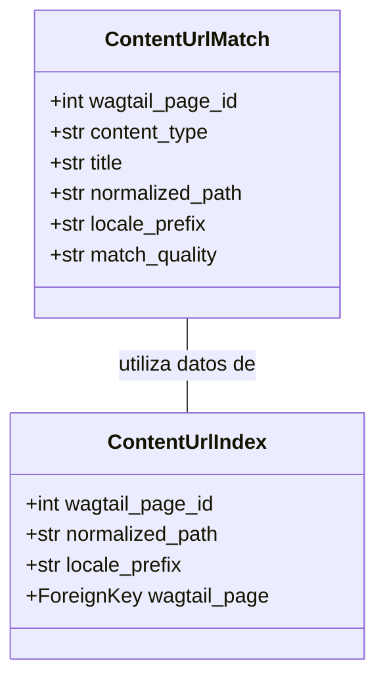
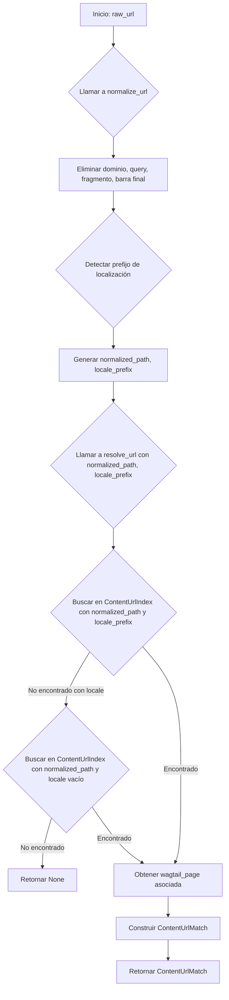

# Resolución de URL y Enlaces Semánticos

Este documento proporciona una visión general del módulo `Content_URL___Semantic_Linking_Logic_URL_Resolution`, que es fundamental para resolver URLs de escaparate (storefront) y de Google Search Console (GSC) a páginas de contenido de Wagtail. El módulo asegura que las URLs externas se mapeen correctamente a su contenido editorial correspondiente dentro del sistema.

## 1. Propósito y Funcionalidad Principal

El módulo `Content_URL___Semantic_Linking_Logic_URL_Resolution` se encarga de estandarizar y buscar URLs para identificar el contenido de Wagtail asociado. Su funcionalidad principal incluye:

*   **Normalización de URLs**: Limpia las URLs de dominios, cadenas de consulta, fragmentos y barras diagonales finales, y detecta los prefijos de localización de Shopify Markets.
*   **Resolución de URLs**: Utiliza un índice preconstruido para encontrar la página de Wagtail que coincide con una URL normalizada, gestionando también la resolución para contenido localizado.

### 1.1. `ContentUrlMatch`

La clase `ContentUrlMatch` es una `dataclass` congelada que representa una coincidencia exitosa entre una URL y una página de contenido de Wagtail.

**Componente Clave:** `shopify_content/content_url_resolver.py::ContentUrlMatch`

```python
@dataclass(frozen=True)
class ContentUrlMatch:
    wagtail_page_id: int
    content_type: str
    title: str
    normalized_path: str
    locale_prefix: str | None
    match_quality: str  # exact | unmapped
```

**Atributos:**
*   `wagtail_page_id` (int): El ID de la página de Wagtail coincidente.
*   `content_type` (str): El tipo de contenido de la página (e.g., "Artículo", "Producto").
*   `title` (str): El título de la página de Wagtail.
*   `normalized_path` (str): La ruta URL normalizada de la página.
*   `locale_prefix` (str | None): El prefijo de localización detectado (e.g., "es-us", "en-ca").
*   `match_quality` (str): Indica la calidad de la coincidencia ("exact" para una coincidencia directa, "unmapped" para una URL sin coincidencia directa, aunque este módulo solo devuelve "exact").

### 1.2. `normalize_url`

La función `normalize_url` toma una URL bruta (raw URL) y un parámetro `property_url` opcional para estandarizar la URL.

**Componente Clave:** `shopify_content/content_url_resolver.py::normalize_url`

```python
def normalize_url(raw_url: str, *, property_url: str = '') -> tuple[str, str]:
    """
    Normaliza una URL de GSC o de escaparate a (normalized_path, locale_prefix).

    Elimina el dominio, la cadena de consulta, el fragmento y la barra final. Detecta los prefijos
    de localización de Shopify Markets (/es-us/, /en-ca/, etc.).
    """
    # ... implementación ...
```

Esta función es crucial para preparar las URLs para la búsqueda, asegurando que variaciones triviales no impidan una coincidencia.

### 1.3. `resolve_url`

La función `resolve_url` utiliza la URL normalizada para buscar una página de contenido correspondiente en el `ContentUrlIndex`.

**Componente Clave:** `shopify_content/content_url_resolver.py::resolve_url`

```python
def resolve_url(raw_url: str, *, property_url: str = '') -> ContentUrlMatch | None:
    """
    Busca una URL de escaparate en ContentUrlIndex.

    Devuelve None cuando ninguna página indexada coincide (URL no mapeada).
    """
    # ... implementación ...
```

Esta función es el punto de entrada para la resolución de URLs en el sistema.

## 2. Arquitectura y Relaciones entre Componentes

El módulo `Content_URL___Semantic_Linking_Logic_URL_Resolution` interactúa principalmente con el modelo `ContentUrlIndex` para realizar sus funciones de resolución de URLs.

### 2.1. Diagrama de Clases

El siguiente diagrama de clases muestra la relación entre `ContentUrlMatch` y el modelo `ContentUrlIndex`.



### 2.2. Flujo de Resolución de URL

El siguiente diagrama de flujo ilustra el proceso de cómo se normaliza y resuelve una URL.



## 3. Integración en el Sistema General

Este módulo es una parte esencial de la gestión de contenido de Shopify, proporcionando la base para la navegación y el SEO al asegurar que las URLs se puedan mapear de manera confiable al contenido.

*   **Indexación de Contenido**: Las URLs son indexadas por procesos que utilizan modelos como `ContentUrlIndex` (definido en [Shopify_Content_Management/Shopify_Content_Models.md](../Shopify_Content_Models.md)) para permitir búsquedas eficientes.
*   **Enlazado Semántico**: Aunque este módulo se centra en la resolución directa de URLs, forma parte de la lógica más amplia de enlaces semánticos, que incluye también la vinculación de artículos y productos, como se detalla en [Content_URL___Semantic_Linking_Logic_Article_Product_Linking.md](Content_URL___Semantic_Linking_Logic_Article_Product_Linking.md).
*   **Wagtail CMS**: Se integra directamente con el sistema de gestión de contenido de Wagtail al referenciar `wagtail_page_id` y extraer títulos de las páginas específicas de Wagtail.

La correcta resolución de URLs es crítica para el rendimiento del sitio web, la experiencia del usuario y la optimización para motores de búsqueda, haciendo de este módulo un componente central en la arquitectura de contenido.