# Migraciones de Base de Datos para Shopify Content Management

Este módulo (`shopify_content/migrations/`) contiene las migraciones de Django que definen y evolucionan el esquema de la base de datos para la gestión de contenido de Shopify. Estas migraciones son esenciales para establecer la estructura de los modelos de Wagtail que interactúan con la API de Shopify, asegurando la coherencia de los datos y la funcionalidad a lo largo del tiempo.

## Arquitectura General

Las migraciones de Django son archivos autogenerados (o creados manualmente) que describen los cambios en el esquema de la base de datos de una aplicación. En el contexto de `Shopify_Content_Management`, estas migraciones:
*   Definen la estructura inicial de las páginas y modelos relacionados con el contenido de Shopify (blogs, artículos, colecciones, productos, ubicaciones, términos de glosario).
*   Añaden nuevos campos a los modelos existentes o modifican las propiedades de los campos.
*   Crean tablas intermedias para relaciones (como etiquetas y metafields) o elementos anidados (como FAQs e imágenes de productos).
*   Establecen índices y restricciones para optimizar el rendimiento y asegurar la integridad de los datos.

Cada archivo de migración tiene una dependencia explícita del anterior, formando una secuencia lineal que permite a Django actualizar el esquema de la base de datos de forma incremental y controlada.

```mermaid
graph TD
    A[0001_initial.py] --> B[0002_blog_description_and_seo.py];
    B --> C[0003_add_faq_items.py];
    C --> D[0004_add_location_page.py];
    D --> E[0005_alter_locationpage_shopify_locale.py];
    E --> F[0006_product_image_urls.py];
    F --> G[0007_shopify_sync_run.py];
    G --> H[0008_content_index.py];
    H --> I[0009_shopifyrootpage_operational_fields.py];
    I --> J[0010_catch_up_schema.py];

    subgraph Flujo de Migraciones
        A -- Creación de modelos base --> B
        B -- Añadir descripción a BlogPage --> C
        C -- Añadir soporte para FAQs --> D
        D -- Añadir página de Ubicación --> E
        E -- Actualizar opciones de local de Ubicación --> F
        F -- Añadir URLs de imágenes de productos --> G
        G -- Crear modelo de ejecución de sincronización --> H
        H -- Crear índices de contenido --> I
        I -- Añadir campos operativos a ShopifyRootPage --> J
        J -- Actualizar esquema con relaciones semánticas y más --> Fin
    end
```

## Componentes Clave y Funcionalidad

Las migraciones de este módulo introducen o modifican el esquema de la base de datos para soportar diversas funcionalidades de gestión de contenido. A continuación, se detallan las principales agrupaciones de cambios:

### 1. Estructura Inicial y Modelos Base (shopify_content/migrations/0001_initial.py)

Esta migración fundamental establece los modelos de página principales y sus relaciones iniciales:
*   `BlogPage`, `CollectionPage`, `ProductPage`, `ArticlePage`: Modelos que representan los tipos de contenido sincronizados con Shopify. Incluyen campos como `shopify_id`, `handle`, `sync_enabled`, `last_synced_at`.
*   `ShopifyRootPage`: Un modelo de página raíz para organizar el contenido relacionado con Shopify en Wagtail.
*   `ArticlePageMetafield`, `CollectionPageMetafield`, `ProductPageMetafield`: Modelos para adjuntar metafields personalizados a los diferentes tipos de página, permitiendo una mayor flexibilidad en los datos.
*   `ArticlePageTag`, `ProductPageTag`: Modelos para asociar etiquetas a artículos y productos, utilizando `django-taggit`.
*   Los campos `StreamField` en `CollectionPage`, `ProductPage`, y `ArticlePage` definen la estructura del cuerpo del contenido, incorporando bloques como `heading`, `paragraph`, `image`, `video`, `callout`, `html`, y `metafield` para `ProductPage`.

### 2. Extensiones de Blog y FAQ (shopify_content/migrations/0002_blog_description_and_seo.py, shopify_content/migrations/0003_add_faq_items.py)

Estas migraciones extienden la funcionalidad de los blogs y añaden soporte para preguntas frecuentes:
*   `0002_blog_description_and_seo.py`: Añade un campo `description` a `BlogPage` para una descripción SEO y de contenido más rica.
*   `0003_add_faq_items.py`: Introduce modelos `ArticlePageFAQ`, `BlogPageFAQ`, `CollectionPageFAQ`, `ProductPageFAQ` para permitir la inclusión de secciones de preguntas frecuentes en diferentes tipos de página.

### 3. Gestión de Páginas de Ubicación (shopify_content/migrations/0004_add_location_page.py, shopify_content/migrations/0005_alter_locationpage_shopify_locale.py)

Estas migraciones introducen la capacidad de gestionar páginas de ubicación:
*   `0004_add_location_page.py`: Crea el modelo `LocationPage` con campos para `shopify_id`, `handle`, información geográfica (país, estado, ciudad), y múltiples secciones de contenido enriquecido (`intro`, `content_2`, `content_3`, `brand_section`, `map_content`, `after_page_content`). También añade `LocationPageFAQ`.
*   `0005_alter_locationpage_shopify_locale.py`: Modifica el campo `shopify_locale` en `LocationPage` para usar una lista predefinida de opciones de locales de Shopify (por ejemplo, "en-US", "es-US").

### 4. Gestión de Imágenes y Sincronización (shopify_content/migrations/0006_product_image_urls.py, shopify_content/migrations/0007_shopify_sync_run.py)

Estas migraciones mejoran la gestión de imágenes y establecen un mecanismo de seguimiento de la sincronización:
*   `0006_product_image_urls.py`: Añade campos relacionados con URL de imágenes a `ArticlePage` (`featured_image_alt`, `featured_image_url`, `shopify_featured_image_id`) y `CollectionPage` (`image_alt_text`, `image_url`, `shopify_image_id`). Además, crea el modelo `ProductPageImage` para manejar múltiples imágenes de productos con `shopify_id`, `url`, `alt_text` y `sort_order`.
*   `0007_shopify_sync_run.py`: Introduce el modelo `ShopifySyncRun` para registrar y rastrear el estado de las operaciones de sincronización de contenido entre Wagtail y Shopify, incluyendo `kind` (inbound/outbound), `resource`, `status`, `message`, y `stats`.

### 5. Indexación de Contenido (shopify_content/migrations/0008_content_index.py)

Esta migración crea la infraestructura para la indexación de contenido:
*   `0008_content_index.py`: Establece los modelos `ContentIndex` y `ContentReferenceIndex`.
    *   `ContentIndex`: Almacena información sobre piezas de contenido indexado (`content_type`, `object_id`, `field_key`, `locale`, `checksum`, `reference_count`).
    *   `ContentReferenceIndex`: Registra las referencias encontradas dentro del contenido indexado (`ref_type`, `identifier`, `token`) y las vincula a un `ContentIndex`.
Esta funcionalidad es clave para la resolución de enlaces y la gestión de referencias cruzadas dentro de la plataforma.

### 6. Actualizaciones de Esquema y Enlaces Semánticos (shopify_content/migrations/0009_shopifyrootpage_operational_fields.py, shopify_content/migrations/0010_catch_up_schema.py)

Estas son migraciones de "puesta al día" que refinan los modelos existentes y añaden una compleja funcionalidad de enlaces semánticos:
*   `0009_shopifyrootpage_operational_fields.py`: Añade campos operativos a `ShopifyRootPage` como `shopify_id`, `handle`, `sync_enabled`, `last_synced_at`, y `export_config`, que son cruciales para la gestión y sincronización de la página raíz.
*   `0010_catch_up_schema.py`: Una migración extensa que incluye:
    *   `EmbeddedCommandRun`: Un modelo para registrar y seguir la ejecución de comandos incrustados.
    *   `available_locales`: Añadido a `ArticlePage` y `BlogPage` para indicar los locales donde el contenido está disponible en la tienda.
    *   `theme_config`: Añadido a `CollectionPage` y `ProductPage` para almacenar configuraciones de tema que se sincronizan como metafields.
    *   Actualizaciones a `StreamField` en `ArticlePage` para incluir nuevos bloques como `product_banner`.
    *   `db_default=True` para `sync_enabled` en varias páginas, asegurando que la sincronización esté habilitada por defecto.
    *   Actualizaciones a `handle` de `LocationPage` para una derivación automática basada en locale y ciudad.
    *   `export_config` en `ShopifyRootPage` con `db_default={}` para configuraciones de exportación específicas del tipo.
    *   Introducción de numerosos modelos de enlaces relacionados: `ArticleRelatedArticleLink`, `ArticleRelatedCollectionLink`, `ArticleRelatedGlossaryTermLink`, `ArticleRelatedProductLink`, y sus equivalentes para `Collection`, `GlossaryTerm` y `Product`. Estos modelos (`SemanticPageLink` en esencia) permiten la vinculación semántica automática y manual entre diferentes tipos de contenido.
    *   `GlossaryTermPage`: Un nuevo modelo para términos de glosario, con campos para `term`, `definition`, `image_alt_text`, `image_url`, `shopify_image_id`, `locale_code`, `related_links`, `external_links`, `synonyms`, y `same_as`.
    *   `HomePage`: Un nuevo modelo para la página de inicio, con amplios campos para contenido `hero`, `body` (un `StreamField` complejo con numerosos bloques específicos de la página de inicio como `promo_gateway`, `nav_collection_pills`, `trust_bar`, `featured_collections`, `editorial_intro`, `best_sellers`, `shop_by_need`, `educational_hub`, `brand_values`, `market_block`, `faq`, `internal_links`, `seo_schema`), y `sections_json`.
    *   `ContentUrlIndex`: Un modelo para indexar las URLs canónicas del contenido de Wagtail para su uso en la tienda, incluyendo `normalized_path`, `content_type`, `handle`, `blog_handle`, `locale`, `locale_prefix`, `is_canonical`, y una referencia a la `wagtail_page`.
