# Modelos de Contenido de Shopify

Este módulo (`shopify_content/models`) define la estructura de datos fundamental y los modelos de página de Wagtail que representan el contenido sincronizado con Shopify. Actúa como el puente entre el sistema de gestión de contenido (Wagtail) y la plataforma de comercio electrónico (Shopify), permitiendo la gestión de diversos tipos de contenido como artículos, blogs, colecciones, productos, páginas de inicio, ubicaciones y términos de glosario.

## Propósito
El objetivo principal de este módulo es:
*   **Representación de Contenido de Shopify:** Modelar entidades de contenido de Shopify dentro de Wagtail, como `BlogPage`, `ArticlePage`, `CollectionPage`, `ProductPage`, `HomePage`, `LocationPage` y `GlossaryTermPage`.
*   **Sincronización de Datos:** Facilitar la sincronización bidireccional de datos entre Wagtail y Shopify, incluyendo metadatos, configuraciones de SEO, contenido de cuerpo y detalles específicos de cada tipo de contenido.
*   **Extensibilidad y Reutilización:** Proporcionar mixins (`AvailableLocalesMixin`, `FAQItem`, `ShopifyMetafield`) que encapsulan la lógica común y las estructuras de datos reutilizables en varios modelos de página.
*   **Indexación de Contenido:** Mantener índices de contenido y URL para búsquedas eficientes y resolución de rutas.
*   **Gestión de Tareas Asíncronas:** Registrar y seguir la ejecución de comandos incrustados y tareas de sincronización.
*   **Enlaces Semánticos:** Permitir la creación y gestión de enlaces internos relacionados entre diferentes tipos de contenido.

## Arquitectura General
El módulo `shopify_content/models` se integra estrechamente con Wagtail y Shopify, sirviendo como la capa de modelado de datos. A continuación, se presenta un diagrama de alto nivel de las relaciones entre los modelos clave.

```mermaid
graph TD
    A[ShopifyRootPage] --> B(Página de Wagtail);
    B --> C[BlogPage];
    B --> D[ArticlePage];
    B --> E[CollectionPage];
    B --> F[ProductPage];
    B --> G[HomePage];
    B --> H[LocationPage];
    B --> I[GlossaryTermPage];

    subgraph Mixins y Componentes Reutilizables
        J[AvailableLocalesMixin]
        K[FAQItem]
        L[ShopifyMetafield]
        M[SemanticPageLink]
    end

    C -- "Hereda de" --> J;
    D -- "Hereda de" --> J;
    C -- "Tiene muchos" --> K;
    D -- "Tiene muchos" --> K;
    E -- "Tiene muchos" --> K;
    F -- "Tiene muchos" --> K;
    G -- "Tiene muchos" --> K;
    H -- "Tiene muchos" --> K;

    D -- "Tiene muchos" --> L;
    E -- "Tiene muchos" --> L;
    F -- "Tiene muchos" --> L;

    C -- "Gestiona" --> M;
    D -- "Gestiona" --> M;
    E -- "Gestiona" --> M;
    F -- "Gestiona" --> M;
    G -- "Gestiona" --> M;
    H -- "Gestiona" --> M;
    I -- "Gestiona" --> M;

    N[ContentIndex] --> O[ContentReferenceIndex];
    P[ContentUrlIndex];
    Q[EmbeddedCommandRun];
    R[ShopifySyncRun];

    subgraph Sincronización e Indexación
        N
        P
        Q
        R
    end

    B -- "Puede referenciar" --> N;
    B -- "Puede referenciar" --> P;
    Q -- "Asociado a" --> R;

    style A fill:#f9f,stroke:#333,stroke-width:2px
    style B fill:#bbf,stroke:#333,stroke-width:2px
    style J fill:#fcf,stroke:#333,stroke-width:2px
    style K fill:#fcf,stroke:#333,stroke-width:2px
    style L fill:#fcf,stroke:#333,stroke-width:2px
    style M fill:#fcf,stroke:#333,stroke-width:2px
    style N fill:#ccf,stroke:#333,stroke-width:2px
    style P fill:#ccf,stroke:#333,stroke-width:2px
    style Q fill:#ccf,stroke:#333,stroke-width:2px
    style R fill:#ccf,stroke:#333,stroke-width:2px
```

## Sub-módulos y Funcionalidades Principales

Este módulo se descompone en varios sub-módulos, cada uno con responsabilidades específicas:

