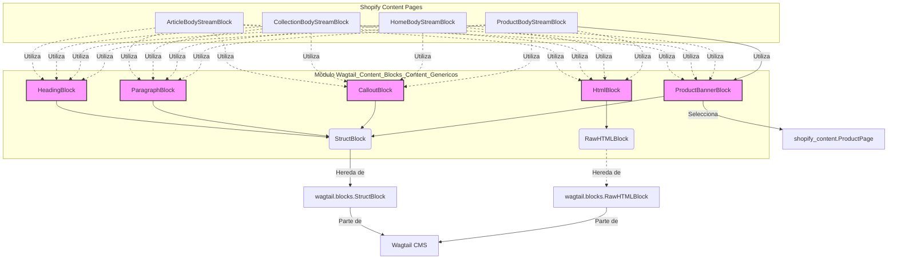

# Bloques de Contenido Genéricos de Wagtail

Este módulo, `Wagtail_Content_Blocks_Content_Genericos`, define un conjunto de bloques de contenido reutilizables para Wagtail que proporcionan elementos de contenido comunes para las páginas de Shopify. Estos bloques están diseñados para ser versátiles y se pueden utilizar en diferentes tipos de páginas de contenido para construir el cuerpo principal de artículos, colecciones, páginas de inicio y productos.

## Propósito y Funcionalidad Principal

El propósito principal de este módulo es ofrecer componentes de contenido estandarizados y fáciles de usar para los editores de contenido en el CMS de Wagtail. Estos bloques encapsulan la lógica de renderizado y la estructura HTML compatible con Shopify, asegurando la consistencia y la correcta visualización del contenido en la tienda Shopify. La funcionalidad clave incluye:

*   **Estructuración del Contenido**: Proporcionar bloques para organizar el texto con encabezados y párrafos.
*   **Contenido Enriquecido**: Permitir la inclusión de texto con formato básico (negrita, cursiva, enlaces, listas).
*   **HTML Personalizado**: Ofrecer una opción para insertar HTML sin procesar para diseños complejos o contenido heredado.
*   **Elementos Destacados**: Facilitar la creación de cuadros de llamada (callouts) para resaltar información importante.
*   **Integración de Productos**: Permitir la inclusión de banners de productos directamente en el flujo de contenido.

### Componentes de Código Clave

Los siguientes bloques de contenido se definen en `shopify_content/blocks/content.py`:

#### `HeadingBlock`

*   **Descripción**: Representa un encabezado de sección. Se renderiza como etiquetas `<h2>`, `<h3>` o `<h4>` en la salida HTML de Shopify.
*   **Campos**: `text` (texto del encabezado), `level` (nivel del encabezado, por defecto `h2`).
*   **Icono**: `title`
*   **Plantilla**: `shopify_content/blocks/heading_block.html`

#### `ParagraphBlock`

*   **Descripción**: Un bloque de párrafo de texto enriquecido con formato limitado a HTML compatible con Shopify.
*   **Características de Texto Enriquecido**: Negrita, cursiva, enlaces, listas ordenadas y no ordenadas, línea horizontal.
*   **Icono**: `pilcrow`
*   **Plantilla**: `shopify_content/blocks/paragraph_block.html`

#### `HtmlBlock`

*   **Descripción**: Un bloque que permite el paso directo de HTML sin procesar. Es útil para importar HTML existente de Shopify sin modificaciones y para enviar HTML personalizado a Shopify.
*   **Icono**: `code`
*   **Ayuda**: 'Raw HTML sent to Shopify verbatim. Use for complex layouts.'

#### `CalloutBlock`

*   **Descripción**: Un cuadro de llamada destacado que se renderiza como un `
` estilizado en el HTML de Shopify.
*   **Campos**: `callout_type` (tipo de llamada: 'info', 'warning', 'tip', 'note'), `text` (contenido de texto enriquecido de la llamada).
*   **Características de Texto Enriquecido**: Negrita, cursiva, enlaces.
*   **Icono**: `warning`
*   **Plantilla**: `shopify_content/blocks/callout_block.html`

#### `ProductBannerBlock`

*   **Descripción**: Un bloque que muestra una tarjeta de producto. Se renderiza como una tarjeta de producto en el HTML de Shopify.
*   **Campos**: `product` (un selector de página que enlaza a una `shopify_content.ProductPage`).
*   **Icono**: `snippet`
*   **Plantilla**: `shopify_content/blocks/product_banner_block.html`

## Arquitectura y Relaciones de Componentes

Los bloques de contenido genéricos se basan en la funcionalidad `StreamBlock` de Wagtail, lo que les permite ser combinados y reordenados de manera flexible dentro de un `StreamField`. Estos bloques son componentes fundamentales utilizados por otros bloques de contenido de nivel superior, como los definidos en [Wagtail_Content_Blocks.md](../Wagtail_Content_Blocks.md), que a su vez se utilizan en modelos de página específicos de Shopify (como `ArticleBodyStreamBlock`, `CollectionBodyStreamBlock`, `HomeBodyStreamBlock`, `ProductBodyStreamBlock`).

*Diagrama de Clases: Relación entre Bloques de Contenido Genéricos y Wagtail*

## Cómo encaja el módulo en el sistema general

Este módulo es una parte integral de la gestión de contenido de Shopify, específicamente dentro del ecosistema de Wagtail. Proporciona los bloques de construcción básicos para el contenido editorial que se publica y sincroniza con Shopify.

Los bloques definidos aquí (`HeadingBlock`, `ParagraphBlock`, `HtmlBlock`, `CalloutBlock`, `ProductBannerBlock`) son elementos fundamentales que se utilizan en los `StreamField` de los modelos de página de Shopify (por ejemplo, `ArticlePage`, `CollectionPage`, `HomePage`, `ProductPage`). Estos modelos de página, a su vez, son gestionados por el [CMS_UI___Frontend.md](../../CMS_UI___Frontend.md) y su contenido se sincroniza con Shopify a través de los mecanismos definidos en [Content_Synchronization___Management_Commands.md](../Content_Synchronization___Management_Commands.md).

La capacidad de integrar `ProductBannerBlock` mediante `PageChooserBlock` demuestra la interconexión con los modelos de datos de productos de Shopify, probablemente gestionados en [Shopify_Content_Models.md](../Shopify_Content_Models.md).

En resumen, `Wagtail_Content_Blocks_Content_Genericos` actúa como la base para la creación de contenido dinámico y estructurado en Wagtail que finalmente se representa en la tienda Shopify. Facilita la creación de páginas ricas en contenido y coherentes con la marca, utilizando un enfoque modular y reutilizable.
