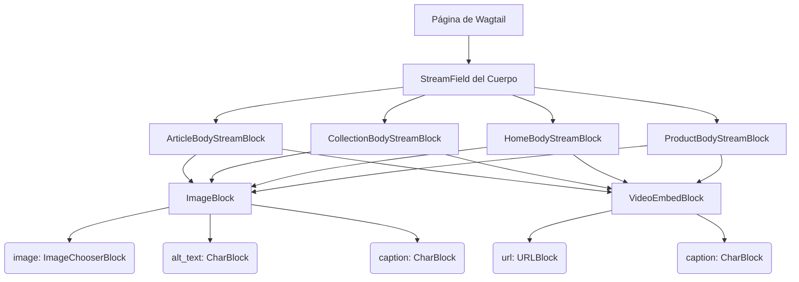

# Bloques de Contenido Wagtail para Medios

Este documento detalla el módulo `Wagtail_Content_Blocks_Medios`, que proporciona bloques de contenido Wagtail para la gestión de medios, específicamente imágenes y videos. Estos bloques son fundamentales para enriquecer el contenido editorial en el sistema de gestión de contenido.

## Propósito y Funcionalidad Principal

El módulo `Wagtail_Content_Blocks_Medios` define dos bloques principales utilizados en los StreamFields de Wagtail:

*   **`ImageBlock`**: Permite a los editores incrustar imágenes en las páginas de Wagtail, con soporte para texto alternativo, subtítulos y una integración con la funcionalidad de IA de Wagtail para el texto alternativo.
*   **`VideoEmbedBlock`**: Facilita la incrustación de videos de plataformas como YouTube o Vimeo, permitiendo a los editores añadir contenido multimedia dinámico.

Estos bloques son serializados para la sincronización saliente con Shopify, donde las imágenes se referencian como medios o se incrustan en HTML, y los videos se incrustan como `<iframe>`.

## Arquitectura y Relaciones de Componentes

Los bloques `ImageBlock` y `VideoEmbedBlock` son componentes clave dentro del sistema de [Bloques de Contenido Wagtail](../Wagtail_Content_Blocks.md) más amplio. Se utilizan en varios `StreamBlock`s de cuerpo principal, como `ArticleBodyStreamBlock`, `CollectionBodyStreamBlock`, `HomeBodyStreamBlock` y `ProductBodyStreamBlock`, definidos en `shopify_content/blocks/__init__.py`.

A continuación, se muestra un diagrama que ilustra cómo estos bloques se integran en la estructura general de los StreamFields de Wagtail:

### `ImageBlock`

El `ImageBlock` permite a los editores insertar imágenes en el contenido.

*   **`image`**: Un `ImageChooserBlock` que permite seleccionar una imagen de la biblioteca de Wagtail. Es un campo obligatorio.
*   **`alt_text`**: Un `CharBlock` para el texto alternativo de la imagen. Este campo sobrescribe el título de la imagen para fines de accesibilidad y es opcional. Está integrado con la funcionalidad `wagtail_ai` para autogeneración.
*   **`caption`**: Un `CharBlock` para un subtítulo descriptivo de la imagen, opcional.

En la sincronización con Shopify, la URL de la imagen de Wagtail se convierte en una referencia multimedia o se incrusta directamente en el HTML de Shopify.

### `VideoEmbedBlock`

El `VideoEmbedBlock` se utiliza para incrustar videos de plataformas como YouTube o Vimeo.

*   **`url`**: Un `URLBlock` que acepta la URL del video de YouTube o Vimeo. Es un campo obligatorio.
*   **`caption`**: Un `CharBlock` para un subtítulo del video, opcional.

Cuando se renderiza en Shopify, este bloque genera una etiqueta `<iframe>` para incrustar el video.

## Referencias

*   [Bloques de Contenido Wagtail](../Wagtail_Content_Blocks.md)
*   [Modelos de Contenido de Shopify (para ver cómo se utilizan estos bloques en las páginas)](../Shopify_Content_Models.md)
