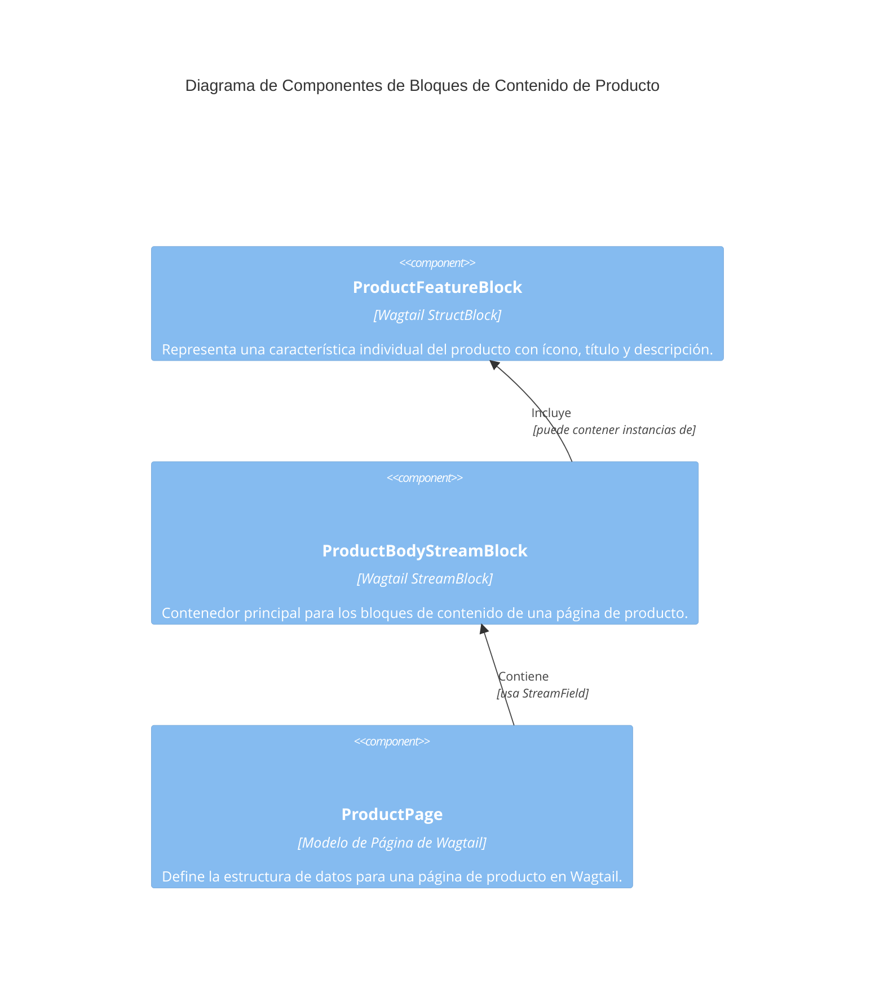

# Bloques de Contenido de Producto en Wagtail

Este módulo, `Wagtail_Content_Blocks_Producto`, define bloques de contenido específicos para la gestión de características de productos dentro del sistema Wagtail. Estos bloques están diseñados para ser reutilizables en `StreamField`s de páginas de productos, permitiendo a los editores de contenido resaltar los puntos de venta clave de los productos de una manera estructurada y consistente.

## Propósito y Funcionalidad del Módulo

El módulo `Wagtail_Content_Blocks_Producto` se centra en la definición de `StreamBlock`s de Wagtail que facilitan la creación y gestión de contenido relacionado con las características de los productos. Su componente principal es `ProductFeatureBlock`, el cual permite a los editores de contenido añadir bloques de características a las páginas de productos, con un ícono opcional, título y descripción.

### `ProductFeatureBlock`

El `ProductFeatureBlock` es un `StructBlock` que agrupa varios campos para definir una característica de producto individual. Está diseñado para ser utilizado dentro de un `StreamField` en una página de producto (como `ProductBodyStreamBlock` que se encuentra en [Wagtail_Content_Blocks.md](../Wagtail_Content_Blocks.md)).

**Componentes principales de `ProductFeatureBlock`:**

*   **`icon`**: Un `ImageChooserBlock` opcional que permite seleccionar un ícono (SVG o PNG) para la característica del producto.
    *   `required`: `False` (opcional)
    *   `help_text`: 'Optional SVG or PNG icon for this feature.'
*   **`title`**: Un `CharBlock` para el título de la característica.
    *   `max_length`: `100`
    *   `required`: `True`
*   **`description`**: Un `TextBlock` para una descripción detallada de la característica.
    *   `required`: `True`

### `ProductFeatureBlock.Meta`

La clase `Meta` anidada dentro de `ProductFeatureBlock` define metadatos y opciones de configuración para el bloque en Wagtail:

*   **`icon`**: `'list-ul'` - Define el ícono que se mostrará en la interfaz de administración de Wagtail para este bloque.
*   **`label`**: `'Product Feature'` - El nombre legible que se mostrará para este bloque en el editor de Wagtail.
*   **`template`**: `'shopify_content/blocks/product_feature_block.html'` - Especifica la ruta a la plantilla HTML que se utilizará para renderizar este bloque en el frontend. Esta plantilla es responsable de cómo se visualizan las características del producto, a menudo como una lista de definición o una fila flexible en el HTML de Shopify.

## Arquitectura y Relaciones de Componentes

El `ProductFeatureBlock` se integra en el sistema de bloques de contenido de Wagtail, formando parte de la familia de bloques definidos en `shopify_content/blocks/`. Se espera que se use en `StreamField`s dentro de modelos de página de producto, como el `ProductPage` (ver [Shopify_Content_Management/Shopify_Content_Models.md](../Shopify_Content_Models.md)).

## Cómo encaja el módulo en el sistema general

El módulo `Wagtail_Content_Blocks_Producto` es una parte fundamental de la estrategia de gestión de contenido de productos basada en Wagtail para Shopify.

1.  **Edición de Contenido**: Permite a los equipos de contenido definir y organizar fácilmente las características clave de los productos directamente dentro del CMS de Wagtail.
2.  **Integración con Shopify**: A través de la plantilla especificada (`shopify_content/blocks/product_feature_block.html`), el contenido estructurado por `ProductFeatureBlock` se renderiza de una manera que puede ser consumida por el frontend de Shopify, asegurando una presentación coherente de la información del producto en la tienda.
3.  **Extensibilidad**: Al ser un `StructBlock` de Wagtail, `ProductFeatureBlock` es modular y se puede extender o combinar con otros bloques de contenido para crear diseños de página de producto más complejos y dinámicos.

Este módulo trabaja en conjunto con:

*   **[Shopify_Content_Management/Shopify_Content_Models.md](../Shopify_Content_Models.md)**: Donde se definen los modelos de página, como `ProductPage`, que utilizan estos bloques.
*   **[Wagtail_Content_Blocks.md](../Wagtail_Content_Blocks.md)**: El módulo padre que agrupa todos los bloques de contenido de Wagtail, incluyendo los bloques de producto.
*   **Shopify Frontend**: El sistema de Shopify que consume y renderiza el HTML generado a partir de estos bloques.