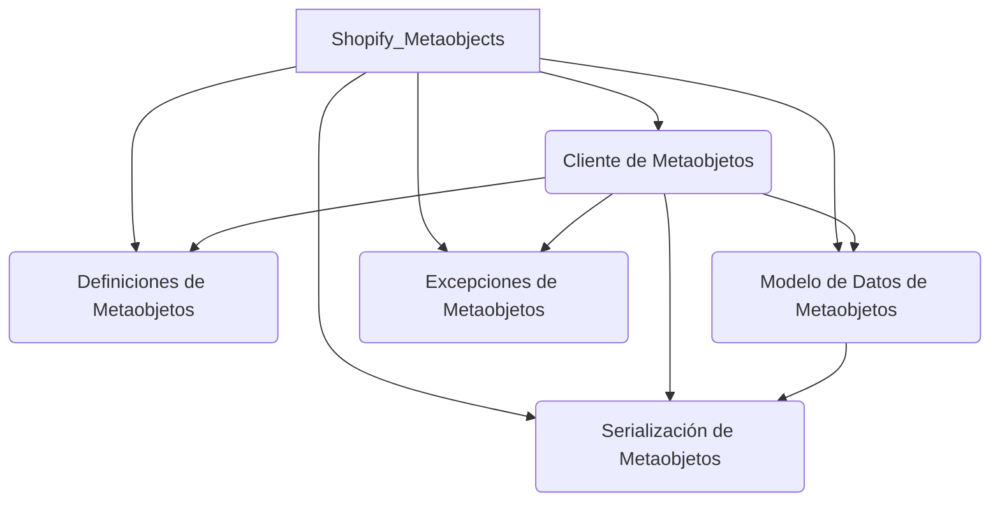
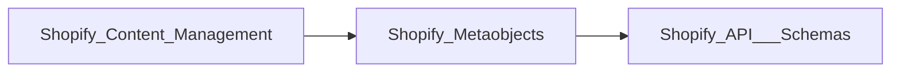

# Módulo Shopify_Metaobjects

Este documento proporciona una visión general completa del módulo `Shopify_Metaobjects`, diseñado para facilitar la interacción con la funcionalidad de los metaobjetos de Shopify. Aborda la creación, actualización, recuperación y gestión de definiciones y datos de metaobjetos, integrándose con la API de administración de Shopify.

## Propósito y Funcionalidad Principal

El módulo `Shopify_Metaobjects` sirve como una capa de abstracción para gestionar los metaobjetos en una tienda Shopify. Permite a los desarrolladores:
*   Definir la estructura de los metaobjetos (tipos de campo, validaciones, capacidades).
*   Crear y actualizar estas definiciones en Shopify.
*   Manipular instancias de metaobjetos (crear, actualizar, obtener por handle).
*   Serializar y deserializar datos de metaobjetos, incluyendo la conversión de HTML a formato de texto enriquecido de Shopify.
*   Manejar errores específicos relacionados con las operaciones de metaobjetos y sus definiciones.

## Arquitectura General

El módulo `Shopify_Metaobjects` se compone de varios sub-módulos que trabajan en conjunto para proporcionar una solución robusta para la gestión de metaobjetos.

### Componentes Principales:

*   **[Cliente de Metaobjetos](Shopify_Metaobjects/Shopify_Metaobjects_Cliente_Metaobjetos.md)**: Proporciona los métodos para interactuar directamente con la API de Shopify para las operaciones de metaobjetos.
*   **[Definiciones de Metaobjetos](Shopify_Metaobjects/Shopify_Metaobjects_Definiciones_de_Metaobjetos.md)**: Define la estructura y especificaciones de los metaobjetos y sus campos.
*   **[Modelo de Datos de Metaobjetos](Shopify_Metaobjects/Shopify_Metaobjects_Modelo_de_Datos_de_Metaobjetos.md)**: Representa una instancia de un metaobjeto de Shopify con sus campos y metacampos.
*   **[Serialización de Metaobjetos](Shopify_Metaobjects/Shopify_Metaobjects_Serializacion_de_Metaobjetos.md)**: Se encarga de la conversión de datos entre formatos Python y el formato esperado por Shopify, especialmente para campos de texto enriquecido.
*   **[Excepciones de Metaobjetos](Shopify_Metaobjects/Shopify_Metaobjects_Excepciones_de_Metaobjetos.md)**: Define clases de excepción personalizadas para errores específicos del módulo.

## Relación con otros módulos

Este módulo interactúa con `Shopify_API___Schemas` para el manejo de GraphQL y `Shopify_Content_Management` para la gestión de contenido.

*   **`Shopify_API___Schemas`**: Utiliza `shopify_requests.graphql_service::execute_admin_graphql` para realizar llamadas a la API de Shopify, lo que implica el uso de esquemas GraphQL definidos en `Shopify_API___Schemas`.
*   **`Shopify_Content_Management`**: El módulo de gestión de contenido depende de `Shopify_Metaobjects` para definir y manipular metaobjetos que estructuran diversos tipos de contenido (e.g., glosario, páginas de inicio).
