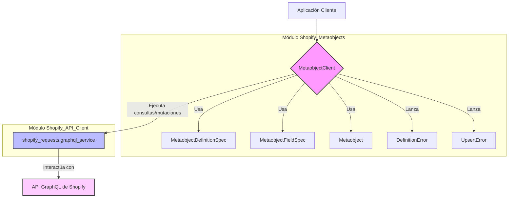

# Cliente de Metaobjetos de Shopify

El módulo `metaobjects/shopify_metaobjects/client.py` proporciona el `MetaobjectClient`, una interfaz robusta para interactuar con la API de Metaobjetos de Shopify. Este cliente permite a la aplicación gestionar definiciones de metaobjetos y datos de metaobjetos individuales dentro de una tienda Shopify, facilitando operaciones como la creación, actualización y recuperación de estos objetos personalizados.

## Funcionalidad Principal

El `MetaobjectClient` encapsula la lógica para realizar diversas operaciones en las definiciones de metaobjetos y los metaobjetos mismos. Utiliza consultas y mutaciones de GraphQL de Shopify para comunicarse con la API.

### `MetaobjectClient`

La clase `MetaobjectClient` es el punto central para todas las interacciones relacionadas con los metaobjetos. Se inicializa con el nombre de la tienda Shopify (`shop`).

#### Métodos Principales:

*   **`get_definition(self, type: str) -> MetaobjectDefinitionSpec | None`**:
    Recupera la definición de un metaobjeto por su `type` (tipo). Si la definición no existe, devuelve `None`.
    En caso de error en la API de Shopify, lanza un `DefinitionError`.

*   **`ensure_definition(self, spec: MetaobjectDefinitionSpec) -> MetaobjectDefinitionSpec`**:
    Asegura que una definición de metaobjeto exista en Shopify. Si ya existe, sincroniza los campos faltantes. Si no existe, la crea.

*   **`sync_missing_fields(self, existing: MetaobjectDefinitionSpec, spec: MetaobjectDefinitionSpec) -> MetaobjectDefinitionSpec`**:
    Actualiza una definición de metaobjeto existente añadiendo cualquier campo nuevo que esté presente en la `spec` deseada pero no en la `existing` definición. También sincroniza los cambios en las capacidades.

*   **`add_definition_fields(self, definition_id: str, fields: list[MetaobjectFieldSpec]) -> MetaobjectDefinitionSpec`**:
    Añade nuevos campos a una definición de metaobjeto existente, identificada por `definition_id`.

*   **`update_definition(self, definition_id: str, *, fields: list[MetaobjectFieldSpec] | None = None, capabilities: dict | None = None) -> MetaobjectDefinitionSpec`**:
    Actualiza una definición de metaobjeto existente con nuevos campos o capacidades modificadas. Solo se deben pasar los campos/capacidades que realmente han cambiado.

*   **`create_definition(self, spec: MetaobjectDefinitionSpec) -> MetaobjectDefinitionSpec`**:
    Crea una nueva definición de metaobjeto en Shopify basada en la especificación (`spec`) proporcionada.

*   **`get_by_handle(self, type: str, handle: str) -> Metaobject | None`**:
    Recupera un metaobjeto específico por su tipo (`type`) y `handle`. Si no se encuentra, devuelve `None`. Lanza un `UpsertError` si la llamada a la API falla.

*   **`update(self, metaobject_id: str, metaobject: Metaobject, *, definition: MetaobjectDefinitionSpec | None = None, validate: bool = True, redirect_new_handle: bool = True) -> Metaobject`**:
    Actualiza un metaobjeto existente en Shopify. Opcionalmente, valida el metaobjeto contra su definición antes de la actualización y puede redirigir el nuevo `handle` si cambia.

*   **`upsert(self, metaobject: Metaobject, *, definition: MetaobjectDefinitionSpec | None = None, validate: bool = True) -> Metaobject`**:
    Crea o actualiza un metaobjeto. Si el metaobjeto ya existe (identificado por su `type` y `handle`), se actualiza; de lo contrario, se crea. Opcionalmente, valida el metaobjeto contra su definición.

*   **`upsert_many(self, metaobjects: list[Metaobject], *, definition: MetaobjectDefinitionSpec | None = None, validate: bool = True) -> dict[str, int]`**:
    Realiza una operación `upsert` para una lista de metaobjetos, devolviendo un diccionario con las estadísticas de operaciones exitosas y fallidas.

*   **`sync(self, data: Any, *, definition: MetaobjectDefinitionSpec, ensure_definition: bool = True, validate: bool = True, existing_id: str | None = None) -> Metaobject`**:
    Sincroniza un dato (diccionario, instancia de dataclass o `Metaobject`) con un metaobjeto en Shopify. Puede asegurar la existencia de la definición del metaobjeto y validar los datos. Si se proporciona `existing_id`, realiza una actualización; de lo contrario, un `upsert`.

## Arquitectura y Relaciones entre Componentes

El `MetaobjectClient` actúa como un orquestador entre la aplicación y la API GraphQL de Shopify para la gestión de metaobjetos.



*   **`MetaobjectClient`**: Es el componente principal de este módulo.
*   **`MetaobjectDefinitionSpec` y `MetaobjectFieldSpec`**: Definidos en [Shopify_Metaobjects_Definiciones_de_Metaobjetos.md], representan la estructura de las definiciones de metaobjetos y sus campos. El cliente los utiliza para crear y actualizar esquemas de metaobjetos en Shopify.
*   **`Metaobject`**: Definido en [Shopify_Metaobjects_Modelo_de_Datos_de_Metaobjetos.md], es la representación interna de un metaobjeto. El cliente lo utiliza para serializar y deserializar datos al interactuar con la API de Shopify.
*   **`DefinitionError` y `UpsertError`**: Definidos en [Shopify_Metaobjects_Excepciones_de_Metaobjetos.md], son las excepciones personalizadas que el cliente lanza para indicar fallos específicos en las operaciones con definiciones y datos de metaobjetos, respectivamente.
*   **`shopify_requests.graphql_service`**: Este servicio, parte del módulo [Shopify_API_Client.md], es utilizado por `MetaobjectClient` para ejecutar todas las llamadas a la API GraphQL de Shopify. Proporciona una capa de abstracción para la comunicación con la API.

## Flujo de Datos y Proceso

### Proceso de Aseguramiento de una Definición de Metaobjeto

El método `ensure_definition` ilustra un flujo clave para gestionar definiciones de metaobjetos.

```mermaid
graph TD
    A[Inicio: ensure_definition(spec)] --> B{¿Definición existente?}
    B -- No --> C[create_definition(spec)]
    C --> F[Fin]
    B -- Sí --> D[get_definition(spec.type)]
    D --> E[sync_missing_fields(existing, spec)]
    E --> F[Fin]
```

1.  El proceso comienza con una solicitud para asegurar una definición de metaobjeto (`ensure_definition`).
2.  Se verifica si la definición ya existe en Shopify mediante `get_definition`.
3.  Si no existe, se procede a crearla con `create_definition`.
4.  Si existe, se recupera la definición actual y se invoca `sync_missing_fields` para añadir cualquier campo faltante o actualizar capacidades.
5.  Ambos caminos convergen en la finalización del proceso de aseguramiento.

### Proceso de Creación/Actualización (Upsert) de un Metaobjeto

El método `upsert` es fundamental para la persistencia de datos de metaobjetos.

```mermaid
graph TD
    A[Inicio: upsert(metaobject, definition)] --> B{¿Validar?}
    B -- Sí --> C[validate_metaobject(metaobject, definition)]
    C -- Errores --> D[Lanzar UpsertError]
    D --> F[Fin con Error]
    C -- Sin Errores --> E[Convertir Metaobject a formato Shopify]
    B -- No --> E
    E --> G[Construir variables GraphQL]
    G --> H[execute_admin_graphql(METAOBJECT_UPSERT)]
    H -- API de Shopify devuelve éxito --> I[Procesar respuesta de éxito]
    I --> J[Devolver Metaobject actualizado]
    J --> K[Fin]
    H -- API de Shopify devuelve error --> L[Procesar errores de usuario / API]
    L --> M[Lanzar UpsertError]
    M --> F
```

1.  La operación `upsert` inicia con un objeto `Metaobject` y opcionalmente su `MetaobjectDefinitionSpec`.
2.  Si la validación está habilitada, `validate_metaobject` verifica la conformidad del metaobjeto con su definición. Cualquier error de validación resulta en un `UpsertError`.
3.  El `Metaobject` se convierte a un formato compatible con la API de Shopify.
4.  Se construyen las variables para la mutación GraphQL `METAOBJECT_UPSERT`.
5.  Se ejecuta la mutación a través de `shopify_requests.graphql_service`.
6.  Si la API de Shopify responde con éxito, se procesan los datos del metaobjeto devuelto y se retorna una instancia de `Metaobject`.
7.  Si la API responde con errores (ya sean errores de usuario o de la API misma), se lanza un `UpsertError`.

## Integración con el Sistema General

El `MetaobjectClient` es un componente vital para cualquier parte del sistema que necesite interactuar con la funcionalidad de metaobjetos de Shopify. Por ejemplo, en el módulo [Shopify_Content_Management.md], este cliente podría ser utilizado por comandos de gestión (`management commands`) para sincronizar datos de contenido personalizado de la aplicación con metaobjetos de Shopify, o para asegurar que las definiciones de metaobjetos requeridas por la aplicación existan en la tienda. Facilita la creación de experiencias de contenido más ricas y estructuradas en Shopify al permitir la gestión programática de datos personalizados.

## Referencias

*   [Definiciones de Metaobjetos de Shopify](Shopify_Metaobjects_Definiciones_de_Metaobjetos.md)
*   [Modelo de Datos de Metaobjetos de Shopify](Shopify_Metaobjects_Modelo_de_Datos_de_Metaobjetos.md)
*   [Excepciones de Metaobjetos de Shopify](Shopify_Metaobjects_Excepciones_de_Metaobjetos.md)
*   [Cliente de la API de Shopify](../Shopify_API_Client.md)
*   [Gestión de Contenido de Shopify](../Shopify_Content_Management.md)
