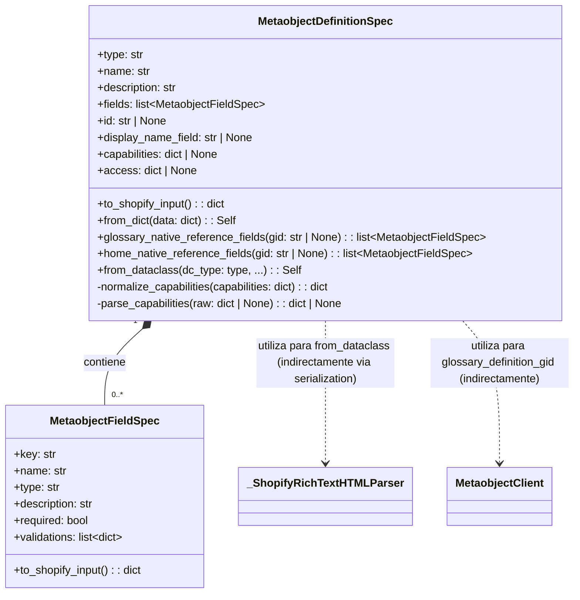

# Definiciones de Metaobjetos de Shopify

El módulo `Shopify_Metaobjects/Shopify_Metaobjects_Definiciones_de_Metaobjetos` es fundamental para la definición y gestión de metaobjetos y sus campos asociados en la plataforma Shopify. Proporciona las estructuras de datos y la lógica necesarias para especificar cómo deben crearse y configurarse los metaobjetos, asegurando la compatibilidad con la API de Shopify.

## Propósito y Funcionalidad Principal

Este módulo encapsula la lógica para definir la estructura de los metaobjetos y sus campos. Actúa como el puente entre una representación de datos interna y el formato requerido por la API de Shopify para la creación o actualización de definiciones de metaobjetos.

Sus componentes principales son:

*   **`MetaobjectDefinitionSpec`**: Define la estructura general de un metaobjeto, incluyendo su tipo, nombre, descripción, campos, campo de nombre visible y capacidades.
*   **`MetaobjectFieldSpec`**: Define las propiedades de un campo individual dentro de un metaobjeto, como su clave, nombre, tipo, descripción, si es requerido y sus validaciones.

## Arquitectura y Relaciones entre Componentes

El módulo se compone de dos clases dataclass principales que trabajan en conjunto para modelar las definiciones de metaobjetos de Shopify.

### `MetaobjectFieldSpec`

Representa la especificación de un campo individual de un metaobjeto.

**Atributos:**

*   `key` (str): La clave única del campo.
*   `name` (str): El nombre visible del campo.
*   `type` (str): El tipo de dato del campo (ej. `single_line_text_field`, `list.product_reference`, `json`).
*   `description` (str): Una descripción opcional del campo.
*   `required` (bool): Indica si el campo es obligatorio.
*   `validations` (list[dict[str, Any]]): Una lista de reglas de validación para el campo.

**Métodos Clave:**

*   `to_shopify_input() -> dict[str, Any]`: Convierte la especificación del campo en un diccionario compatible con el formato de entrada de la API de Shopify para definiciones de campos de metaobjetos. Las validaciones con valores que no son cadenas se serializan a JSON.

### `MetaobjectDefinitionSpec`

Representa la especificación completa de una definición de metaobjeto.

**Atributos:**

*   `type` (str): El tipo de metaobjeto (identificador único).
*   `name` (str): El nombre visible de la definición del metaobjeto.
*   `description` (str): Una descripción del metaobjeto.
*   `fields` (list[MetaobjectFieldSpec]): Una lista de objetos `MetaobjectFieldSpec` que definen los campos de este metaobjeto.
*   `id` (str | None): El ID global de Shopify de la definición del metaobjeto, si existe.
*   `display_name_field` (str | None): La clave del campo que se utilizará como nombre visible para las instancias de este metaobjeto.
*   `capabilities` (dict | None): Define las capacidades del metaobjeto, como si es renderizable o publicable.
*   `access` (dict | None): Define los permisos de acceso al metaobjeto.

**Métodos Clave:**

*   `to_shopify_input() -> dict[str, Any]`: Convierte la especificación de la definición del metaobjeto en un diccionario compatible con el formato de entrada de la API de Shopify. Normaliza la estructura de las capacidades antes de enviarla.
*   `_normalize_capabilities(capabilities: dict) -> dict`: Un método estático que ajusta la estructura de las capacidades para que coincida con el formato esperado por Shopify, especialmente para campos de SEO (`metaTitleKey`, `metaDescriptionKey`).
*   `_parse_capabilities(raw: dict[str, Any] | None) -> dict[str, Any] | None`: Un método estático que convierte la forma de las capacidades de GraphQL en el formato de diccionario utilizado para construir las especificaciones.
*   `from_dict(data: dict[str, Any]) -> Self`: Constructor de clase que crea una instancia de `MetaobjectDefinitionSpec` a partir de un diccionario de datos (útil para parsear respuestas de la API de Shopify o configuraciones).
*   `glossary_native_reference_fields(cls, glossary_definition_gid: str | None = None) -> list['MetaobjectFieldSpec']`: Devuelve una lista de `MetaobjectFieldSpec` predefinidos para campos de referencia nativos relacionados con productos, colecciones, artículos y términos de glosario.
*   `home_native_reference_fields(cls, glossary_definition_gid: str | None = None) -> list['MetaobjectFieldSpec']`: Devuelve una lista de `MetaobjectFieldSpec` predefinidos para campos de referencia nativos específicos de la página de inicio.
*   `from_dataclass(cls, dc_type: type, *, type: str, name: str, description: str, handle_field: str = "handle") -> Self`: Crea una `MetaobjectDefinitionSpec` a partir de una clase dataclass Python, utilizando la función `field_specs_from_dataclass` del módulo de [Serialización de Metaobjetos](Shopify_Metaobjects_Serializacion_de_Metaobjetos.md) para inferir los campos.

### Diagrama de Clases



### Flujo de Creación/Actualización de Definiciones de Metaobjetos

El siguiente diagrama ilustra el proceso de cómo se utiliza este módulo para definir y potencialmente crear o actualizar definiciones de metaobjetos en Shopify.

```mermaid
graph TD
    A[Inicio] --> B{Datos de Definición de Metaobjeto};
    B --> C[Crear MetaobjectDefinitionSpec];
    C --> D[Crear MetaobjectFieldSpec por cada campo];
    D --> E[Añadir MetaobjectFieldSpec a MetaobjectDefinitionSpec];
    E --> F[Llamar a MetaobjectDefinitionSpec.to_shopify_input()];
    F --> G[Enviar payload a la API de Shopify];
    G --> H{Shopify crea/actualiza la definición};
    H --> I[Fin];

    subgraph Módulo de Definiciones
        C; D; E; F;
    end

    subgraph Shopify API
        G; H;
    end
```

## Cómo encaja el módulo en el sistema general

Este módulo es una pieza central en la infraestructura de gestión de contenido para Shopify, particularmente para la extensibilidad a través de metaobjetos.

*   **Definición de Esquemas de Datos**: Permite a los desarrolladores definir programáticamente los esquemas de datos para contenido personalizado que residirá en Shopify como metaobjetos. Esto es crucial para la integración de sistemas de gestión de contenido (CMS) externos o para la automatización de la configuración de la tienda.
*   **Integración con Shopify**: Los métodos `to_shopify_input()` de `MetaobjectDefinitionSpec` y `MetaobjectFieldSpec` son la interfaz directa para interactuar con la API de Shopify, asegurando que las definiciones se envíen en el formato correcto.
*   **Generación de Definiciones a partir de Dataclasses**: La función `from_dataclass` facilita la creación de definiciones de metaobjetos a partir de modelos de datos Python existentes (dataclasses). Esto promueve la consistencia entre los modelos de datos internos de la aplicación y las definiciones de metaobjetos en Shopify. Este proceso se apoya en el módulo de [Serialización de Metaobjetos](Shopify_Metaobjects_Serializacion_de_Metaobjetos.md) para extraer las especificaciones de los campos.
*   **Referencias Nativas y Contenido Enlazado**: Los métodos `glossary_native_reference_fields` y `home_native_reference_fields` demuestran cómo este módulo es utilizado para crear campos de metaobjetos que referencian de forma nativa otros recursos de Shopify (productos, colecciones, artículos) o incluso otros metaobjetos (términos de glosario), facilitando la interconexión de contenido.
*   **Operaciones con Cliente de Metaobjetos**: El módulo utiliza indirectamente el [Cliente de Metaobjetos](Shopify_Metaobjects_Cliente_Metaobjetos.md) para realizar búsquedas del GID (Global ID) de la definición del metaobjeto del glosario, lo que permite validaciones de referencia cruzada.

## Funciones Auxiliares

Además de las clases principales, el módulo incluye un par de funciones auxiliares para la gestión de GIDs de definiciones de metaobjetos de glosario.

### `glossary_definition_gid(shop: str) -> str | None`

Esta función realiza una búsqueda en caché del GID de la definición del metaobjeto `glossary_term` para una tienda específica. Esto es útil para las validaciones de referencia dentro de otros metaobjetos. Utiliza el `MetaobjectClient` del módulo [Cliente de Metaobjetos](Shopify_Metaobjects_Cliente_Metaobjetos.md) para obtener la definición si no está en caché.

### `clear_glossary_definition_gid_cache() -> None`

Borra la caché de GIDs de definiciones de metaobjetos de glosario. Esto es útil en entornos de prueba o cuando se necesita forzar una nueva consulta a la API de Shopify.
