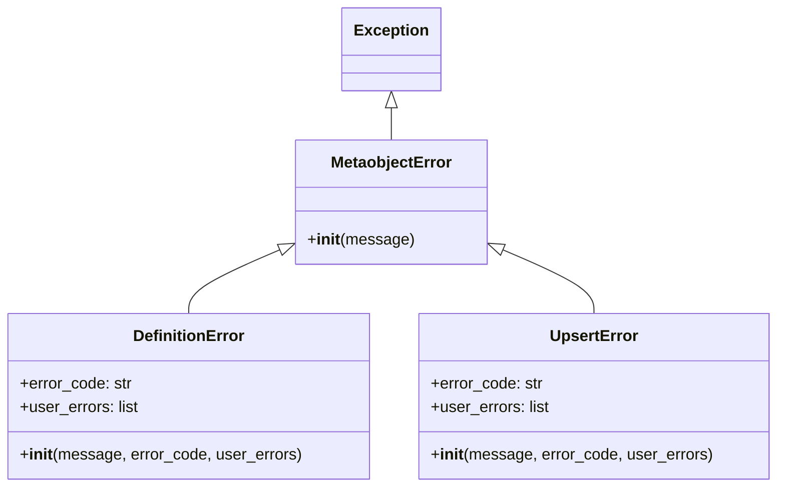

# Excepciones de Metaobjetos de Shopify

Este módulo, `Shopify_Metaobjects_Excepciones_de_Metaobjetos`, define un conjunto de clases de excepción personalizadas diseñadas para manejar errores específicos que pueden ocurrir durante las operaciones con metaobjetos de Shopify. Estas excepciones proporcionan un mecanismo estructurado para identificar y gestionar fallos relacionados con la definición de metaobjetos, la inserción/actualización (upsert) de metaobjetos y otras operaciones generales.

## Propósito y Funcionalidad Principal

El propósito principal de este módulo es mejorar la robustez y la capacidad de depuración de las interacciones con la API de metaobjetos de Shopify. Al utilizar excepciones específicas, los desarrolladores pueden capturar y manejar diferentes tipos de errores de manera más precisa, lo que conduce a un código más claro y un manejo de errores más eficaz.

Las funcionalidades clave incluyen:

*   **Manejo de Errores Base:** Proporciona una clase base `MetaobjectError` para todas las excepciones relacionadas con metaobjetos.
*   **Errores de Definición:** Ofrece `DefinitionError` para errores que ocurren durante la creación o modificación de las definiciones de metaobjetos.
*   **Errores de Inserción/Actualización:** Incluye `UpsertError` para fallos al intentar insertar o actualizar instancias de metaobjetos.
*   **Detalles del Error:** Las excepciones `DefinitionError` y `UpsertError` permiten adjuntar un `error_code` y una lista de `user_errors`, lo que facilita la transmisión de información detallada desde la API de Shopify o validaciones internas.

## Arquitectura y Relaciones de Componentes

El módulo de excepciones tiene una arquitectura sencilla basada en la herencia de clases. La clase `MetaobjectError` actúa como la base para todas las excepciones específicas de metaobjetos. `DefinitionError` y `UpsertError` heredan de `MetaobjectError`, permitiendo un manejo jerárquico de errores.

### Diagrama de Clases



### Clases de Excepción

A continuación, se describen las clases de excepción definidas en este módulo:

#### `MetaobjectError`

*   **Descripción:** Esta es la clase base para todas las excepciones personalizadas relacionadas con las operaciones de metaobjetos. Cualquier error general que no encaje en las categorías más específicas puede lanzarse como `MetaobjectError`.
*   **Uso:** Sirve como un punto de captura general para todos los errores de metaobjetos.

#### `DefinitionError`

*   **Descripción:** Se lanza específicamente cuando una operación de definición de metaobjeto falla. Esto podría ocurrir, por ejemplo, al intentar crear o actualizar una definición de metaobjeto con un esquema inválido o campos incorrectos.
*   **Atributos:**
    *   `message`: Un mensaje descriptivo del error.
    *   `error_code` (opcional): Un código de error que puede proporcionar más contexto sobre la causa del fallo (ej. un código de error de la API de Shopify).
    *   `user_errors` (opcional): Una lista de errores a nivel de usuario, útil para mostrar mensajes específicos en la interfaz de usuario o para depuración detallada.

#### `UpsertError`

*   **Descripción:** Se lanza cuando una operación de "upsert" (insertar si no existe, actualizar si existe) de un metaobjeto falla. Esto puede incluir problemas con los datos del metaobjeto, validaciones fallidas, o errores de comunicación con la API de Shopify.
*   **Atributos:**
    *   `message`: Un mensaje descriptivo del error.
    *   `error_code` (opcional): Un código de error para un contexto adicional.
    *   `user_errors` (opcional): Una lista de errores a nivel de usuario.

## Integración con el Sistema

Estas excepciones son fundamentales para el módulo padre [Shopify_Metaobjects](../Shopify_Metaobjects.md) y, en particular, para el [Shopify_Metaobjects_Cliente_Metaobjetos](Shopify_Metaobjects_Cliente_Metaobjetos.md). El `MetaobjectClient` probablemente utiliza estas excepciones para informar de fallos cuando interactúa con la API de Shopify para crear, leer, actualizar o eliminar metaobjetos y sus definiciones.

Otros módulos que interactúan con las funcionalidades de metaobjetos, como los comandos de gestión o las tareas de sincronización, también deben estar preparados para capturar y manejar estas excepciones. Al hacerlo, el sistema puede reaccionar adecuadamente a los errores, ya sea reintentando operaciones, registrando fallos o notificando a los usuarios.

### Diagrama de Flujo de Interacción

```mermaid
sequenceDiagram
    participant A as Módulo Cliente (e.g., MetaobjectClient)
    participant B as Lógica de Operación de Metaobjeto
    participant C as API de Shopify

    A->>B: Iniciar operación de Metaobjeto (ej. crear definición)
    B->>C: Llamada a la API de Shopify
    alt Operación exitosa
        C-->>B: Respuesta exitosa
        B-->>A: Operación completada
    else Fallo en la Definición
        C-->>B: Error de API (ej. validación)
        B->>B: Formular DefinitionError
        B--x>>A: Lanza DefinitionError
        A->>A: Capturar DefinitionError y manejar
    else Fallo en Upsert
        C-->>B: Error de API (ej. datos inválidos)
        B->>B: Formular UpsertError
        B--x>>A: Lanza UpsertError
        A->>A: Capturar UpsertError y manejar
    else Fallo General
        C-->>B: Otro error de API
        B->>B: Formular MetaobjectError
        B--x>>A: Lanza MetaobjectError
        A->>A: Capturar MetaobjectError y manejar
    end
```
