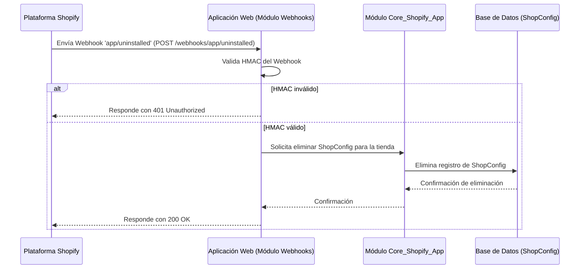

# Webhooks

El módulo `Webhooks` gestiona la recepción y el procesamiento de eventos de webhook de Shopify, permitiendo que la aplicación reaccione a cambios importantes en la tienda Shopify, como la desinstalación de la aplicación o la actualización de los ámbitos de permisos. Su propósito principal es mantener la sincronización del estado de la aplicación con los eventos externos de Shopify.

## Arquitectura

El módulo `Webhooks` se integra con la infraestructura de la aplicación para escuchar y validar los eventos de webhook de Shopify. Aunque las vistas específicas que manejan los webhooks no se incluyen en los componentes principales proporcionados, el módulo `webhooks/tests.py` sugiere la existencia de manejadores para eventos como `app/uninstalled` y `app/scopes_update`.

```mermaid
graph TD
    Shopify[Plataforma Shopify] -- Envía Webhook --> WebhooksModule[Módulo Webhooks]
    WebhooksModule -- Valida y Procesa --> CoreShopifyApp[Módulo Core_Shopify_App]
    CoreShopifyApp -- Gestiona Configuración de Tienda --> ShopConfigDB[Base de Datos de ShopConfig]

    subgraph Módulo Webhooks
        A[webhooks/apps.py::WebhooksConfig]
        B[Manejadores de Webhooks (inferido)]
        C[webhooks/tests.py::WebhookUninstalledTests]
        D[webhooks/tests.py::WebhookScopesUpdateTests]
    end

    WebhooksModule --> B
    B -- Configuración de la App --> A
    B -- Actualiza ShopConfig --> CoreShopifyApp
    B -- Verificación --> C
    B -- Verificación --> D
```
**Descripción de Componentes Clave:**

*   **[`Webhooks/Webhooks_Configuracion.md`](Webhooks/Webhooks_Configuracion.md)**: Define la configuración de la aplicación Django para el módulo de webhooks. Establece el nombre de la aplicación (`"webhooks"`) y un nombre más legible (`"Shopify webhooks"`).
*   **Manejadores de Webhooks (inferido)**: Basado en las pruebas, existen manejadores de webhook (probablemente en `webhooks/views.py`) que reciben y procesan los eventos de Shopify. Estos manejadores son responsables de:
    *   Validar la autenticidad del webhook usando `get_shopify_app().verify_webhook_req`.
    *   Reaccionar a eventos específicos, como la desinstalación de la aplicación o la actualización de ámbitos.
*   **[`Webhooks/Webhooks_Pruebas_Desinstalacion.md`](Webhooks/Webhooks_Pruebas_Desinstalacion.md)**: Contiene pruebas unitarias para el manejador del webhook `app/uninstalled`. Estas pruebas aseguran que, cuando Shopify envía un evento de desinstalación, la configuración de la tienda asociada se elimina correctamente de la base de datos.
*   **[`Webhooks/Webhooks_Pruebas_Actualizacion_Ambitos.md`](Webhooks/Webhooks_Pruebas_Actualizacion_Ambitos.md)**: Contiene pruebas unitarias para el manejador del webhook `app/scopes_update`. Estas pruebas verifican que la aplicación puede manejar correctamente los eventos de actualización de ámbitos de Shopify.

### Integración con el Sistema General

El módulo `Webhooks` es crucial para la integración con Shopify. Depende directamente del módulo [Core_Shopify_App](Core_Shopify_App.md) para acceder y modificar la configuración de la tienda (`ShopConfig`). Los eventos de webhook impulsan acciones que mantienen la coherencia del estado de la aplicación con respecto a Shopify.

## Flujo de Procesamiento del Webhook (Ejemplo: `app/uninstalled`)

Cuando una tienda desinstala la aplicación, Shopify envía un webhook `app/uninstalled`. El flujo de procesamiento es el siguiente:



### Descripción Detallada del Flujo

1.  **Shopify Envía Webhook**: La plataforma Shopify envía una solicitud POST al endpoint `/webhooks/app/uninstalled` de la aplicación cuando el comerciante desinstala la aplicación. El cuerpo de la solicitud contiene los detalles del evento.
2.  **Validación del HMAC**: El manejador del webhook en la aplicación web (presumiblemente en `webhooks/views.py`) recibe la solicitud y realiza una verificación de la firma HMAC para asegurar que la solicitud proviene de Shopify y no ha sido manipulada.
    *   Si el HMAC es inválido, la aplicación responde con un estado HTTP 401 (Unauthorized) y el procesamiento termina.
    *   Si el HMAC es válido, la aplicación procede con el procesamiento del evento.
3.  **Eliminación de `ShopConfig`**: Para el webhook `app/uninstalled`, la aplicación interactúa con el módulo [Core_Shopify_App](Core_Shopify_App.md) para eliminar la entrada `ShopConfig` correspondiente a la tienda que desinstaló la aplicación. Esto asegura que los datos de la tienda y las credenciales de acceso se eliminen cuando la aplicación ya no esté instalada.
4.  **Respuesta Exitosa**: Una vez que la `ShopConfig` se ha eliminado correctamente, la aplicación responde a Shopify con un estado HTTP 200 OK, confirmando la recepción y el procesamiento del webhook.

Este proceso es fundamental para el ciclo de vida de la aplicación en Shopify, garantizando que se mantenga el estado correcto de la instalación y desinstalación de la aplicación.
