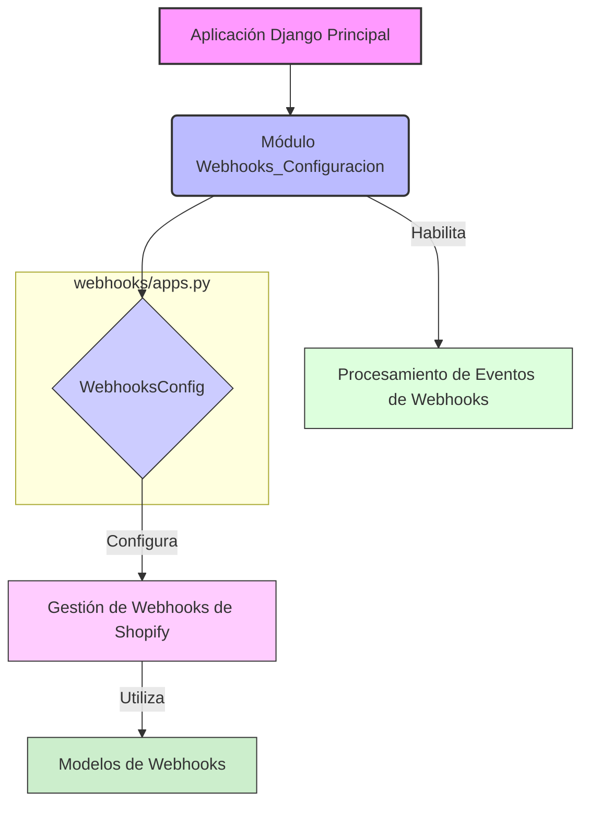

# Configuración de Webhooks

Este documento detalla la configuración del módulo de webhooks en la aplicación, centrándose en la clase `WebhooksConfig` y su papel dentro del sistema de gestión de webhooks de Shopify.

## Propósito del Módulo

El módulo `Webhooks_Configuracion` es responsable de definir la configuración de la aplicación Django para la gestión de webhooks. Esto incluye la configuración básica necesaria para que Django reconozca y administre este módulo como parte del proyecto.

## Componentes Principales

### `WebhooksConfig`

La clase `WebhooksConfig` (ubicada en `webhooks/apps.py`) es una subclase de `django.apps.AppConfig` y proporciona la configuración específica para la aplicación `webhooks`. Sus atributos son:

*   `default_auto_field`: Establecido en `"django.db.models.BigAutoField"`, indica el tipo de campo automático por defecto para los modelos de la aplicación, lo que asegura que las claves primarias se gestionen con tipos de enteros grandes.
*   `name`: Establecido en `"webhooks"`, este es el nombre canónico de la aplicación Django. Es utilizado por Django para referenciar la aplicación dentro del proyecto.
*   `verbose_name`: Establecido en `"Shopify webhooks"`, este nombre legible por humanos se utiliza en la interfaz de administración de Django y en otros lugares donde se requiere un nombre descriptivo para la aplicación.

### Relación con otros módulos

El módulo `Webhooks_Configuracion` es fundamental para que el sistema reconozca y configure correctamente la aplicación de webhooks. Se integra con:

*   **[Webhooks.md](../Webhooks.md)**: El módulo padre `Webhooks` se encarga de la lógica general de los webhooks, y `Webhooks_Configuracion` proporciona la base para su registro en Django.

## Diagrama de Arquitectura (Mermaid)

**Descripción del Diagrama:**

El diagrama ilustra cómo el módulo `Webhooks_Configuracion` se integra en la aplicación Django. La `Aplicación Django Principal` reconoce el `Módulo Webhooks_Configuracion` a través de la clase `WebhooksConfig`. Esta configuración es crucial para la `Gestión de Webhooks de Shopify`, lo que a su vez puede implicar el uso de `Modelos de Webhooks` y habilita el `Procesamiento de Eventos de Webhooks`.